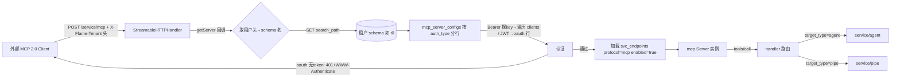

## 用户需求
为 flame 后端（flame/nexus）新增 MCP 2.0 Server 能力，将各租户在 `svc_endpoints` 表中配置的 MCP 工具通过 Streamable HTTP 单端点对外暴露，供任意 MCP 2.0 客户端调用。首期仅实现 Server 端。

## 产品概述
在现有 flame 后端之上新增一套 MCP 2.0 Server 层：外部客户端通过 `POST /service/mcp` 端点（无状态、请求自包含）调用工具；服务端通过全局配置文件约定的 HTTP 头识别租户，将标识值作为 Postgres schema 名路由到对应租户，读取该租户 `mcp_server_configs`（按 auth_type 分行，最多两行）中的认证配置完成鉴权，再加载该租户 `svc_endpoints` 中 `protocol='mcp' AND enabled=true` 的行注册为 MCP tools。

## 核心特性
- Streamable HTTP 单端点 `POST /service/mcp`，URL 不加版本号，版本经协议层 `_meta` 与请求头协商（MCP 2026-07-28）。
- 租户识别：全局配置文件约定租户头名（如 `X-Flame-Tenant`），请求头取值直接作为 Postgres schema 名（如 `t0`）路由。
- 每租户 `mcp_server_configs` 表按 `auth_type` 分行（最多两行：apikey、oauth），`auth_type` 唯一 + CHECK 仅 apikey/oauth，`auth_config` JSONB，`enabled` 默认 true。表已实际建好。
- apikey 行 `auth_config` 支持多个客户端密钥（方案 A）：`{"kind":"raw","clients":[{"client_id":"app1","secret":"sk-xxxx","enabled":true},...]}`，支持多 key 与单独吊销。
- oauth 行 `auth_config` 仅存信任配置（issuer/authorize_endpoint/jwks_url/audience/required_scope），不存 client 凭据，后端只验不发放 token。
- 认证统一走 `Authorization: Bearer`：裸 key（不像 JWT）走 apikey 行遍历 clients 比对；JWT（eyJ 开头、三段）走 oauth 行 JWKS 验签；oauth 无/无效 Bearer 时返回 401 + `WWW-Authenticate` 指引。
- 工具动态来源于 `svc_endpoints`：`name`→tool 名、`description`→描述、`input_schema`(JSONB)→输入 JSON Schema、`target_type`+`target_id`→路由到 `service/agent` 或 `service/pipe` 执行。


## 技术栈
- 语言/框架：Go 1.25 + Gin（沿用 flame/nexus 现有栈）
- MCP SDK：`github.com/modelcontextprotocol/go-sdk`（核心包 `mcp`），版本 `v1.7.0-pre.1`（已原生支持 MCP 2026-07-28）
- 数据库：沿用 Postgres，租户隔离采用 schema 隔离（标识值即 schema 名，如 `t0`）
- 复用：flame/tools 下的 xhttp/xlog/xsql、现有 `shared/config`、`shared/db` 租户 schema 路由、`shared/models`、`shared/repository/svcendpoints`

## 实现方案
采用官方 SDK + 现有租户 schema 隔离策略。MCP 2.0 无状态由 `mcp.NewStreamableHTTPHandler(func(*http.Request)*mcp.Server, opts)` 的 `getServer` 回调承载：回调从配置约定的头取租户标识 → 作为 schema 名设置 `search_path` → 查该 schema 的 `mcp_server_configs` 做认证 → 查 `svc_endpoints` 构建工具集 → 返回 `*mcp.Server` 实例。工具注册用 `mcp.AddTool(server, &mcp.Tool{...}, handler)`，handler 按 `target_type` 路由调用 `service/agent` 或 `service/pipe`，结果包成 `mcp.NewTextResult`。

### 关键决策与权衡
1. **SDK 选官方 go-sdk 而非 mark3labs/mcp-go**：已核实 `v1.7.0-pre.1` 原生支持 2026-07-28，省去自研无状态层。
2. **Server 放 `service/mcp/server/` 而非 `shared/mcp/`**：Server 需 import `service/agent`、`service/pipe`，放 `shared` 会倒置依赖/潜在循环。
3. **租户标识 = schema 名**：避免跨租户映射表，直接 `SET search_path` 复用 flame 现有 schema 隔离机制（请求头租户标识即实际 schema 名，如 `t0`）。
4. **apikey + oauth 双支持、按 auth_type 分行**：`mcp_server_configs` 已建好（uuid 主键，auth_type varchar(20) 唯一 + CHECK，auth_config jsonb，enabled 默认 true）。认证统一走 `Authorization: Bearer`，靠值形态（裸 key / JWT）分流；apikey 行 `auth_config` 为 `clients` 数组支持多 key 单独吊销；oauth 采用 JWKS 远程验签，后端仅"验 token + 401 时返回 WWW-Authenticate 指引"，不发放 token。
5. **input_schema 列而非复用 config**：语义清晰，与协议层 `arguments` 无冲突。
6. **apikey 多 clients（方案 A）**：零 DDL 改动，仍满足 UNIQUE(auth_type)，前端可增删/吊销单个 client。

## 实现要点（防回归）
- `nexus/go.mod` 加 `github.com/modelcontextprotocol/go-sdk v1.7.0-pre.1`；`go mod tidy`；保留 `replace => ../tools`。
- `SvcEndpoint` 加 `InputSchema xsql.JSONB`；`svcendpoints/postgres.go` columns/scan/Create/Update 同步补 `input_schema`；`ListSvcEndpointsRequest` 加 `Enabled *bool`。
- 新增 `McpServerConfig` 模型（id uuid、AuthType string、AuthConfig xsql.JSONB、Enabled bool、时间戳）与 scan，对齐已建 DDL；新增 `mcpserverconfig` 仓库（按 schema 查 apikey/oauth 两行）。
- 复用现有 `shared/db` 租户 schema 路由/`authInfo` 机制，MCP 端点中间件里设置 `search_path` 并做认证。
- 不改动现有 `McpConnection` CRUD、admin 路由、models 其他字段；仅扩展。
- 认证失败/租户缺失返回标准 JSON-RPC 错误，日志不记录凭证明文；apikey secret 首期明文比对（后续补哈希）。

## 架构设计


## 目录结构
```
flame/nexus/
├── go.mod                                    # [MODIFY] 增加 go-sdk 依赖，go mod tidy
├── config.yaml                               # [MODIFY] 增加 mcp.server.tenant_header 配置段
├── cmd/
│   └── router.go                             # [MODIFY] /service 组注册 POST /mcp，委托 StreamableHTTPHandler
├── shared/
│   ├── config/                               # [MODIFY] 配置结构体加 Mcp.Server.TenantHeader
│   └── models/models.go                      # [MODIFY] SvcEndpoint 加 InputSchema xsql.JSONB；新增 McpServerConfig 模型
├── shared/repository/
│   ├── svcendpoints/
│   │   ├── postgres.go                       # [MODIFY] columns/scan/Create/Update 补 input_schema
│   │   └── repository.go                     # [MODIFY] ListSvcEndpointsRequest 加 Enabled *bool
│   └── mcpserverconfig/                      # [NEW] McpServerConfig 仓库（按 schema 读 apikey/oauth 行）
│       └── postgres.go                       # [NEW] 查询 mcp_server_configs，对齐已建 DDL
├── service/mcp/server/
│   ├── server.go                             # [NEW] 构建 mcp.Server，注册 svc_endpoints 工具，getServer 回调，handler 路由
│   ├── auth.go               # [NEW] apikey/oauth 认证（Bearer 值形态分流，apikey 遍历 clients，oauth 401+WWW-Authenticate）
│   └── tenant.go             # [NEW] 从配置头取租户标识→schema 名→search_path 路由
```

## 待执行前需确认的代码事实（由 code-explorer 探查）
- `service/agent` 的 `core.Agent.Run` 签名与 `service/pipe` 的 flow 执行入口函数签名（handler 调用所需）。
- `shared/config` 加载方式与结构体（加 tenant_header 段）。
- 现有租户 schema 路由/`authInfo` 中间件实现（tenant.go 复用参考）。


## Agent Extensions
### SubAgent
- **code-explorer**
  - Purpose: 探查 service/agent 的 core.Agent.Run 签名、service/pipe 的 flow 执行入口签名、shared/config 加载方式、现有租户 schema 路由/authInfo 中间件，确认 server.go/auth.go/tenant.go 所需的最小契约与可复用代码。
  - Expected outcome: 输出 agent/pipe 可被暴露为 MCP tool 的调用参数契约、config 结构体扩展点、租户 schema 路由现有实现位置，避免方案建立在错误假设上。
