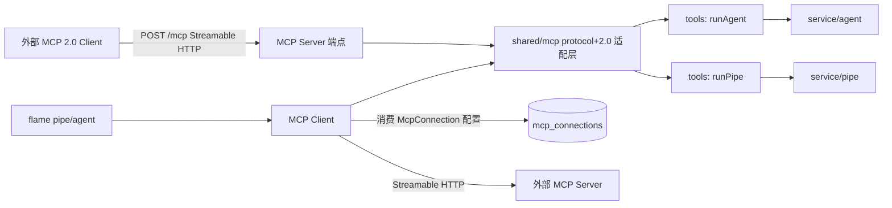

## 用户需求
为 flame 工程创建 MCP 服务能力，支持 MCP 2.0（2026-07-28 Final 规范），同时作为 Client 与 Server 两种角色，传输层采用 Streamable HTTP，优先引入成熟 Go SDK（mark3labs/mcp-go）并补齐 2.0 无状态差异。

## 产品概述
在现有 flame 后端（flame/nexus）之上新增一套 MCP 2.0 能力层：对外可将 flame 自身的 agent 运行、pipe 工作流执行封装为 MCP tools 通过 Streamable HTTP 端点暴露给任意 MCP 2.0 客户端调用；对内可作为 MCP Client 消费已配置的外部 MCP Server 连接，将其远程 tools 拉取并适配为 flame 内部可调用工具，供 pipe/agent 编排使用。复用现有 McpConnection 配置模型与 admin 管理页。

## 核心特性
- Server 端点：新增无状态 `POST /mcp` Streamable HTTP 单端点，支持 tools/list、tools/call，请求自包含（经 `_meta` 携带版本/能力），响应头携带 `MCP-Protocol-Version`/`Mcp-Method`。
- 本地能力暴露：将 `service/agent` 的运行能力、`service/pipe` 的流程执行能力注册为 MCP tools（含输入 schema 与 handler 调用）。
- Client 接入：基于 `McpConnection` 配置连接外部 MCP Server 的 Streamable HTTP 端点，执行 list_tools 并适配为 flame 内部工具抽象。
- 连接探测：在现有 mcpconnections 路由组扩展"测试连接/列出远程 tools"能力，复用 URL/Auth(JSONB) 凭证字段。
- 2.0 无状态适配：封装一层 2.0 无状态协议适配（剥离 initialize 握手依赖、单端点路由、标准 JSON-RPC 错误码），以 mcp-go 为类型/传输底座，缺失部分在 flame 侧自补。


## 技术栈
- 语言/框架：Go 1.25 + Gin（沿用 flame/nexus 现有栈）
- MCP SDK：引入 `github.com/mark3labs/mcp-go` 作为协议/传输底座；在 `flame/nexus/shared/mcp` 内封装 2.0 无状态适配层
- 复用：`flame/tools` 下的 xhttp/xlog/xsql/xregistry、现有 `McpConnection` 模型与 `mcpconnections` 仓库/路由
- 数据库：沿用 Postgres（mcp_connections 表已存在）

## 实现方式
采用"SDK 底座 + flame 侧 2.0 无状态适配层"策略。MCP 2.0 是 2026-07-28 刚定稿的规范（无状态化、删 initialize 握手、Streamable HTTP 单端点），而 mark3labs/mcp-go 对 2.0 仅"温和升级"且刚发布 2 天，大概率仍实现有状态 1.x 握手模型。因此：
- 优先 `go get` mcp-go 并启用其 stateless 模式（若版本已支持）；
- 若未支持，则在 `shared/mcp` 包内基于其类型定义自行实现最小 2.0 无状态 JSON-RPC 层（请求 `_meta` 自包含、单端点 `POST /mcp`、响应头 `MCP-Protocol-Version`/`Mcp-Method`、标准错误码 `-32602`），保证真正满足"mcp2.0"。

Server 端在 `cmd/router.go` 注册 `POST /mcp` 端点，将 agent/pipe 封装为 tools。Client 端新增 `shared/mcp/client` 消费 `McpConnection` 配置。两者共享 `shared/mcp` 的协议与类型定义，保证一致性。

## 性能与可靠性
- Server 端点无状态，天然支持轮询负载均衡与水平扩展，无需 session 存储。
- tools/list 返回 `ttlMs`/`cacheScope` 以支持客户端响应缓存，降低重复查询。
- Client 连接按 `McpConnection.ID` 做懒加载与连接池复用，避免每次调用重建 HTTP 连接。
- 错误处理：统一 JSON-RPC 标准错误码，handler 内捕获 panic 防止单 tool 故障拖垮端点；日志记录请求方法、耗时、错误（不记录凭证明文）。

## 实现要点（防回归）
- 不改动现有 McpConnection CRUD、admin 路由、models 字段；仅扩展。
- 引入外部 SDK 后须运行 `go mod tidy` 并更新 go.sum；注意 `flame/nexus` 已有指向本地 `flame/tools` 的 replace，勿误删。
- 复用现有 `xhttp.OkJSON`/`ErrJSON` 响应风格；新增 handler 沿用 `authInfo` 鉴权中间件。
- Server 暴露的 tools 需与 `service/agent`、`service/pipe` 现有调用签名对齐，避免破坏其内部逻辑。

## 架构设计


## 目录结构
```
flame/nexus/
├── go.mod                         # [MODIFY] 增加 github.com/mark3labs/mcp-go 依赖与 go.sum 更新
├── cmd/
│   └── router.go                  # [MODIFY] 注册 POST /mcp 端点（Streamable HTTP，挂载 Server handler）
├── shared/
│   └── mcp/
│       ├── protocol.go            # [NEW] 2.0 无状态协议适配层：JSON-RPC 类型、_meta 自包含、标准错误码、响应头构造；复用 mcp-go 类型
│       ├── server.go             # [NEW] MCP Server 实现：注册 agent/pipe 为 tools，处理 tools/list、tools/call，无状态单端点
│       └── client.go             # [NEW] MCP Client：消费 McpConnection 配置，连接外部 Streamable HTTP 端点，list_tools 并适配为内部工具
├── service/
│   └── mcp/
│       └── tools.go              # [NEW] 将 service/agent、service/pipe 封装为 MCP tool 定义与 handler 适配器
└── admin/
    └── mcpconnections/
        └── handlers.go           # [MODIFY] 扩展 ProbeConnection / ListRemoteTools handler，复用 URL/Auth 字段
```


## Agent Extensions
### SubAgent
- **code-explorer**
  - Purpose: 在生成详细实现前，深入探查 `service/agent`、`service/pipe` 的调用入口与签名，确认 tools 封装所需参数；核对 mcp-go 当前版本对 2.0 无状态的实际支持程度。
  - Expected outcome: 输出 agent/pipe 可被暴露为 MCP tool 的最小参数契约，以及 mcp-go 是否支持 2.0 stateless 的结论，避免方案建立在错误假设上。
