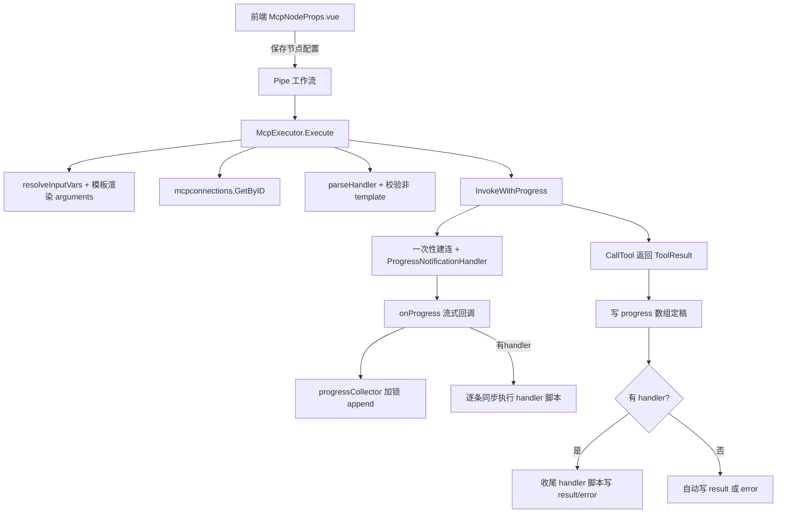

## 产品概述
在工作流（pipe）中新增 `mcp` 节点，用于调用远端 MCP 工具。复用项目已有的 MCP 客户端能力，以及 HTTP/LLM 节点成熟的「handler 脚本 + 固定输出变量 + 流式绑定」机制，支持流式接收 MCP progress 通知并自动维护 progress 数组。

## 核心特性
- 新增 `mcp` 节点类型：配置 `connection_id`（连接）、`tool_name`（工具名）、`arguments`（参数，支持模板渲染）
- 固定输出变量：`result`(string)、`progress`(array[string])、`error`(string)
- 支持 handler 脚本，但**仅限 lua/python/javascript，排除 template**（handler 需要「判断 + wf_write_output/wf_append_output 副作用」，template 是纯渲染无副作用，语义不符）
- 流式接收 MCP progress 通知：`InvokeWithProgress` 边调边推

## 输出变量写入规则（核心决策）
| 场景 | progress 数组 | result | error |
|------|--------------|--------|-------|
| 无 handler | 自动写 | 自动写 | 自动写（仅 IsError） |
| 有 handler | 自动写 | 脚本写 | 脚本写 |

- `progress` 数组**仅在 CallTool 返回后写一次**（定稿）；逐条 progress 到达时只「收集 + 有 handler 才同步执行脚本」，不写变量
- progress 写一次时机：CallTool 返回后、收尾 handler 之前（节点先定稿 progress，脚本只读不抢）
- 逐条 progress 的 handler eventData：`progress`（本条结构化对象）+ `progress_raw`（本条完整原始 JSON 字符串）
- 收尾 handler 的 eventData：`result`、`is_error`(bool)、全量 `progress` 数组、`done`(true)


## 技术栈
- 后端：Go + Gin，`github.com/modelcontextprotocol/go-sdk v1.7.0-pre.1`，`flame/tools/xsql`
- 前端：Vue 3 + Element Plus（`nexus_desk`）
- 数据库：复用 `mcp_connections`（连接配置）与 `mcp_connection_tools`（工具列表）

## 实现方案

### 策略
后端新增 `executors/mcp.go`，复用 `http.go` 的 `parseHandler`/`executeHandlerScript`/`mergeInputs`/`resolveInputVars`/`RenderTemplate`/`BuildScriptTemplateContext` 等包级函数。MCP 客户端层新增带进度回调的流式入口 `InvokeWithProgress`（不改现有函数签名）。前端新增 `McpNodeProps.vue` 并注册到 `PropsPanel.vue`/`NodePanel.vue`。

### 关键技术决策

#### 1. 新增 `InvokeWithProgress`（不改现有函数）
现有 `NewClientSession`/`newStdioSession` 均 `mcp.NewClient(ClientImpl, nil)` 且被 `discover.go` 等多处复用，不能改签名。故新增独立建连：
- 建连时注入 `&mcp.ClientOptions{ ProgressNotificationHandler: func(ctx, req){ onProgress(req.Params) } }`
- `params.SetProgressToken(uuid.NewString())` 设置 progress token
- **v1 统一走一次性建连**（streamable_http 与 stdio 都临时建连，不复用 stdio 进程池）。理由：池化 session 的 progress handler 是建连时定的，流式 progress 需按「当前调用」路由，路由复杂度高；一次性建连语义清晰、无并发串扰。stdio 池化 + 流式 progress 作为后续独立优化。

#### 2. 并发与加锁
`ProgressNotificationHandler` 在 SDK 后台读协程触发，与阻塞在 `CallTool` 的主协程并发：
- `progressCollector` 用 `sync.Mutex` 保护 `append`
- 有 handler 时逐条同步执行脚本：`nr.OutputVars` 由 `NodeResult.mu` 保护，写变量安全；collector append 独立加锁
- CallTool 返回后主协程写 progress 数组 + 收尾 handler，此时 onProgress 已结束，无竞争

#### 3. handler 脚本语言限制
- **handler 仅允许 lua/python/javascript，排除 template**。
- 后端：MCP 节点执行 handler 前校验 lang，若 `lang == "template"` 走 `nr.Finish(StatusFailed, ErrCodeConfig, "handler 不支持 template 语言")` 并返回错误（与 `parseHandler` 默认 lua 的行为衔接）。
- 前端：`McpNodeProps.vue` 的 handler 语言下拉框只给 `['lua','python','javascript']`，不复用含 template 的全局 `scriptLanguages`。

#### 4. result 值形态
- `result` 固定变量存 `flattenResult` 的 `Content`(string)；`Structured` 暂不单独落变量（后续可议）。

### 性能与可靠性
- 一次性建连 + 流式回调，无额外常驻资源；progress 按到达顺序逐条处理
- 加锁粒度为 collector append 的最小临界区，避免长时间持锁
- 复用 `xsql.JSONB`/现有仓储/脚本执行，不引入新类型

## 架构设计


## 目录结构
```
d:/proj/flame/
├── nexus/service/mcp/client/invoke.go        # [MODIFY] 新增 InvokeWithProgress + 带 ProgressNotificationHandler 的一次性建连
├── nexus/service/pipe/executors/mcp.go       # [NEW] MCP 节点 executor（含 handler 非 template 校验、progressCollector）
├── nexus/service/pipe/flow/nodeResult.go     # [MODIFY] NodeType 常量加 NodeTypeMCP = "mcp"
└── nexus_desk/src/components/pipeinstances/pipe/
    ├── McpNodeProps.vue                       # [NEW] MCP 节点配置面板（handler 语言仅 lua/python/javascript）
    ├── PropsPanel.vue                         # [MODIFY] 注册 mcp 分支 + import + 图标
    └── NodePanel.vue                          # [MODIFY] 加 MCP 节点卡片
```

## 关键代码结构
```go
// nexus/service/mcp/client/invoke.go 新增
func InvokeWithProgress(
    ctx context.Context,
    conn *models.McpConnection,
    toolName string,
    arguments map[string]any,
    onProgress func(*mcp.ProgressNotificationParams),
) (*ToolResult, error)
```

```go
// nexus/service/pipe/executors/mcp.go
var mcpFixedOutputVars = map[string]string{
    "result":   "string",
    "progress": "array[string]",
    "error":    "string",
}

type progressCollector struct {
    mu   sync.Mutex
    list []string
}
func (c *progressCollector) append(raw string)
func (c *progressCollector) snapshot() []string
```


## Agent Extensions
### SubAgent
- **code-explorer**
  - Purpose: 实现前端前二次核对 `admin.js` 中 MCP 连接/工具的 API 路径与配置键，以及 `HttpNodeProps.vue` 中 handler/outputs 编辑的可复用结构，确保 `McpNodeProps.vue` 与现有面板交互一致
  - Expected outcome: 产出前端 API 配置键与可复用组件结构清单，避免 McpNodeProps.vue 偏离既有交互模式
