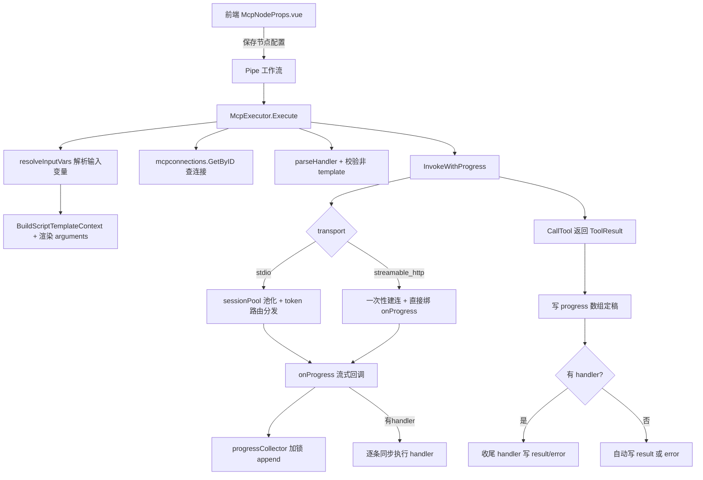

## 产品概述
在工作流（pipe）中新增 `mcp` 节点，用于调用远端 MCP 工具。节点支持输入变量、handler 脚本、流式进度接收，并复用 HTTP/LLM 节点成熟的「固定输出变量 + 流式绑定」机制。同时顺带收紧 HTTP/LLM/on_error 的 handler 脚本语言（显式报错排除 template）。

## 核心特性
- 新增 `mcp` 节点类型，配置：`connection_id`（连接）、`tool_name`（工具名）、`arguments`（参数，支持模板渲染）、`inputs`（输入变量）、`handler`（脚本）、`outputs`（输出变量）
- 输入变量：与 HTTP/LLM 一致，`config.inputs` 定义输入变量来源，`resolveInputVars` 解析，供 arguments 模板用 `{{.input.xxx}}` 引用
- 固定输出变量：`result`(string)、`progress`(array[string])、`error`(string)
- handler 脚本仅限 lua/python/javascript（排除 template）
- 流式接收 MCP progress 通知：`InvokeWithProgress` 边调边推

## 输出变量写入规则
| 场景 | progress 数组 | result | error |
|------|--------------|--------|-------|
| 无 handler | 自动写 | 自动写 | 自动写（仅 IsError） |
| 有 handler | 自动写（基础设施输出） | 脚本写 | 脚本写 |

- `progress` 数组仅在 CallTool 返回后写一次（定稿）；逐条 progress 到达时只「收集 + 有 handler 才同步执行脚本」，不写变量
- progress 写一次时机：CallTool 返回后、收尾 handler 之前
- 逐条 progress 的 handler eventData：`progress`（本条结构化对象）+ `progress_raw`（本条完整原始 JSON 字符串）
- 收尾 handler 的 eventData：`result`、`is_error`(bool)、全量 `progress` 数组、`done`(true)


## 技术栈
- 后端：Go + Gin，`github.com/modelcontextprotocol/go-sdk v1.7.0-pre.1`，`flame/tools/xsql`
- 前端：Vue 3 + Element Plus（`nexus_desk`），组件内 `fetch` 调用 admin API
- 数据库：复用 `mcp_connections`（连接配置）与 `mcp_connection_tools`（工具列表）

## 实现方案

### 策略
后端新增 `executors/mcp.go`，复用 `http.go` 的 `parseHandler`/`executeHandlerScript`/`mergeInputs`/`resolveInputVars`/`RenderTemplate`/`BuildScriptTemplateContext` 等包级函数。MCP 客户端层新增带进度回调的流式入口 `InvokeWithProgress`。前端新增 `McpNodeProps.vue` 并注册到 `PropsPanel.vue`/`NodePanel.vue`。

### 关键技术决策

#### 1. 输入变量（复用 HTTP/LLM 模式）
MCP 节点 config 含 `inputs`（每个变量含 `source_type`/`source_key`/`source_ref`/`type`）。执行流程：
- `inputArgs, err := resolveInputVars(node, ctx, processID)` 解析输入变量
- `tmplCtx := BuildScriptTemplateContext(nr, inputArgs)` 构建模板上下文
- arguments 中字符串用 `RenderTemplate(str, tmplCtx)` 渲染，引用 `{{.input.xxx}}`

#### 2. InvokeWithProgress（方案 A：stdio 池化 + token 路由）
- **streamable_http**：一次性建连 `mcp.NewClient(ClientImpl, &mcp.ClientOptions{ ProgressNotificationHandler: 直接绑 onProgress })`，`defer session.Close()`。
- **stdio**：复用 `sessionPool`。`SessionPool` 新增 `progressRoutes map[string]func(*mcp.ProgressNotificationParams)`（加锁），`newStdioSession` 建连时注入 `ProgressNotificationHandler` 做查表分发：`key := fmt.Sprint(req.Params.ProgressToken)` 查 `progressRoutes[key]` 调用。
- 每次调用：`token := uuid.NewString()`；`params.SetProgressToken(token)`；调用前 `sessionPool.RegisterProgress(token, onProgress)`，调用后 `defer sessionPool.UnregisterProgress(token)`。
- 签名：
```go
func InvokeWithProgress(
    ctx context.Context,
    conn *models.McpConnection,
    toolName string,
    arguments map[string]any,
    onProgress func(*mcp.ProgressNotificationParams),
) (*ToolResult, error)
```
- 按 `conn.Transport` 分流（stdio 走池化+路由，streamable_http 走一次性建连）。

#### 3. 并发与加锁
`ProgressNotificationHandler` 在 SDK 后台读协程触发，与阻塞在 `CallTool` 的主协程并发执行：
- `progressCollector` 用 `sync.Mutex` 保护 `append`
- 有 handler 时逐条同步执行脚本：`nr.OutputVars` 由 `NodeResult.mu` 保护，写变量安全
- `SessionPool.progressRoutes` 加锁（sync.RWMutex）
- CallTool 返回后主协程写 progress 数组 + 收尾 handler，此时 onProgress 已结束，无竞争

#### 4. handler 脚本语言收紧（方式 B 显式报错）
- `parseHandler` 改签名 `(script, lang string, timeout int, err error)`，`lang == "template"` 时返回错误「handler 不支持 template 语言」
- http.go:104、llm.go:83 两处调用点捕获 error 后 `nr.Finish(StatusFailed, ErrCodeConfig, ...)` 并返回
- mcp.go 同样调用 `parseHandler` 获得校验，行为一致
- 前端 HttpNodeProps/LLMNodeProps/OnErrorConfig 的 handler(post) 语言下拉框过滤掉 template（不影响 Code/Progress/Result/Branch/Loop 的代码/条件脚本）

#### 5. result 值形态
`result` 固定变量存 `flattenResult` 的 `Content`(string)；`Structured` 暂不单独落变量。

### 输出写入流程
```
CallTool 返回前（onProgress 并发回调）:
  raw = json.Marshal(p) → coll.append(raw)（加锁）
  if handler: 同步执行 handler(eventData={progress:结构化对象, progress_raw:raw})

CallTool 返回后（主协程）:
  nr.SetOutputVarWithFire("progress", coll.snapshot())  // 写一次定稿
  if handler: 收尾 handler(eventData={result, is_error, progress:全量数组, done})
  else:
    if res.IsError: SetOutputVarWithFire("error", ...); Finish(success)
    else: SetOutputVarWithFire("result", ...); Finish(success)
```

## 架构设计


## 目录结构
```
d:/proj/flame/
├── nexus/service/mcp/client/invoke.go        # [MODIFY] 新增 InvokeWithProgress + 按 transport 分流建连
├── nexus/service/mcp/client/pool.go          # [MODIFY] SessionPool 加 progressRoutes + RegisterProgress/UnregisterProgress；newStdioSession 注入分发 handler
├── nexus/service/pipe/executors/mcp.go       # [NEW] MCP 节点 executor（输入变量、流式收集 progress、handler、写 result/progress/error）
├── nexus/service/pipe/executors/http.go      # [MODIFY] parseHandler 加 error 返回 + 校验非 template；调用点处理 error
├── nexus/service/pipe/executors/llm.go       # [MODIFY] parseHandler 调用点处理 error
├── nexus/service/pipe/flow/nodeResult.go     # [MODIFY] NodeType 常量加 NodeTypeMCP = "mcp"
└── nexus_desk/src/components/pipeinstances/pipe/
    ├── McpNodeProps.vue                       # [NEW] MCP 节点配置面板（输入变量、连接/工具选择、参数、handler、outputs）
    ├── HttpNodeProps.vue                      # [MODIFY] handler 语言下拉框过滤 template
    ├── LLMNodeProps.vue                       # [MODIFY] handlerLanguages 过滤 template
    ├── OnErrorConfig.vue                      # [MODIFY] handler/post 语言下拉框过滤 template
    ├── PropsPanel.vue                         # [MODIFY] 注册 mcp 分支 + import + 图标
    └── NodePanel.vue                          # [MODIFY] 加 MCP 节点卡片 + 图标
```

## 实现注意事项
- 输出变量必须先 `InitOutputVars` 定义，否则 `SetOutputVarWithFire` 报 "output var not defined"；progress 是 `array[string]`，不在 `InitOutputBindings` 绑定范围（仅 string/number/boolean 可绑），符合预期
- `progressCollector.append` 与 `SessionPool.progressRoutes` 加锁粒度保持最小临界区
- `InvokeWithProgress` 内一次性建连（streamable_http）需 `defer session.Close()` 释放资源
- `parseHandler` 改签名是破坏性变更，需同步更新 http.go:104、llm.go:83 两处调用点（已核对仅此两处 + 新增 mcp.go）
- MCP 节点 `Capabilities()` 返回 `ErrCodeConfig/Connection/Timeout/Auth/NotFound/Script/Var/Other`，`Actions` 含 retry/skip/handler，`HasPost: true`（对齐 http/llm）
- stdio 的 token 路由表挂在 SessionPool 上（跨 session 共享），token 是调用级唯一（uuid），避免不同调用串扰


## Agent Extensions
### SubAgent
- **code-explorer**
  - Purpose: 实现前端前核对 `admin.js` 中 MCP 连接/工具的 API 配置键与 `HttpNodeProps.vue` 中「输入变量」「handler」「outputs」编辑区块的可复用结构，确保 `McpNodeProps.vue` 与现有面板交互一致，并确认 `parseHandler` 仅 http.go/llm.go 两处调用无遗漏
  - Expected outcome: 产出前端 API 配置键（mcpConnections）、可复用组件结构清单、以及 `parseHandler` 调用点完整清单，避免实现偏离既有模式或遗漏改动
