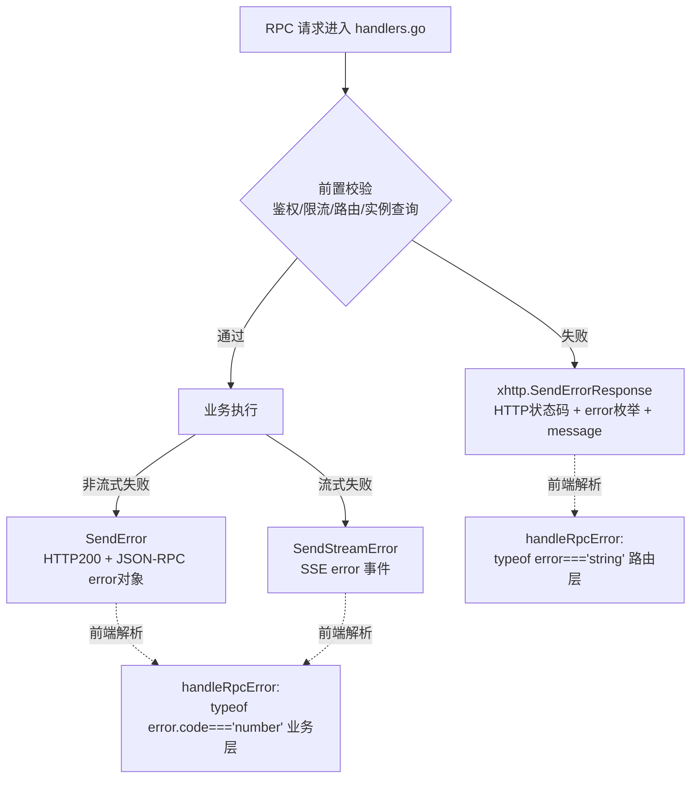

## 用户需求
RPC 服务对"找不到工具/端点"等前置（路由层）错误，当前通过 `xhttp.SendMessage` 返回 HTTP 状态码加字符串 `code`（如 `"bad request"`），与 MCP 路径返回的 JSON-RPC error 格式不同，且 `SendMessage` 的 `code`（字符串）与 `OkJSON`/`ErrJSON` 的 `code`（整数）及 JSON-RPC `error.code`（整数）命名冲突，前端需写多套解析逻辑。用户要求不直接改动 `SendMessage`，而是**新增一个专门发送路由层错误的函数**，并让前端同步改造，统一错误表达、消除字段冲突。

## 产品概述
为 RPC 前置错误新增专用发送函数 `SendErrorResponse`，返回体使用顶层 `error`（snake_case 字符串枚举）+ `message`，不再复用 `code` 字段；将 `handlers.go` 中所有路由层错误从 `SendMessage` 切换到新函数，规范 reason 枚举，并修正 HTTP 状态码语义错配；前端同步把对 `resp.code`（字符串）的解析改为 `resp.error`（字符串枚举），并清晰区分路由层错误与 JSON-RPC 业务层错误。MCP 路径与业务错误 `SendError` 路径保持不变。

## 核心特性
- 新增 `SendErrorResponse` 函数，返回 `{"error": "<reason>","message": "..."}`，不改动原有 `SendMessage`
- `handlers.go` 全部路由层错误调用切换至新函数，`reason` 枚举化（invalid_request / not_found / unauthorized / forbidden / rate_limited / internal_error）
- 修正 5 处 HTTP 状态码与 reason 语义错配（404 配 not_found、401 配 unauthorized、资源不存在不再用 500）
- 前端统一错误解析：路由层读 `resp.error`（字符串），业务层读 `resp.error.code`（整数）
- 建立可复用的前端 RPC 错误分发工具，减少组件内重复判断


## 技术栈
- 后端：Go + Gin（`github.com/gin-gonic/gin`），`xhttp` 工具包、RPC handler 服务
- 前端：Vue 3 + Element Plus（`nexus_desk`），组件内直接 fetch/axios 调用，无全局响应拦截器（已确认）

## 实现方案
### 策略
后端新增专用函数 `SendErrorResponse` 承载路由层错误，保留 `SendMessage` 不动以零影响其他调用方；`handlers.go` 路由层错误统一切换到新函数并规范枚举；前端抽出一个 `handleRpcError`/`parseRpcResponse` 工具，区分"路由层错误（error 为字符串）"与"业务层错误（error 为对象含整数 code）"。

### 关键技术决策
1. **新增函数而非改 `SendMessage`**：避免破坏其他可能仍在使用 `SendMessage`（返回 `code` 字符串）的模块，改动面最小、风险最低，符合用户明确意图。
2. **reason 用 snake_case 字符串枚举**：与 JSON-RPC 整数 `code` 世界区分，机器可判定、前端按枚举分支，避免 `code` 字段类型冲突。
3. **保留 `message` 字段**：保留人类可读描述（含端点名、原始 err 等上下文），不破坏前端提示文案来源。
4. **HTTP 状态码语义修正**：资源不存在（端点/实例/sql.ErrNoRows）归 404，鉴权失败归 401，真正的服务器内部异常才归 500；让网关/监控按状态码正确识别。
5. **前端统一工具**：RPC 响应分散在多个大组件（AgentInstances 88KB、Pipe 67KB 等），抽工具函数避免在每个调用点重复写类型判断。

### 性能与可靠性
- 纯结构体字面量返回，无额外分配开销；枚举为常量字符串，无运行时解析成本。
- 向后不兼容仅限路由层错误 body 字段名（`code`→`error`），需前后端同步发版；MCP、业务错误信封完全不受影响。

## 实现注意事项
- `SendMessage` 不可删除或改签名，仅新增 `SendErrorResponse`。
- `handlers.go` 中 `OkJSON`/`ErrJSON` 的成功/参数响应、**`SendError`/`SendStreamError`（位于 rpc.go）的 JSON-RPC 信封**均不动。
- 前端改造须覆盖**流式（SSE）错误**解析点（`SendStreamError` 结构不变，但组件内解析需兼容字符串 `error` 与对象 `error`）。
- 使用 [subagent:code-explorer] 精确盘点前端所有读取 RPC 响应 `code`/`message`/`error` 的文件与行号，避免遗漏大文件中的解析点。

## 架构设计


## 目录结构
```
d:/proj/flame/
├── tools/xhttp/http.go                         # [MODIFY] 新增 SendErrorResponse(c, status, reason, message)，返回 {"error":reason,"message":message}；SendMessage 保留不动
├── nexus/service/rpc/handlers.go               # [MODIFY] 约 30 处路由层错误从 xhttp.SendMessage 切到 xhttp.SendErrorResponse，reason 枚举化并修正 5 处 HTTP 状态码语义错配
└── nexus_desk/src/
    ├── utils/rpcError.js                       # [NEW] 新增 RPC 响应错误分发工具：区分路由层(error 字符串)与业务层(error.code 整数)，导出 handleRpcError(resp)/parseRpcResponse(resp)
    ├── components/AgentInstances.vue           # [MODIFY] 将 RPC 响应中读 resp.code(字符串) 改为 resp.error(枚举)，调用 rpcError 工具
    ├── components/PipeInstances.vue            # [MODIFY] 同上，覆盖运行/测试 pipe 的错误解析
    ├── components/pipeinstances/Pipe.vue       # [MODIFY] 同上，覆盖流式(SSE)与同步 RPC 错误解析
    └── components/Login.vue                    # [MODIFY] 401 鉴权失败解析从 resp.code 改为 resp.error==='unauthorized'
```
（注：最终前端文件清单由 [subagent:code-explorer] 精确盘点后确认，上述为重点候选）

## 关键代码结构
```go
// tools/xhttp/http.go 新增
// SendErrorResponse 返回传输层/路由层错误（前置校验失败专用）。
// status: HTTP 状态码（401/403/404/429/500...）承担分层语义
// reason: snake_case 错误枚举（invalid_request/not_found/unauthorized/forbidden/rate_limited/internal_error），机器可读
// message: 人类可读描述，可含上下文
// 与 SendMessage 的区别：不使用 code 字段，避免与 OkJSON/ErrJSON 整数 code 及 JSON-RPC error.code 混淆
func SendErrorResponse(c *gin.Context, status int, reason, message string) {
	c.JSON(status, gin.H{"error": reason, "message": message})
}
```


## Agent Extensions
### SubAgent
- **code-explorer**
  - Purpose: 精确盘点 nexus_desk 前端中所有读取 RPC 响应 `code`/`message`/`error` 字段的文件与行号（含 AgentInstances.vue、PipeInstances.vue、Pipe.vue、Login.vue 等大文件及流式 SSE 错误解析点），并确认是否存在全局 fetch/axios 响应拦截器。
  - Expected outcome: 产出完整的前端改动点清单（文件+行号+当前解析方式），供实施阶段精准修改，避免遗漏。
