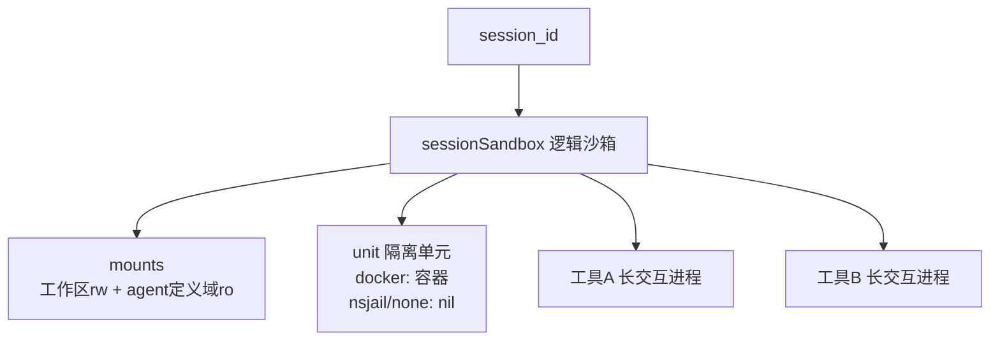

# 长交互沙箱（Long-lived Interactive Sandbox）设计方案

## 0. 一句话

在现有「短命令（exec）」和「脚本（script）」之外，新增第三种运行形态「长交互进程」：**nexus 无状态（拼 mounts + 传 session_id）→ gateway 无状态（负载走内存快照，粘性路由在多实例时才用共享存储）→ sandboxd 按 session 持有「逻辑沙箱 + 多长交互进程」，进程可重建、文件落盘兜底**。

## 1. 目标

让某个工具（shell / REPL 等）的进程**跨多次调用存活**，下一次调用能按身份键找到它继续交互，同时不要求 nexus 有状态、不要求 sandboxd 单实例。

## 2. 现状盘点（已确认的代码事实）

| 形态 | 端点 | 模型 | 生命周期 |
|---|---|---|---|
| exec | `/v1/exec` | 一条连接 = 一个进程 | 断连即杀（`clientGone → proc.Kill()`） |
| script | `/v1/script` | slotPool 同质借还 + scripthost 每次 fork 解释器 | 借出→归还→复用 |
| **长交互（新增）** | 待定 | session 级逻辑沙箱 + 多进程注册表 | 懒建→持有→回收 |

- 三种 mode（none / nsjail / docker）都能跑，差异只在隔离层。
- `Reusable`/`Unit` 抽象（隔离单元与执行进程分离）**目前只有 docker 实现**；nsjail/none 不需要补（见 §6）。
- 通信：sandboxd↔scripthost 是 stdio 帧协议（4 字节长度前缀 + JSON）；scripthost↔解释器是 fork + argv + stdout/stderr。
- 挂载校验：`guardMounts` 校验 `Mount.Host` 落在 `allowed_mount_roots` 内；none 额外 `guardDir` + 反向翻译。
- 挂载是**多路径**的（`Spec.Mounts` 数组）：如 `/workspace` ← 运行域（rw、cwd）+ `/agent` ← 定义域（ro）。

## 3. 核心决策（已敲定）

1. **nexus 无状态、多实例**，不粘实例。
2. **sandboxd 多实例**，不能单实例。
3. **gateway 无状态**；负载均衡走「内存快照」（定期拉 sandboxd metrics），不在请求热路径读共享存储。
4. **粘性路由的共享存储是「可选」的**：gateway 单实例用内存 map；多实例才需要 redis/注册中心，且只存「session→实例」映射，不存负载。
5. **身份与位置分离**：`session_id` 为身份（跨调用找进程），`mounts`（一组挂载）为位置（文件视图），两者解耦。
6. **短命令/脚本不需要 session_id，长交互才需要**：定位文件用挂载即可；只有跨调用找「同一个进程」时才引入 session_id。
7. **新增「长交互」类型**：一个 session 一个「逻辑沙箱」，里面多个长交互进程（一个工具一个）。
8. **长交互沙箱是「注册表」不是「池」**（有归属、不可互换）。

## 4. 总体架构

```mermaid
graph LR
    nexus[nexus 多实例<br/>无状态 拼mounts] -->|带 session_id+tool| gw[gateway<br/>无状态: 负载快照+粘性路由]
    gw --> sd1[sandboxd-1]
    gw --> sd2[sandboxd-2]
    gw --> sd3[sandboxd-3]
    gw -.多实例时.-> redis[(redis 可选<br/>session_id→instance 映射)]
    sd1 -.文件落盘.-> fs[(共享/可推导路径<br/>users/{uid}/sessions/{sid}/)]
```

gateway 职责：

- **健康检查**：探测 sandboxd 存活，摘除死实例。
- **负载均衡**：定期拉 sandboxd metrics 到内存，按负载选实例（只作用于新 session 首次分配 + 无粘性请求）。
- **粘性路由**：已有 session 查映射固定转发；映射的存储单实例用内存、多实例用 redis/注册中心。

## 5. 身份模型：session_id 为身份，mounts 为位置

| 键 | 语义 | 用途 |
|---|---|---|
| `session_id` | 身份（时间连续性） | 粘性 key、sandboxd 注册表 key、跨调用找进程 |
| `mounts` | 位置（文件视图） | 一组 `Spec.Mounts`，其中工作区挂载（rw、cwd）承载文件状态，其余只读 |

- nexus 拼 `mounts`（业务真相源），sandboxd 逐项校验 `Host` 落在 `allowed_mount_roots` 内。
- 短命令/脚本只带挂载定位文件，不需要 session_id；长交互才引入 session_id 作为身份键。

```
session_id（身份）──→ 粘性 key + sandboxd 注册表 key
mounts（位置）────→ 文件落盘 + 挂载（首次创建时生效）
```

## 6. 长交互沙箱模型（sessionSandbox 统一抽象，unit 可选）



- 管理结构三种 mode 统一：`session_id → { mounts, unit?, tools }`，`tools` 是 `{ tool_id → process }`。
- **docker**：`unit` 是容器（`Acquire` 空容器），所有 tool 进程 `docker exec` 进去，共享容器级挂载；建第一个进程时 `Acquire`，删最后一个时 `Close`。
- **nsjail / none**：`unit` 为 `nil`，每个 tool 进程独立 `Start`（nsjail ~10ms、none 0ms，复用单元无意义），各自挂载同一组 mounts。

统一抽象（差异收敛到 `Spawn` 一个分支）：

```go
type sessionSandbox struct {
    mounts   []sandbox.Mount
    unit     sandbox.Unit    // docker 非空；nsjail/none 为 nil
    isolate  sandbox.Sandbox // nsjail/none 独立 Start 用
    tools    map[string]*toolProc
}

func (s *sessionSandbox) Spawn(toolID string, argv []string) (*toolProc, error) {
    if s.unit != nil {
        return spawnInUnit(s.unit, toolID, argv)   // docker：unit.Exec
    }
    return spawnIsolated(s.isolate, toolID, argv)  // nsjail/none：isolate.Start
}

func (s *sessionSandbox) Close() {
    for _, t := range s.tools { t.process.Kill() } // 三种 mode 一样
    if s.unit != nil { _ = s.unit.Close() }        // docker 额外销毁容器
}
```

- 共享的是「文件」（mounts），不是「进程空间」（namespace）——长交互工具靠文件交互，不靠 namespace。
- docker「一个容器多进程」是容器隔离的副作用，不是需求；nsjail/none 独立 jail 隔离更强，两者在满足需求上等价。

## 7. 关键机制

### 7.1 负载均衡

- **负载指标**：script 池占用、exec 并发占用、长会话进程占用（及 CPU/内存），由 sandboxd 汇总。
- **收集方式**：sandboxd 暴露 `/metrics`（含负载字段），gateway **定期拉到内存**（如每 1~5s），内存里加权成「负载分数」。
- **均衡时机**：只作用于「新 session 首次分配」+「无粘性请求（短命令/脚本）」；**已有 session 的粘性路由不看负载**（进程长在固定实例，换了就丢）。
- **不碰共享存储**：负载是各 gateway 各拉的估计值，不要求跨实例一致，请求路径读内存 `O(1)`，零 redis 开销。

两段式路由：

```
请求 → 无粘性？ → 按负载选实例（每个请求都均衡）
     → 有粘性？
          ├─ 新 session → 按负载选实例 → 绑定 → 转发
          └─ 已有 session → 查绑定 → 直接转发（不看负载）
```

### 7.2 粘性路由

- **gateway 单实例**：`session → 实例` 存内存 map，不需要共享存储。
- **gateway 多实例**：负载可各拉各的，但粘性表必须共享（否则同一 session 被两个 gateway 绑到不同实例 → 进程分裂）。共享存储可选 redis 或注册中心。
- 绑定用 `SET ... NX EX 1800` 原子抢占；每次路由后 `EXPIRE` 续期实现空闲回收；实例宕机 → 摘除 → 删其 session key → 下次懒绑到健康实例 + 重建。

### 7.3 沙箱注册表（非池）

sandboxd 实例内存持有：

```
session_id → {
    mounts: []Mount            // 首次创建时确定并挂载
    unit:   sandbox.Unit|null  // docker 非空，nsjail/none 为 nil
    tools:  { tool_id → { process, stdin, stdout, last_active } }
}
```

- 语义：查得到就用、查不到就建、超时/结束就删。
- 不预热、不借还、不复用给别的 session。

### 7.4 进程真相源与可重建

- 进程句柄只在持有它的 sandboxd 实例内存里，**不可迁移**。
- 粘性映射可能指向「进程已没了」的实例，因此 sandboxd 侧必须「**查不到就懒建**」。
- 正确性靠「文件落盘 + 进程可重建」兜底；粘性路由只是「尽量别重建」的优化。

### 7.5 生命周期

| 事件 | 动作 |
|---|---|
| 首次调用某工具 | 懒建逻辑沙箱 + 挂载 mounts + 懒建长交互进程，注册 |
| 每次调用 | 喂命令 → 收输出 → 连接关（进程不杀）→ 续期 |
| 空闲超时 | TTL 过期 + sandboxd 侧空闲计时 → kill 进程 → Close 单元 |
| session 结束 / 显式 close | 同上，并清粘性 key |

### 7.6 并发

- 同一 `tool` 的进程只有一根 stdin，同一时刻只服务一次调用：实例内对该进程加锁/排队，或每次调用独占。
- 不同 tool、不同 session 互不影响。

## 8. 请求协议（草案）

长交互请求在现有 Spec 基础上加少量字段：

```json
{
  "mode": "interactive",          // 区分三种形态（exec / script / interactive）
  "session_id": "s_8f3a...",      // 身份：跨调用找进程的 key
  "tool_id": "shell",             // 长交互进程的标识
  "argv": ["sh"],                 // 首次创建时的启动命令
  "mounts": [
    { "host": "/data/users/u1/sessions/s_8f3a", "guest": "/workspace", "read_only": false },
    { "host": "/data/agents/poet", "guest": "/agent", "read_only": true }
  ],
  "input": "echo hi\n"            // 本次喂给 stdin 的命令（非首次必填）
}
```

- 首次调用带 `argv + mounts` 触发创建；后续调用只带 `session_id + tool_id + input`，sandboxd 按注册表找到进程喂命令。
- 挂载只在首次创建时生效（进程启动即挂好）。

## 9. 安全边界（不因改造放松）

- `guardMounts` / `allowed_mount_roots` 原样保留：nexus 拼 mounts ≠ 免校验。
- 长交互沙箱的每个 `mount.host` 同样过闸，落在允许根内。
- nexus 拼 mounts 依赖「nexus 的 root_dir == sandboxd 的 allowed_mount_roots」这条显式对齐。

## 10. 崩溃恢复

- gateway 单实例重启：内存粘性表 + 负载快照丢失，重新懒绑 + 进程重建（文件落盘兜底）。
- gateway 多实例 + redis：redis 自身高可用，映射不丢；redis 清空则 session 重新懒绑 + 重建。
- sandboxd 实例宕机：进程丢、文件在，重新懒建；粘性 key 摘除后重新绑定。

## 11. 改动点清单（与现状衔接）

1. **nexus 侧**：新增「长交互」工具调用形态，传 session_id + 拼 mounts + tool_id，透传 mode。
2. **gateway（新增）**：无状态转发 + 内存负载快照（拉 sandboxd `/metrics`）+ 粘性路由 + 健康检查摘除；多实例时粘性表入 redis/注册中心。
3. **sandboxd 侧**：
   - 新增 `sessionSandbox` 统一抽象（`mounts + unit? + tools`）与长交互注册表，懒建/续期/回收逻辑；
   - 新增 `/v1/interactive` 端点（复用 exec 的 stdin/stdout 转发，但「断连不杀、进程归注册表」）；
   - docker 用 `Acquire`/`Exec` 复用容器；nsjail/none 独立 `Start`（**不补 Unit**）；
   - 复用 `guardMounts` 校验 mounts；暴露 `/metrics` 供 gateway 拉负载。
4. **redis（可选，仅 gateway 多实例）**：新增 `sandboxd:session:{session_id}` key（含 instance / last_active / tools），TTL 管生命周期。

## 12. 实施步骤（建议顺序）

1. **P1**：sandboxd 内做 `sessionSandbox` + 长交互注册表 + `/v1/interactive` 端点（先单实例、无 gateway、无 redis，用内存 map）。
2. **P2**：sandboxd 暴露 `/metrics`（负载字段）；新增 gateway（单实例：内存负载快照 + 内存粘性表 + 健康检查）。
3. **P3**：生命周期补齐（空闲回收、显式 close、崩溃重建）+ 并发串行化。
4. **P4**：接入 nexus 工具形态，端到端打通。
5. **P5（可选）**：gateway 多实例化，粘性表迁到 redis/注册中心。

## 13. 待定项

1. **`mode` 字段形态**：独立字段 vs 复用 Spec 里的现有结构？工具「长交互」由谁声明（工具类型 vs 请求 flag）？
2. **负载指标与权重**：script/exec/长会话占用如何加权成「负载分数」？`/metrics` 暴露哪些字段？
3. **空闲超时取值**：粘性 TTL / sandboxd 空闲计时各定多少？
4. **并发语义**：同一 tool 并发调用是「排队」还是「拒绝并报 busy」？
5. **`tool_id` 的 argv 来源**：首次请求带 argv 懒建，还是工具类型声明默认启动命令？
