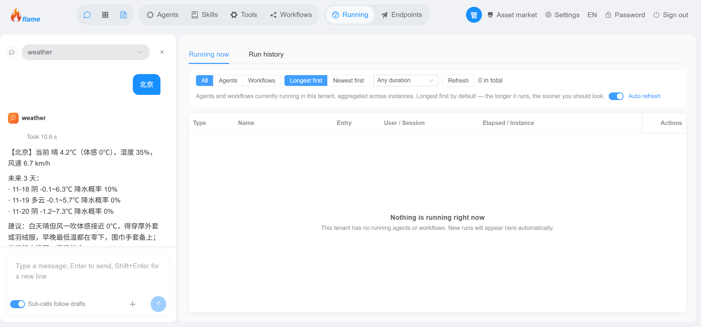
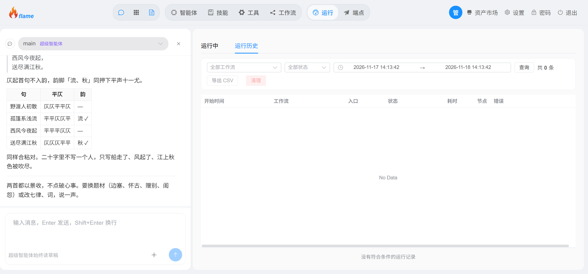
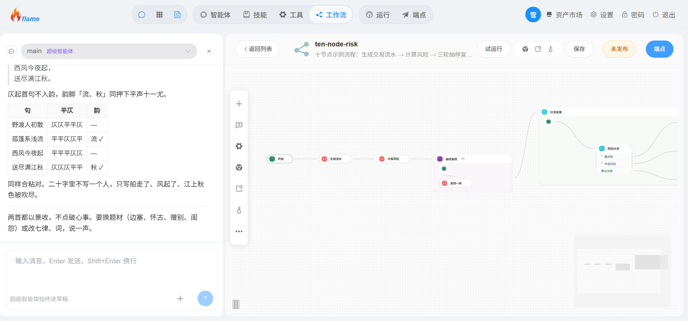
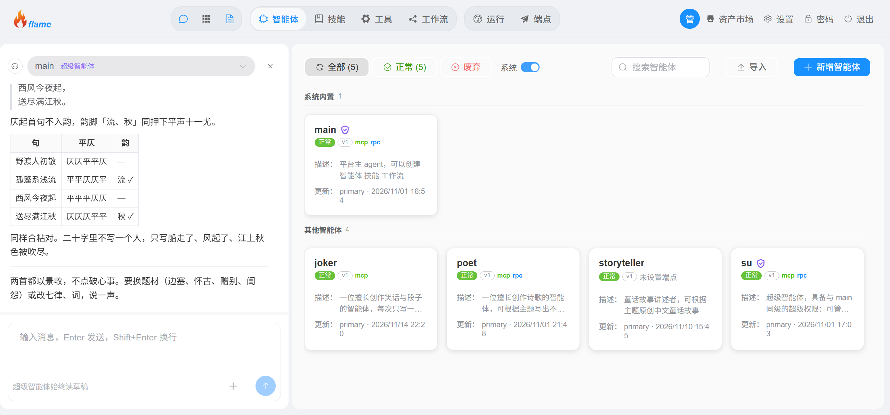
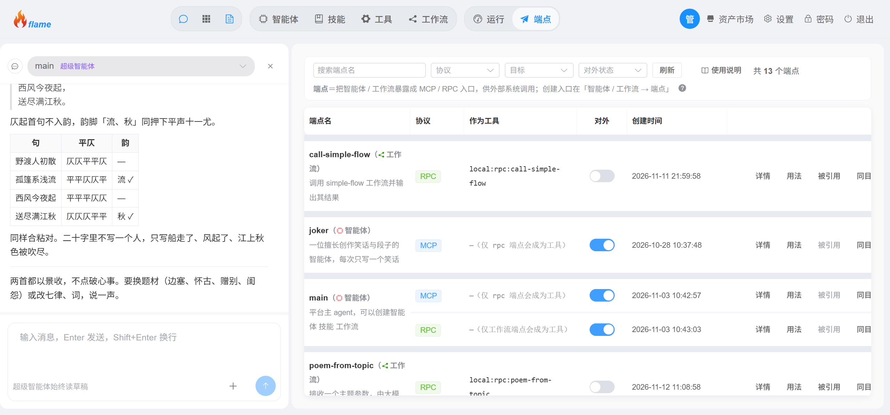
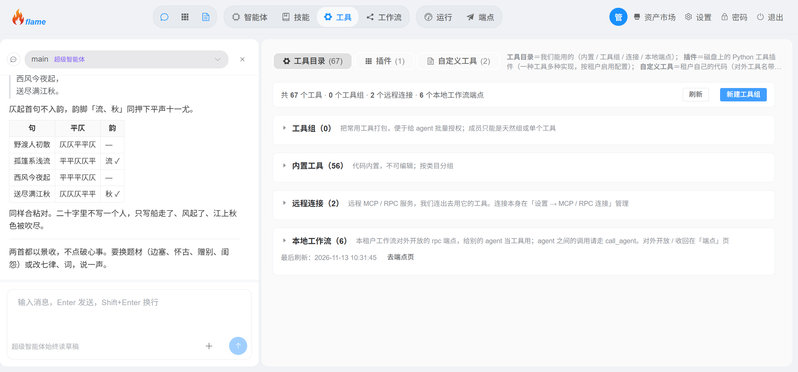

# flame

[中文](README.zh.md) | English

A Go-based, multi-tenant AI agent platform. It manages agents, skills, tools and workflows as first-class build artifacts,
exposes them as callable endpoints (MCP / RPC), and shows everything currently running in a single runtime ledger.

Ships with a Vue 3 admin console (`desktop/`), shared by the tenant side and the platform side.

## Features

**Build artifacts**

- **Agents** — prompt + model + tools + skills, with knowledge bases and tool permissions
- **Skills** — a capability package of `SKILL.md` plus scripts, executed inside the sandbox
- **Tools** — a tool catalog (MCP / RPC and other inbound capabilities), plugins, and custom tools
- **Workflows** — visual orchestration (nodes / edges / variables) with a debugger, versions and releases

**Runtime**

- **Runtime ledger** — a cross-instance view of what is running (agents + workflows), filterable by type / duration, and cancellable
- **Run history** — persisted records, queryable by workflow / status / time range, exportable as CSV, cleanable per record or by filter
- **Endpoints** — expose an agent or a workflow as an MCP or RPC entry point, with a per-tenant "expose / retract" switch
- **Sandbox** — scripts and commands run in isolated units (docker / nsjail / none) with resource limits and a network kill switch

**Platform**

- **Multi-tenancy** — one PostgreSQL schema per tenant; tenants and their accounts are provisioned from the platform console
- **Asset market** — list and install assets across tenants (`listed` / `delisted`)
- **Settings** — models and connections, server-side auth (apikey / oauth), global variables (secrets encrypted at rest)

## Screenshots

| Runtime ledger · who is running what across instances, filterable by type / duration, cancellable | Run history · persisted records, queryable by workflow / status / time range, exportable as CSV |
|---|---|
|  |  |
| Workflow editor · nodes / edges / variables, with debugger, versions and releases | Agent · prompt + model + tools + skills assembly |
|  |  |
| Endpoints · expose agents / workflows as MCP / RPC, toggle exposure per tenant | Tools · catalog / plugins / custom tools, three sources in one place |
|  |  |

## Components

| Directory | Language | Purpose |
|---|---|---|
| `nexus/` | Go | Main service: platform API, tenant API, admin API (default `:27006`) |
| `sandboxd/` | Go | Sandbox daemon: isolated execution of scripts / commands / browser (default `:27081`) |
| `sandboxg/` | Go | Sandbox gateway: unified `/v1/*` for `nexus`, with load balancing and sticky routing (default `:27080`) |
| `tools/` | Go | Shared local libraries used by all three services (`xhttp` / `xsql` / `xlog` / `sandbox` / `code` …) |
| `desktop/` | Vue 3 + Vite | Admin console (dev port `:5173`) |

Dependency direction is one-way: the three services reference the local libraries via `replace flame/tools => ../tools`;
`tools` never depends back on any service.

```
browser ── desktop ──> nexus ──┬──> PostgreSQL    business data (one schema per tenant)
                               ├──> Redis         runtime ledger / stop signals / quotas
                               ├──> LiteLLM       model calls
                               └──> sandboxg ──> sandboxd ──> isolated unit
                                                              (docker / nsjail / none)
```

## Design highlights

A few decisions that run through the whole repository and shape both speed and boundaries. The full write-up lives in
[`nexus/docs/design-highlights.md`](nexus/docs/design-highlights.md).

- **Endpoints are called in-process** within the owning tenant: an `rpc` node invoking a flow or an agent pays no network hop,
  and stdio MCP sessions reuse one child process per connection, rebuilt only when the configuration fingerprint changes.
- **Recursion is bounded by a depth limit plus an ancestor-chain check, not a counter**: every cross-run hop creates a fresh
  `ExecContext`, so per-run counters reset. Configuring the limit as `-1` / `0` ("unlimited") is deliberately refused here — for
  pure flow chains this is the only gate.
- **Multi-tenancy is schema-per-tenant with explicit schema qualification**: no reliance on `search_path`, which is unsafe once
  connections are pooled. Quotas and runtime limits are clamped through "system ceiling → tenant → user".
- **An endpoint is one row of target × protocol**: `exposed` only means "visible outside the tenant"; in-tenant calls ignore it.
  Authorization binds to the **target** (agent / flow), not the endpoint, because endpoints can be recreated while targets are
  stable identities.
- **Fewer database reads on the hot path**: the endpoint catalog comes from a run-time snapshot; configuration and quotas use a
  Redis read-through cache (including negative caching); runtime parameters are frozen once when a run starts.

## Requirements

- Go **1.25+**
- Node **18+** (frontend build)
- PostgreSQL **14+**
- Redis **7+**
- LiteLLM Proxy (model calls; disable with `litellm.enabled` if you don't need models)
- Optional: Docker (`mode: docker` for `sandboxd`, recommended in production), Consul (service discovery)

## Quick start

### 1. Start dependencies

Run PostgreSQL and Redis locally (default ports `5432` / `6379`), and LiteLLM (on `:4000`) if you need models.

### 2. Configure nexus

```bash
cp nexus/config.example.yaml nexus/config.yaml
```

Then edit `nexus/config.yaml`; at minimum change the database connection, `jwt.secret_key` and `litellm.master_key`.

Everything can also come from environment variables (`${VAR}` is expanded before YAML parsing):

```bash
# Linux / macOS
export JWT_SECRET="$(openssl rand -base64 48)"
export LITELLM_MASTER_KEY="sk-..."
# Windows PowerShell
$env:JWT_SECRET = [Convert]::ToBase64String([byte[]](1..48 | ForEach-Object { Get-Random -Maximum 256 }))
```

> A leaked `jwt.secret_key` means anyone can self-sign a token and operate on any tenant. Always use a random value and never
> commit it. The real `nexus/config.yaml` is excluded by `.gitignore`.

### 3. Start the services

```bash
# nexus
cd nexus && go run ./cmd

# sandboxd (in another terminal)
cd sandboxd && go run ./cmd/sandboxd

# gateway (optional, only needed for multi-backend load balancing)
cd sandboxg && go run .
```

`sandboxd` defaults to `mode: none` (direct host execution, local development only). In production switch to `docker` or
`nsjail`; see `sandboxd/config.yaml`.

### 4. Start the frontend

```bash
cd desktop
npm install
npm run dev      # http://localhost:5173
```

The dev server proxies `/nexus` to `http://localhost:27006` (see `desktop/vite.config.js`).

## Repository layout

```
nexus/
  admin/          admin endpoints (platform + tenant)
  service/        business services (agent / flow / capability / market …)
  shared/         config, repositories, auth, logging
  platform/       platform bootstrap and tenant template (including agent definition files)
  docs/           terminology, sandbox design, workspace layout
sandboxd/         isolated execution (docker / nsjail / none) + codehost + browserhost
sandboxg/         sandbox gateway
tools/            shared libraries
desktop/          Vue 3 admin console
```

## Docs

- `nexus/docs/terminology.md` — terminology and verb conventions (read this before changing code)
- `nexus/docs/sandbox-design.md` — sandbox isolation design and the three execution channels
- `nexus/docs/workspace-layout-and-supervisor-power.md` — tenant workspace layout
- `nexus/docs/design-highlights.md` — design highlights: call-chain recursion, multi-tenant quotas, endpoint model
  ([中文](nexus/docs/design-highlights.zh.md))
- `nexus/docs/i18n-plan.md` — the layered bilingual plan, its costs and pitfalls
- `nexus/docs/error-codes.md` — business error-code conventions (a prerequisite for a bilingual UI)
- `AGENTS.md` — module map and cross-domain ground rules

## Security notes

- `nexus/config.yaml` and `desktop/.env` are machine-local configuration and are not committed.
- `nexus/data/` (tenant workspaces) is ignored and never committed.
- Change default credentials before deploying, and configure tokens for `sandbox` / `sandboxg`.

## License

[Apache License 2.0](LICENSE)
