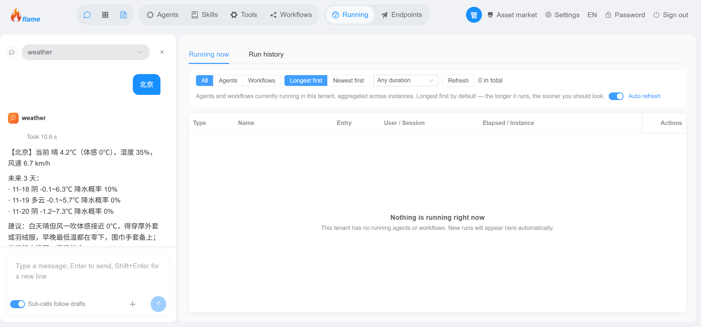
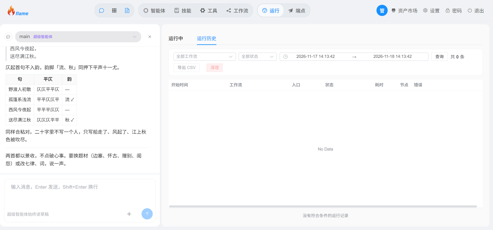
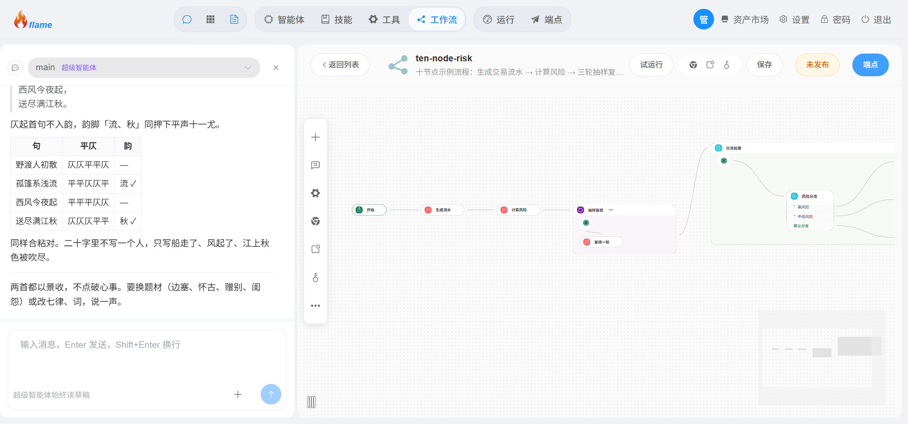
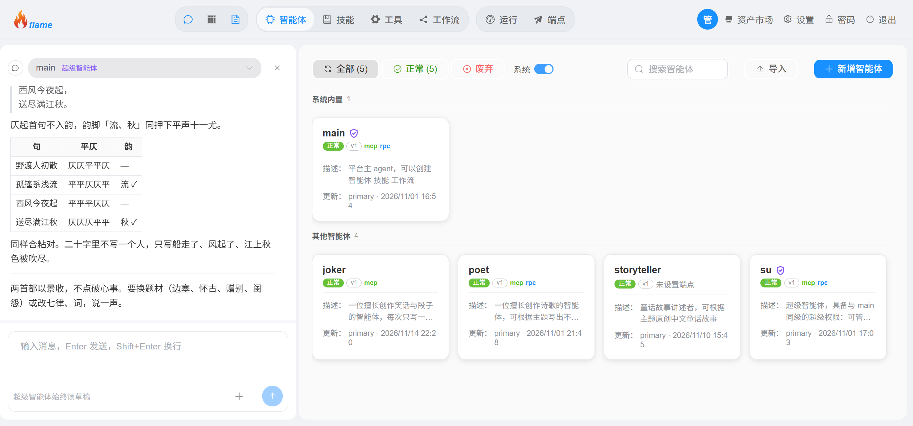
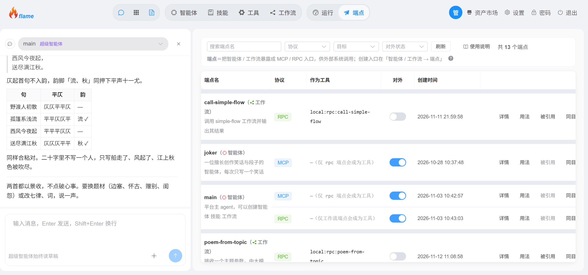
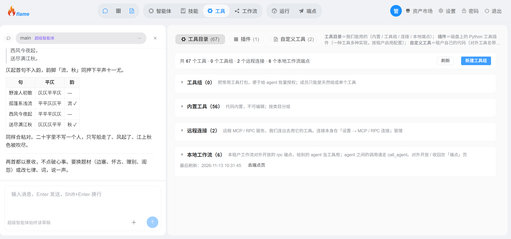

# flame

中文 | [English](README.md)

Go 写的多租户 AI Agent 平台。把「智能体 / 技能 / 工具 / 工作流」这些构建物管起来，把它们暴露成对外可调的端点（MCP / RPC），并在一个统一的运行台账里看到所有正在跑的东西。

配套一个 Vue 3 管理台（`desktop/`），租户端与平台端共用一套前端。

> **想直接跑起来？** `deploy/poc/` 是一个双容器演示（产品栈 + LiteLLM 网关），用 `docker compose` 一条命令起、只占一个端口——见 [`deploy/poc/README.zh.md`](deploy/poc/README.zh.md)。每次推送都会发布预构建镜像，跑起来不需要工具链。它是概念验证，不是生产部署。
>
> **想正式部署？** 每个 `v*` tag 会把五个生产镜像发布到 GHCR，并在该 Release 上挂一个宿主侧 tar 包，安装同样不需要工具链。[`deploy/prod/INSTALL.zh.md`](deploy/prod/INSTALL.zh.md) 是逐条命令的路径：先装一台（tier 1），再把同一套安装长到裸机执行器节点（tier 2）与跨机拆分（tier 3），全程不重装。各目录里有什么见 [`deploy/prod/README.zh.md`](deploy/prod/README.zh.md)。

## 功能

**构建物**

- **智能体**：提示词 + 模型 + 工具 + 技能的组合，可挂知识、可配工具权限、可设默认回复语言
- **技能**（Skill）：`SKILL.md` + 脚本的能力包，脚本在沙箱里跑
- **工具**：工具目录（MCP / RPC 等入向能力）、插件、自定义工具
- **工作流**：可视化编排（节点 / 连线 / 变量），带调试器、版本与发布

**运行**

- **运行台账**：跨实例看「现在在跑什么」（智能体 + 工作流），按类型 / 耗时过滤，可终止
- **运行历史**：跑完落库的记录，按工作流 / 状态 / 时间段查，可导出 CSV、单条或按条件清理
- **端点**：把智能体 / 工作流暴露成 MCP 或 RPC 入口，按租户开关「对外开放 / 收回对外」
- **沙箱**：脚本与命令在独立单元里执行（docker / nsjail / none 三档），带资源上限与断网开关

**平台**

- **多租户**：每租户一个 PostgreSQL schema，平台端统一开租户、发账号
- **资产市场**：跨租户上架 / 安装资产（上架 `listed` / 下架 `delisted`）
- **设置**：模型与连接、服务端认证（apikey / oauth）、全局变量（secret 静态加密）

## 界面一览

| 运行台账 · 跨实例看「谁在跑」、跑了多久，可按类型 / 耗时过滤并直接终止 | 运行历史 · 跑完落库的记录，按工作流 / 状态 / 时间段查，可导出 CSV |
|---|---|
|  |  |
| 工作流编排 · 节点 / 连线 / 变量，带调试器、版本与发布 | 智能体 · 提示词 + 模型 + 工具 + 技能的装配面 |
|  |  |
| 端点 · 把智能体 / 工作流暴露成 MCP / RPC，按租户开关对外 | 工具 · 工具目录 / 插件 / 自定义工具，三种来源统一管理 |
|  |  |

## 组成

| 目录 | 语言 | 作用 |
|---|---|---|
| `nexus/` | Go | 主服务：平台 API、租户 API、管理 API（默认 `:27006`） |
| `sandboxd/` | Go | 执行沙箱守护进程：脚本 / 命令的隔离执行（默认 `:27081`） |
| `sandboxg/` | Go | 沙箱网关：对 `nexus` 暴露统一 `/v1/*`，后端做负载均衡与粘性路由（默认 `:27080`） |
| `browserg/` | Go | 浏览器网关：对 `nexus` 暴露 `/v1/browser` 与聚合的 `/v1/capabilities`，按会话粘性路由到浏览器池实例，并执行租户配额（默认 `:27090`） |
| `browserd/` | Go | 独立浏览器池：一个会话一个 Chromium，自带容量上限、租户配额与空闲回收（默认 `:27091`） |
| `tools/` | Go | 各服务共用的本地库（`xhttp` / `xsql` / `xlog` / `sandbox` / `code` …） |
| `desktop/` | Vue 3 + Vite | 管理台（开发端口 `:5173`） |
| `deploy/` | Docker | 部署：`deploy/poc/` 是双镜像演示（产品栈 + LiteLLM 网关） |

依赖方向是单向的：三个服务用 `replace flame/tools => ../tools` 引用本地库，`tools` 不反向依赖任何服务。

```
浏览器 ── desktop ──> nexus ──┬──> PostgreSQL    业务数据（每租户一个 schema）
                              ├──> Redis         运行台账 / 停止信号 / 配额
                              ├──> LiteLLM       模型调用
                              └──> sandboxg ──> sandboxd ──> 隔离单元
                                                   （docker / nsjail / none）
```

## 设计要点

几条贯穿全仓的取舍，决定了这套东西在速度和边界上的表现。细节见 [`nexus/docs/design-highlights.md`](nexus/docs/design-highlights.md)。

- **端点在本租户进程内直调**：`rpc` 节点调 flow / agent 不走网络；stdio MCP 会话按连接复用子进程，配置变更才重建。
- **防环靠深度 + 祖先链，不靠计数器**：每次跨 run 都会新建 `ExecContext`、执行计数归零，所以只能让「层数」收敛。配置成 `-1` / `0`（不限）在这里**刻意不认** —— 纯 flow 的环只有这一道闸。
- **多租户 = 一租户一 schema + SQL 显式限定**：不依赖 `search_path`（连接池复用下不可靠）。配额与运行参数都是「系统硬顶 → 租户收紧 → 用户再收紧」的三层 clamp。
- **端点是一行「目标 × 协议」**：`exposed` 只表达「对外可见」，租户内部直调不受它限制；授权绑的是**目标**（agent / flow），不是端点 —— 端点可以重建，目标才是稳定身份。
- **热路径上少查一次库**：端点目录按运行快照、配置与配额走 Redis 读穿缓存（含负缓存）、运行参数在 run 开始时冻结一次。

## 环境要求

- Go **1.25+**
- Node **18+**（前端构建）
- PostgreSQL **14+**
- Redis **7+**
- LiteLLM Proxy（模型调用；不用模型可以关掉 `litellm.enabled`）
- 可选：Docker（`sandboxd` 的 `mode: docker`，生产推荐）、Consul（服务发现）

## 快速开始

### 1. 起依赖

本地起 PostgreSQL 与 Redis（默认端口 `5432` / `6379`），按需起 LiteLLM（`:4000`）。

### 2. 配 nexus

```bash
cp nexus/config.example.yaml nexus/config.yaml
```

然后编辑 `nexus/config.yaml`，至少改这几项：数据库连接、`jwt.secret_key`、`litellm.master_key`。

也可以全部走环境变量（`${VAR}` 会在 YAML 解析前展开）：

```bash
# Linux / macOS
export JWT_SECRET="$(openssl rand -base64 48)"
export LITELLM_MASTER_KEY="sk-..."
# Windows PowerShell
$env:JWT_SECRET = [Convert]::ToBase64String([byte[]](1..48 | ForEach-Object { Get-Random -Maximum 256 }))
```

> `jwt.secret_key` 泄露等于任何人都能自签 token 操作任意租户，务必用随机值，不要提交到仓库。
> 真正的 `nexus/config.yaml` 已被 `.gitignore` 排除。

### 3. 起服务

```bash
# nexus
cd nexus && go run ./cmd

# sandboxd（另开一个终端）
cd sandboxd && go run ./cmd/sandboxd

# 网关（可选，多后端负载均衡时才需要）
cd sandboxg && go run .
```

`sandboxd` 默认 `mode: none`（宿主直通、只用于本机开发）。生产请切到 `docker` 或 `nsjail`，
配置见 `sandboxd/config.yaml`。

### 4. 起前端

```bash
cd desktop
npm install
npm run dev      # http://localhost:5173
```

开发服务器把 `/nexus` 代理到 `http://localhost:27006`（见 `desktop/vite.config.js`）。

## 目录结构

```
nexus/
  admin/          管理端接口（平台 + 租户）
  service/        业务服务（agent / flow / capability / market …）
  shared/         配置、仓储、鉴权、日志
  platform/       平台初始化与租户模板（含 agent 定义域模板）
  docs/           术语、沙箱设计、工作区布局等文档
sandboxd/         隔离执行（docker / nsjail / none）+ codehost
sandboxg/         沙箱网关
browserd/         独立浏览器池（一会话一个 Chromium）
tools/            公共库
desktop/          Vue 3 管理台
```

## MCP 协议版本

端点只讲 **MCP `2026-07-28`**：无状态的那一版——没有 `initialize` 握手、没有协议层会话，每个请求在
`params._meta` 里带 `protocolVersion` / `clientInfo` / `clientCapabilities`。默认走旧协议的客户端会在传输层被直接
拒绝；具体的失败形态和出站（客户端）一侧见 [`nexus/docs/mcp-support.md`](nexus/docs/mcp-support.md)。

## RPC 协议

除了 MCP，端点还可以暴露成**普通 JSON-RPC 2.0 接口**（`protocol = rpc`）。它仍是同一行 `svc_endpoints`、同一个目标、
同一套 `exposed` 语义，区别只在信封——已经会说 MCP 的调用方认得这些负载。

**它的独特价值，在于第三方协议结构上给不了的东西。** MCP 是把互操作押在别人的客户端上；rpc 是版本、错误语义与调用
上下文都由自己定义的那一个。由此有三件事，是「只有 MCP 一个面」拿不到的：

- **唯一的租户内能力总线。** agent 能拿到的 `local__<endpoint>` 工具只开 rpc 端点；MCP 端点完全不进授权体系，因为
  内部发起的调用刻意不校验 `exposed`。「让自己的 agent 调自己的子流程、又不对外开放」这条路只有 rpc 能走。
- **唯一能承载调用链的通道。** 循环防护需要跨 run 的状态——每一跳都新建 `ExecContext`，计数器会归零。这条链写进了
  线协议（跨进程 `params._meta.call_chain`，进程内 `_call_chain`，入口统一剥离，模型看不到），于是 `f → a → f` 在
  第 2 跳就被拒绝，而不是一直跑到深度上限：一次尝试替代一整个预算，也就不会留一群 worker 互相等着。
- **唯一不会把业务拒绝报成服务端故障的地方。** 标准码只表示「你发的东西有问题」；配额超限（`-32000`）、调用成环
  （`-32001`）、配置错误（`-32002`）落在实现自定义区间，于是把 `-32603` 当成「服务器坏了」的客户端，不会为调用方
  自己的配额问题去惊动运维。

这份能力之所以便宜，是因为孪生纪律守住了：版本走信封（`version`，只有主版本，不传等于最低版本），结果与
`tools/list` 保持 MCP 形状，暴露是按**目标**切的开关——收回时一条语句让该目标下所有协议一起下线，所以多一种协议
只多一行，不是多一个开关、也不是多一次授权。

它仍然不是 MCP 的替代品：没有第三方生态，只有 tools 面（没有 resources / prompts / sampling）。这笔取舍很直白——
MCP 买的是触达，rpc 买的是掌控，而「一个目标 × 一种协议 = 一行」让同一个目标可以同时拥有两者。理由见
[`nexus/docs/design-highlights.md`](nexus/docs/design-highlights.md)。

## 文档

- `nexus/docs/terminology.md` — 术语与动作词约定（改代码前建议先读）（[中文版](nexus/docs/terminology.zh.md)）
- `nexus/docs/sandbox-design.md` — 沙箱隔离设计与三条执行通道（[中文版](nexus/docs/sandbox-design.zh.md)）
- `nexus/docs/mcp-support.md` — MCP 支持：只支持 `2026-07-28`、为什么是无状态的、握手失败长什么样（[中文版](nexus/docs/mcp-support.zh.md)）
- `nexus/docs/deployment.md` — 部署方案：单机原生布局、产物清单、多实例需要的旋钮（[中文版](nexus/docs/deployment.zh.md)）
- `nexus/docs/deployment-runbook.md` — 部署操作手册：三档形态、配置、首启、升级、备份、验收与排障
  （[中文版](nexus/docs/deployment-runbook.zh.md)）
- `nexus/docs/workspace-layout-and-supervisor-power.md` — 租户工作区布局（[中文版](nexus/docs/workspace-layout-and-supervisor-power.zh.md)）
- `nexus/docs/design-highlights.md` — 设计要点：调用链防环、多租户配额、端点模型（[中文版](nexus/docs/design-highlights.zh.md)）
- `nexus/docs/i18n-plan.md` — 中英双语的分层方案、成本与坑位（[中文版](nexus/docs/i18n-plan.zh.md)）
- `nexus/docs/error-codes.md` — 业务错误码规范（UI 双语的前置条件）（[中文版](nexus/docs/error-codes.zh.md)）
- `nexus/docs/node-audit.md` — 逐节点审计：每个节点类型查哪些维度、哪些已由测试或门禁保证、哪些还要继续审计
  （[中文版](nexus/docs/node-audit.zh.md)）
- `nexus/docs/parallel-scope.md` — 并发重做方案：每个执行体一个并发作用域、取消 `fork` / `wait`，以及让成员失败无处可丢的规则
  （[中文版](nexus/docs/parallel-scope.zh.md)）
- `browserd/README.md` — 独立浏览器池：nexus 如何访问、如何构建与部署、哪三项配置必须对齐
  （[中文版](browserd/README.zh.md)）
- `browserg/README.md` — 浏览器网关：粘性路由、租户上限，以及为什么它不并进 sandboxg
  （[中文版](browserg/README.zh.md)）
- `AGENTS.md` — 模块地图与跨领域红线

## 安全提示

- `nexus/config.yaml`、`desktop/.env` 都是本机配置，不入库。
- `nexus/data/`（租户工作区）被忽略，不会被提交。
- 生产部署前请改掉默认口令，并给 `sandbox` / `sandboxg` 配 token。

## 许可

[Apache License 2.0](LICENSE)
