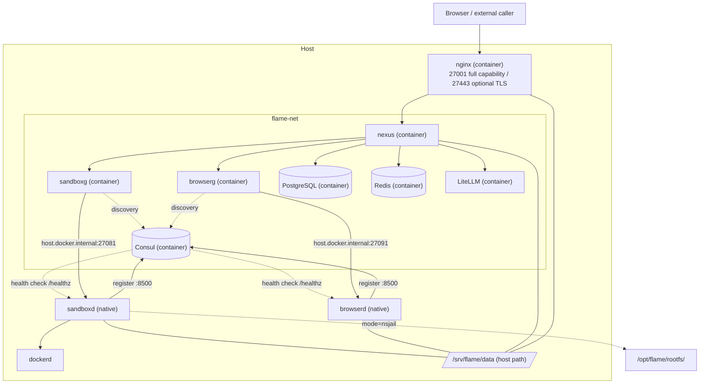

# Flame deployment plan

[中文](deployment.zh.md) | English

> Status: **design settled, not verified**. Everything marked `TODO(verify)` is an estimate, not a measurement.
> Scope: one ordinary Linux host can run the whole stack — one compose file as the launcher, systemd for boot and
> restart. When the stack grows to several machines, this plan only ships the components and the knobs.
>
> The `deploy/prod/` inventory in §5.1 is a **specification**, not a description of files that exist today.
>
> Step-by-step commands, configs and acceptance checks: [`deployment-runbook.md`](deployment-runbook.md).

---

## 1. Goals and scope

### 1.1 Goals

1. One set of artifacts that runs the complete product on **a single ordinary Linux host** — a compose file as launcher,
   systemd for boot and restart, no Kubernetes and no cluster.
2. Every component can be **released, configured and rolled back on its own**: the image tag is separate from the
   configuration, and a rollback is one variable.
3. When the deployment grows to several machines, the operator only decides *how many*, *on which port* and *who load
   balances* — no code changes.

### 1.2 Non-goals

- Kubernetes, Ansible and other orchestration / configuration-management layers;
- autoscaling and service mesh;
- anything beyond multi-tenant isolation (data-residency and model-compliance questions are product concerns).

### 1.3 Delivery shape

| Shape | Carries | Why |
|---|---|---|
| **Native** (systemd + binary) | `sandboxd` + `codehost`, `browserd` + `browserhost`, `nsjail` | they need the host's docker daemon, the host's Chromium, setuid and a local profile directory; in a container the paths stop meaning the same thing and the boundary inverts |
| **Container** (one `flame-net`) | `nexus`, `sandboxg`, `browserg`, `nginx`, `postgres`, `redis`, `litellm`, `consul` | no host state; service-name addressing; the host needs no Python, PostgreSQL, Redis or nginx package |
| Host level | Docker Engine, systemd | container runtime and process supervision |

One sentence: **whatever holds a host privilege or a host device runs native; everything else runs in a container.**

---

## 2. Decisions

| # | Decision | Rationale |
|---|---|---|
| 1 | No Kubernetes, no Ansible; one compose file as the single-host launcher | "installable on one host, splittable across many"; compose only launches, it does not schedule |
| 2 | Only the executors run native: sandboxd, browserd (with codehost / browserhost / nsjail) | sandboxd's entire job is `docker run -v <host path>`; in a container the path stops meaning the same thing, and mounting the socket hands host-root to an isolated component |
| 3 | Everything else is containerised: nexus, both gateways, nginx, PostgreSQL, Redis, LiteLLM | immutable artifacts; no Python or database packages on the host; capability versions match the image |
| 4 | **Only nginx publishes an external port** (27001, optionally 27443); the intranet gets exactly two things: Consul's 8500, and — when nexus spans machines — the data plane (PG 5432 / Redis 6379 / LiteLLM 4000), bound to `FLAME_BIND_IP` (loopback on one host, intranet when scaled) | every other container omits `-p`, so PostgreSQL's authentication surface never reaches the host or the public network. Both 8500 and the cross-machine data plane exist precisely because they must be reachable across machines, so they bind loopback or an intranet interface, are firewalled to the platform's own nodes, and never go through nginx; the full conditions are in §9.3 |
| 5 | A release is identified by an image tag, one shared `FLAME_TAG` | rollback is one variable; no "new nexus, old gateway" drift |
| 6 | One sandboxd per docker daemon (one per node) | the startup sweep deletes containers by a global label, so a shared daemon means deleting each other's work |
| 7 | One browserd per node; capacity grows through `workers` | it owns Chromium and the profile directory |
| 8 | One sandbox `mode` per platform | nexus holds a single `sandbox.url`; mixing modes makes the capability snapshot lie and the capacity score incomparable |
| 9 | The nsjail rootfs is derived from the image, never maintained separately | one build definition, two materialisations, no drift |
| 10 | The shared path is fixed at `/srv/flame/data` and mounted at the **same path** inside containers | sandbox bind mounts, screenshots and downloads all use one absolute path |
| 11 | Platform SQL runs as a separate migrate job | several nexus replicas running DDL on startup means lock waits and half-applied state |
| 12 | PostgreSQL 18 comes from the official image | version matches upstream and is identical across distros; the data directory is still local block storage |
| 13 | TLS terminates at nginx; nexus speaks plaintext only | nexus has no TLS code; nginx is required anyway; one certificate instead of one per instance |
| 14 | 27001 is the full-capability entry; 27443 is an optional layer | with no certificate `listen ... ssl` makes nginx refuse to start, so TLS can only be additive |
| 15 | Three native binaries ship; `seedpoc` does not | the rest go into images; `seedpoc` only seeds a demo environment |
| 16 | Configuration and tenant data never enter an image | day-to-day operations (new skills, edited `AGENT.md`, asset listing) rebuild nothing |
| 17 | A dedicated dockerd is optional and off in v1 | `flame-docker.service` ships disabled; enable it when stronger isolation is wanted |
| 18 | Images and native binaries share one version number | two rails must not become two version lines |
| 19 | First-boot seeding is a separate bootstrap job, never something nexus does on startup | the box is usable out of the box without making "create a default-password admin" a per-boot behaviour |
| 20 | bootstrap registers no model and embeds no provider key | an install script must not guess a key; the administrator adds one after the first login, as the README states |
| 21 | The seed content matches the PoC, including the default password and the fixed API key | deploy and PoC run the same scripts, so validation covers both; the risk is documented in the README rather than forking the seed |
| 22 | Consul is enabled by default and runs in a container alongside everything else; single host and multi-host share one configuration; 8500 is published on the intranet only | it is accessed **in both directions** — executors register, gateways discover — so running it on the host adds a second host dependency and its own upgrade path; in a container it is just `consul:8500`. When scaled out, every node's executor registers with the first host's 8500 and a `service_id` derived from name+address+port keeps the instances apart automatically, so no per-node agent is needed. Defaulting it off forks the single-host and multi-host configurations, and "add a second sandbox node" is exactly the moment discovery matters |

---

## 3. Topology

### 3.1 Single host



### 3.2 Scaling out

Only sandboxd and browserd are replicated per node; nexus and the two gateways are replicated **on one host** by
default. Every container-to-container call goes through `flame-net` service names. Spreading nexus across machines
requires the data plane (PostgreSQL / Redis / LiteLLM) to be reachable from the nexus nodes; the cost and conditions
are in §9.3.

- sandboxd and browserd register themselves in Consul and the gateways discover them; a static `backends` seed is a
  fallback, not the single-host alternative (one host and many hosts share one configuration, see decision 22);
- Consul is always on but not a hard dependency: a failed pull keeps the current pool. The gap is a gateway that
  **restarts while Consul is unreachable** — it then only has the seed;
- **a container reaching a native executor needs an explicit path**, see the sixth constraint in §6.2.

---

## 4. Components

### 4.1 Services

| Component | Shape | Port | State | Multi-instance |
|---|---|---|---|---|
| nginx | container | **27001 published** (+27443 optional) | frontend assets, mounted certificates | yes (behind an LB) |
| nexus | container | 27006 (not published) | shared storage, plugin directory | yes (same keys, same PG · Redis · storage) |
| sandboxg | container | 27080 (not published) | none (stickiness in Redis) | yes (Redis required) |
| browserg | container | 27090 (not published) | none (stickiness in Redis) | yes (Redis required) |
| sandboxd | native | 27081 (intranet: gateway and Consul) | docker daemon, `tmp_dir` | **one per node** |
| browserd | native | 27091 (intranet: gateway and Consul) | Chromium, `profile_root` | **one per node** |
| PostgreSQL | container | 5432 (`flame-net` only; intranet when nexus spans machines) | named volume (local disk) | primary / standby |
| Redis | container | 6379 (`flame-net` only; intranet when nexus spans machines) | named volume (AOF) | Sentinel / managed |
| LiteLLM | container | 4000 (`flame-net` only; intranet when nexus spans machines) | its own database | yes (same salt key) |
| Consul | container | 8500 (intranet interface only; `consul:8500` inside `flame-net`) | named volume (the catalog is rebuildable from re-registration) | single-node server; for redundancy add the same image as a server elsewhere and `retry_join` |

### 4.2 What is inside `flame/sandbox`

| Category | Content |
|---|---|
| Interpreters | Python 3.13 (`/usr/local/bin/python` → `python3`), Lua 5.4, Node 24, bash |
| Python packages | openpyxl, xlrd, pandas, numpy, requests, python-docx, beautifulsoup4 — installed and byte-compiled at build time |
| System tools | coreutils (`sleep` for the resident command), procps (`pkill`/`pgrep`/`ps`), passwd, ca-certificates |
| Fonts | fonts-liberation, fonts-noto-cjk |
| Our own binary | `/usr/local/bin/codehost` — resident inside the unit, forks a fresh interpreter per execute |
| Runtime constraints | non-root `1000:1000`, read-only rootfs, no `ENTRYPOINT`, `CMD sleep infinity` |

**Deliberately absent**: nexus, sandboxd, browserd, PostgreSQL, Redis, nginx, a browser, `curl`, `git`, `jq`, `pip`,
`gcc`, global npm packages, network access.

The consequence must be stated: `pip install` inside an agent script always fails (no network plus a read-only rootfs);
a new dependency means editing the Dockerfile and rebuilding.

### 4.3 The other images

| Image | Content | Note |
|---|---|---|
| `flame/nexus` | nexus, backfillversions, **bootstrap**, the Python interpreter and dependencies plugins need | the host needs no Python; bootstrap must come from the same module as provisioning, see §7.2 |
| `flame/gateway` | sandboxg and browserg (one image, selected by `ARG` / entry argument) | distroless-like, no shell |
| `flame/web` | nginx configuration + frontend assets | certificates and shared storage are mounted, never baked in |
| `postgres:18.<minor>` | upstream | named volume + initdb.d scripts |
| `redis:7-alpine` | upstream | requirepass + AOF |
| `hashicorp/consul` | upstream | single-node server; `retry_join` when it spans hosts |
| LiteLLM upstream image | upstream | the `-database` variant |

---

## 5. Layout

### 5.1 In the repository (`deploy/prod/`, to be created)

```
deploy/prod/
├─ README.md / README.zh.md            preflight, quickstart, decision record
├─ compose.yaml                        single-host composition (nexus / gateways / web / PG / Redis / LiteLLM / consul)
├─ compose.multi-host.yaml             multi-host overlay: ports only, loaded by COMPOSE_FILE
├─ build.sh                            three native binaries + frontend → out/
├─ images/
│  ├─ nexus.Dockerfile                 nexus + backfillversions + the Python plugins need
│  ├─ gateway.Dockerfile               sandboxg / browserg, same shape
│  ├─ web.Dockerfile                   nginx + dist + site configuration
│  └─ sandbox.Dockerfile               reuses the sandboxd/Dockerfile build context
├─ config/
│  ├─ nexus.yaml                       everything as ${VAR}
│  ├─ sandboxd.yaml                    mode + registry + both isolation sections
│  ├─ sandboxg.yaml                    discovery + sandbox_token + backends seed
│  ├─ browserd.yaml                    shared workspace_root + local profile_root
│  ├─ browserg.yaml                    discovery + max_per_tenant + redis
│  ├─ nginx/
│  │  ├─ flame-common.conf             the maps, defined once at http level
│  │  ├─ flame-locations.inc           every business location, shared by both entries
│  │  ├─ flame-http.conf               listen 27001, full capability
│  │  └─ flame-tls.conf                listen 27443 ssl, optional
│  ├─ postgres/
│  │  ├─ 10-litellm-db.sql             initdb.d: roles and databases only, never platform SQL
│  │  └─ 90-admin.sql                  the first platform administrator `plat`; applied last by migrate, outside the file-set check
│  └─ redis/redis.conf                 requirepass + appendonly yes
├─ env/
│  ├─ flame.env.example                version tag, keys, paths, and the deployment-shape switch (FLAME_BIND_IP / COMPOSE_FILE)
│  ├─ sandboxd.env.example             CONSUL_HTTP_TOKEN (no token field in yaml; the address lives in registry.address)
│  └─ SECRETS.md                       blast radius and rotation risk per variable
├─ systemd/
│  ├─ flame.service                    `docker compose up -d` — the only container entry
│  ├─ flame-migrate.service            oneshot, `compose run --rm migrate`
│  ├─ flame-sandboxd.service           native, After=docker.service
│  ├─ flame-browserd.service           native
│  └─ flame-docker.service             optional, not enabled by default
├─ scripts/
│  ├─ build.sh      images.sh     install.sh
│  ├─ init-db.sh    migrate.sh    health.sh
├─ sql -> ../../nexus/platform/sql     symlink; a single source of truth
└─ docs/                               added once validation has real numbers
```

### 5.2 On the host (`install.sh` creates these, idempotently)

```
/opt/flame/releases/<ver>/{bin,static,web,compose*.yaml}  +  current -> releases/<ver>
/opt/flame/rootfs/<ver>/                                  nsjail rootfs, exported from the image
/etc/flame/{flame.env, sandboxd.yaml, sandboxd.env, browserd.yaml}
/etc/flame/tls/{fullchain,privkey}.pem                    optional; present enables 27443
/srv/flame/data/{tenants,platform-assets,plugins}
/var/lib/flame/{sandboxd/tmp, browserd/profiles}
/var/log/flame/<service>/
```

`/opt/flame/rootfs/<ver>` is one directory per image generation, and it is **exported, not built**: the tree comes out of
`flame/sandbox:<ver>`, so the two modes can never drift. Two things do not survive that export — `docker export` carries no
device nodes, so `/dev/null`, `/dev/zero`, `/dev/random`, `/dev/urandom` and `/dev/tty` must be created with `mknod`
before the jail is usable; without them nsjail starts, the first exec fails, and the language is reported unavailable
rather than broken. Mark `read_only_rootfs: true` afterwards: a rootfs that can be edited at runtime is a rootfs that
silently diverges from its image. Recipe and the commands that prove it works: runbook §5.3.

Persistent Docker state: the `flame-pg`, `flame-redis` and `flame-consul` named volumes, plus the `flame-net` network.
`flame-consul` holds the service catalog only, so losing it is equivalent to a reinstall: executors re-register
periodically and come back on their own.

### 5.3 Three asymmetries

- **nexus has no `-config` flag**: it reads `./config.yaml` from its working directory, so the container sets
  `working_dir: /etc/flame` and mounts the file. The other four services take `-config <path>`.
- **Shared storage must be mounted at the same path inside containers** (`/srv/flame/data:/srv/flame/data`). Mounting it
  elsewhere does not fail, it just gives nexus and sandboxd two different views of the same "directory".
- **Executors roll through the `releases/` symlink; containers roll through image tags.** Both share one version number.

---

## 6. Configuration

### 6.1 Per service

| Service | Key points |
|---|---|
| `compose.yaml` | every container joins `flame-net`; only `web` has external `ports`, and `consul` additionally publishes `${FLAME_BIND_IP}:8500:8500` (loopback on one host, intranet when scaled); PG / Redis / LiteLLM `ports` live only in `compose.multi-host.yaml`, not loaded on a single host; `nexus` and `web` mount `/srv/flame/data:/srv/flame/data`; `web` also mounts the certificates; `postgres` mounts its volume and `initdb.d`; `consul` mounts `flame-consul`; both gateways **and `consul`** need `extra_hosts: host.docker.internal:host-gateway` — the health check is issued by consul, so it must resolve `service_addr` too |
| nexus | `sandbox.url` → `ws://sandboxg:27080`, `browser.url` → `ws://browserg:27090` (service names); `storage.root_dir=/srv/flame/data`; `download.x_accel_prefix=/__files`; `db.host=postgres`, `redis.addrs=[redis:6379]`, `litellm.url=http://litellm:4000` (across machines these become the first host's intranet address, see §9.4) |
| sandboxd | `mode` is the switch; `allowed_mount_roots` must be **literally equal** to nexus's `storage.root_dir`; `tmp_dir` is machine-local and exclusive; `listen` on `0.0.0.0:27081`; `registry.service_addr` left empty is derived from `listen` (a concrete address is used as-is, a wildcard goes through `advertise_iface` or the hostname) and a failed derivation — or a loopback result while the registry is remote — **refuses to start**; `service_port` is gone (the port always follows `listen`); `service_id` defaults to `<name>-<address>-<port>`, no hand-tuning |
| consul | a single-node server (`-bootstrap-expect=1`) with its data in `flame-consul`; 8500 binds `FLAME_BIND_IP` (loopback on one host, intranet when scaled), containers use `consul:8500`; an executor's ID is derived from its address and therefore unique, no configuration needed. With ACLs on, executors pass `CONSUL_HTTP_TOKEN`. To remove the single point of failure, start the same image as a server on another host and `retry_join` it to the first |
| sandboxg | `discovery.type=consul` plus `discovery.address=consul:8500` and a **required** `sandbox_token`; the `backends` seed is a fallback only and **must not say `127.0.0.1`** (loopback inside the container is the gateway itself) — delete it or use `host.docker.internal:27081`; `sticky_ttl_sec ≥ interactive_idle_sec + 2×janitor_sec` |
| browserd | `workspace_root` is the same directory as nexus's storage root; `profile_root` is machine-local; `max_per_tenant: 0` |
| browserg | `max_per_tenant` is the only enforcement point; Redis is required |
| nginx | 27001 is the full-capability entry: static site, `/nexus/` stripped, `/service/` kept, `/__files/` as `internal` with an `alias`, WebSocket upgrade; 27443 is the optional TLS layer, see §6.4 |
| PostgreSQL | `/docker-entrypoint-initdb.d` runs **only when the data directory is empty**, so it creates roles and the `litellm` database only; platform SQL stays with `migrate.sh`; use a named volume, not a bind mount (uid 999); `shm_size` ≥ 256 MB or parallel queries fail on the 64 MB `/dev/shm` |
| Redis | `requirepass` + `appendonly yes`; `noeviction` (caches and quota counters share it) |

### 6.2 Seven hard constraints

1. **The shared storage path is identical everywhere and mounted at the same path inside containers** — a mismatch does
   not fail loudly, it silently loses files.
2. **The sandbox uid (1000) matches the uid the nexus container runs as** (`user: "1000:1000"`) — otherwise files written
   by a script cannot be read or deleted by the tenant.
3. **`interactive_idle_sec` and `janitor_sec` are identical across the fleet** — a gateway pulls the capability snapshot
   from *one* instance to validate its own `sticky_ttl`.
4. **Pool settings are not portable between modes** — nsjail cold-starts in ~10 ms and needs nothing resident; docker
   costs 300 ms–1 s, which is what `idle.max` exists to amortise.
5. **Only nginx publishes an external port; the only intranet exceptions are Consul's 8500 and the data plane of a
   cross-machine nexus (§9.3); no container mounts the docker socket** — the first keeps PostgreSQL's authentication
   surface off the public network and the registration entry point intranet-only, the second keeps the isolation
   boundary from inverting.
6. **`registry.service_addr` may be left empty; when written it must be an address both the gateway and Consul can
   dial** — empty derives it from `listen` (a concrete address is used as-is; a wildcard goes through
   `advertise_iface` or the hostname). A failed derivation, or a loopback result while the registry is remote,
   **refuses to start** instead of registering an entry that stays critical forever. When written explicitly, a single
   host uses `host.docker.internal` (which requires `extra_hosts: host.docker.internal:host-gateway` on the gateways
   **and on `consul`**) and multiple hosts use an intranet address. The same address serves two things: the gateway
   dials it, and the Consul agent's HTTP health check probes it.
7. **The `/v1/code` channel has no egress, in either mode, with no knob** — the request frame carries no egress intent
   (the channel is shared across tenants, so a snippet cannot be attributed), and the daemon pins the code worker to
   `Egress: false`, which becomes `--network none` under docker and `--iface_no_lo` under nsjail. The capability report
   says `code: off`; a sandbox that contradicts its own report is worse than a misconfiguration, because the agent is told
   something false about its runtime and has no way to notice.

Constraint 6 deserves an honest note: containerising moves the cross-boundary link from *native → container* to
*container → native*; it does not remove it. What it buys is immutable artifacts and no Python on the host; what it costs
is that both the gateway and consul need a path to the executor, which must be configured in two places (compose and
`sandboxd.yaml`) or it shows up as "sandboxd unreachable" or "registered but never healthy".

### 6.3 Switching the sandbox mode

| Knob | docker | nsjail |
|---|---|---|
| `mode` | `docker` | `nsjail` |
| Runtime source | `docker.image: flame/sandbox:<ver>` | `nsjail.rootfs: /opt/flame/rootfs/<ver>` |
| Host dependency | dockerd + docker CLI | nsjail (setuid root) |
| Egress | `docker.network: bridge` | requires `--disable_clone_newnet`; **`/v1/code` is offline in both modes** (constraint 7) |
| Interpreter names | from the image; `lua` / `python` resolve through the image's own PATH | the rootfs comes from the image too, so the same names are there — but the resolution must follow symlinks **inside** the rootfs (`/usr/local/bin/lua` → `/usr/bin/lua5.4`, an absolute target); a host-side `stat` sees a dangling link and the name reaches nsjail unresolved, which fails as "language unavailable, exit 255" |
| Pooling | L2 container reuse | L3 only (jail and interpreter share a lifetime) |

nsjail is installed **setuid root** while sandboxd keeps running as the `flame` user, so switching modes changes neither
the unit nor the user. The cost must be written down: this gives `flame` a controlled privilege escalation path, and the
security boundary becomes nsjail's own argument validation.

### 6.4 TLS and the entry ports

**TLS terminates at nginx; nexus speaks plaintext only. 27001 is the full-capability entry, 27443 is an optional layer.**

Rationale: nexus has no TLS code (no `ListenAndServeTLS` / `tls.Config` anywhere); nginx is required anyway; one
certificate instead of one per instance; nexus uses no cookies (auth is `Authorization: Bearer`), so the backend never
needs to know whether a request arrived over HTTPS.

| Scenario | 27001 | 27443 | Use |
|---|---|---|---|
| **A no certificate (default)** | `0.0.0.0` or the intranet address, full capability | absent | intranet deployments, first bring-up |
| **B local certificate** | `127.0.0.1`, full capability | `0.0.0.0`, full capability over TLS | serving HTTPS directly |
| **C TLS terminated upstream** | intranet address, full capability | absent | a cloud LB or corporate gateway in front |

Same capability, different exposure. With no certificate `listen ... ssl` makes nginx refuse to start
(`[emerg] cannot load certificate`), so TLS can only be additive.

A `map` may be defined only once, at http level (`flame-common.conf`); two copies fail with `duplicate map`. Enabling:
`install.sh` symlinks `flame-tls.conf` when the certificate exists and otherwise installs only `flame-http.conf`.

**Security precondition: full capability means Bearer tokens travel in cleartext.** A binds to the intranet, B narrows
27001 to `127.0.0.1`, C accepts traffic from the LB only.

Forwarded headers go through a map, never a bare `$scheme`:

```nginx
map $http_upgrade $connection_upgrade { default upgrade; '' close; }
map $http_x_forwarded_proto $fwd_proto { default $scheme; https https; }
```

Otherwise in scenario C nexus always sees `http` — harmless today, but an OAuth callback or an emailed link will trip on
it later.

Certificate issuance is tied to the port choice: 27443 means **DNS-01** (HTTP-01 needs 80, TLS-ALPN-01 needs 443). When
the DNS provider offers no API, the options are briefly opening 80 or a corporate CA. On RHEL-family systems under
SELinux enforcing the port also needs `semanage port -a -t http_port_t -p tcp 27443`.

---

## 7. Install

```bash
./scripts/build.sh                                  # three native binaries + frontend
./scripts/images.sh --tag $FLAME_TAG                # four images plus the sandbox image and rootfs
sudo ./scripts/install.sh --tag $FLAME_TAG --check  # preflight + placement + units
docker compose up -d postgres redis litellm         # data plane first
./scripts/migrate.sh                                # compose run --rm migrate
docker compose run --rm bootstrap                   # platform admin + t0 seed, see §7.2
systemctl enable --now flame-sandboxd flame-browserd
docker compose up -d                                # nexus / gateways / web
./scripts/health.sh
```

### 7.1 Preflight

| Check | Command | Consequence when missing |
|---|---|---|
| Docker and the compose plugin | `docker info && docker compose version` | nothing starts |
| Shared storage really mounted | `findmnt -T /srv/flame/data` | files are silently lost |
| Images present | `docker image inspect flame/nexus:$FLAME_TAG` and friends | containers fail to start |
| Sandbox image / rootfs | `docker image inspect flame/sandbox` / directory exists | the first exec fails |
| Chromium and fonts | `command -v chromium` | the browser tool reports "unavailable" |
| nsjail | `nsjail --version`, setuid bit, `/sys/fs/cgroup` writable | nsjail mode is unavailable |
| Ports | 27001 (+27443) + 27081 / 27091 (intranet: gateway and Consul) + 8500 (intranet) | startup fails, or a service stays registered but never healthy |
| Certificate (optional) | present under `/etc/flame/tls/` enables 27443 | not an error — the stack runs as scenario A |
| Memory | ≥ 6 GB without a browser, ≥ 10 GB with one | OOM under load |

The host no longer needs `python3`, `psql`, or distribution PostgreSQL / Redis packages — they live in images.

`migrate.sh --check` reproduces the PoC's invariant: the file set under `nexus/platform/sql/` must equal the execution
list exactly.

### 7.2 First-boot seed data

The seed lives in **two schemas**, with the same content as the PoC; only the carrier differs per schema:

| Schema | Seed content | Source |
|---|---|---|
| `platform` | platform tables, provider presets (`llm_provider_presets` / `llm_presets_seed`), limit defaults (`zz_limit_defaults`), capability gates (`capability_gates` / `plugin_gates` / `tenant_plugins`), and the first platform administrator `plat` | `nexus/platform/sql/*.sql` in dependency order, then `config/postgres/90-admin.sql` last |
| `t0` | tenant tables, definition files materialised to disk (`main`'s `AGENT.md`, the four protected skills), the registry row, the tenant administrator, every capability, the API key | `docker compose run --rm bootstrap`, equivalent to the PoC's `seedpoc` |

**`platform` is pure SQL; `t0` has to be a command** — that is not a trade-off, it is how the PoC splits it too:
`90-admin.sql` only creates an account, while t0's `AGENT.md` and skill files are materialised by `seedpoc` through
`provision.Provision`, because SQL cannot write files.

What `bootstrap` does (equivalent to `seedpoc`, every step idempotent):

| Step | Content | On a second run |
|---|---|---|
| 1 | platform administrator `plat` (`auth.BootstrapAdminName`, a code constant, not configurable); password defaults to `12345678`, overridable with `FLAME_ADMIN_PASSWORD` | **the password is left alone** when the user exists |
| 2 | platform user `user01` as the owner of t0 | reused when present |
| 3 | tenant `t0`, display name `Default tenant`: `provision.Provision` creates the tables, materialises the definition files and writes the registry row; tenant administrator `provision.DefaultAdminName` with the same password | skipped; existing data is preserved |
| 4 | verify `main` still holds the supervisor privilege and the four protected skills are present | failure aborts — this is the root cause of "the console is empty" |
| 5 | grant t0 **every** capability (`capability.All()`, the same list the PoC uses) | idempotent |
| 6 | create the API key for t0's primary user, default `sk-poc-t0-primary` | reused when present |

**Only two things differ from the PoC, and neither changes the seed content**:

- **when it runs**: the PoC runs `seedpoc` on every container start; production runs `bootstrap` once, explicitly, during
  install or upgrade. Both are idempotent, so a second run only fills in what is missing;
- **where the credentials go**: the PoC prints them to stdout; production also writes
  `/etc/flame/initial-credentials.txt` (`0600`, owned by `flame`) and prints the path, with `--print` to send the
  plaintext to stdout.

**Two warnings that belong in the README** (they do not change the design, they document it):

1. `12345678` and the fixed API key `sk-poc-t0-primary` are the PoC's values — change the password at the first login and
   rotate or delete that key;
2. what `plat` protects is its profile / role / status and its deletion; the password itself can be changed.

**No model is registered.** After install the console holds one `main` agent and an empty model list — a model needs a
provider key, and the PoC does not seed one either. Three steps after the first login: sign in as `plat` with the default
password → change it → add a model; only then is `main` usable.

**Not overwriting an existing tenant** is deliberate: overwriting would erase whatever an administrator changed in t0.
Refreshing t0's definition files after a template change is `tenantmigrate` (§11 item 8), not bootstrap.

**Two one-shot services in compose**: `migrate` (the `postgres` image running psql, with `90-admin.sql` applied last) and
`bootstrap` (the `flame/nexus` image with an overridden `entrypoint`). Both need the same `user: "1000:1000"` and storage
mount as nexus — otherwise the files bootstrap writes are owned by the wrong uid and neither nexus nor the sandbox can
read them.

---

## 8. Release and rollback

### 8.1 Six kinds of change, six paths

| Change | Action | Cost |
|---|---|---|
| Go code / dependencies | rebuild that service's image → change the tag → recreate the container | compile + build, tens of seconds to a minute |
| Configuration (`config.yaml` / env) | edit the mounted file → restart the container | seconds |
| Frontend assets | rebuild `flame/web` → change the tag | seconds to tens of seconds |
| **Tenant definition domain** (`AGENT.md`, `SKILL.md`, skills, plugins) | **nothing** | zero |
| Platform SQL | `migrate.sh` | seconds |
| Sandbox runtime (Python packages) | rebuild `flame/sandbox` → change the tag → restart sandboxd | minutes |

The fourth row matters most: **day-to-day tenant operations rebuild nothing.** Skills, agent instructions, assets and
version directories are data under `/srv/flame/data`.

### 8.2 Why rebuilding is cheap

Images are layered: `flame/base` (Python and plugin dependencies, rarely changes) → application layer (only the binary
changes). An ordinary release adds one layer and pushes a few tens of megabytes. A single-host deployment needs **no
registry** at all: the image is already local and `compose up -d` uses it.

### 8.3 Order and rollback

```bash
./scripts/build.sh
./scripts/images.sh --tag 2026.12.01
./scripts/migrate.sh                 # migrate first
# edit /etc/flame/flame.env: FLAME_TAG=2026.12.01
docker compose up -d sandboxg browserg
docker compose up -d nexus
docker compose up -d web
```

A rollback is changing `FLAME_TAG` back plus `compose up -d`. The old image stays on the host; nothing depends on the
network. Native binaries roll back by repointing `/opt/flame/current` and restarting the unit.

### 8.4 Three rules

1. **Never edit files inside a container** — a recreate loses them. Only two things vary: mounted configuration and
   `/srv/flame/data`.
2. **Never use `latest`** — the version is `FLAME_TAG`, shared by images and binaries.
3. **Even an emergency hotfix goes through a build** — `docker cp` into a container is a stopgap, must be recorded, and
   is undone by the next release.

The cost of restarting a pool is recorded honestly: stopping sandboxd calls `Close()` on the reused containers, so every
interactive session on that node is gone; stopping browserd destroys every Chromium there, and `session lost` is the
designed answer. There is no drain endpoint, so the procedure is: off-peak → wait for `interactive_idle_sec` (300 s) to
expire → then stop.

---

## 9. Multi-instance

The artifacts provide four things only: changeable ports, fillable addresses, a per-instance state directory, and units.

### 9.1 Adding a sandbox node

```bash
1) install docker, mount /srv/flame/data at the same path (Consul runs in a container on the first host; do not install an agent here)
2) place /srv/flame/bin/{sandboxd,codehost,nsjail}, import the sandbox image, extract the rootfs
3) write /etc/flame/sandboxd{,.env}, changing registry.address only (the first host's intranet IP:8500); service_addr
   left empty is derived automatically (on a multi-NIC host use advertise_iface, or write this host's intranet IP);
   service_id is unique by default; add CONSUL_HTTP_TOKEN when ACLs are on
4) open this host's 27081 to the first host (Consul probes `/healthz`) and to the gateway node; `listen` must be
   0.0.0.0:27081
5) systemctl enable --now flame-sandboxd
6) confirm: curl -s "http://<first host intranet IP>:8500/v1/health/service/sandboxd?passing=1" lists this host and
   `consul catalog services` still shows sandboxd with both instances
7) change nothing on the gateway: the next pull (≤ 5 s) picks it up
```

### 9.2 Multiple processes on one host (nexus / gateways)

`docker compose up -d --scale nexus=2` works, with two conditions:

- every replica shares one `FLAME_TAG`, one `JWT_SECRET` / `FLAME_VALUE_KEY` and one `flame-net`;
- **nginx does not follow a scale event**: `proxy_pass http://nexus:27006` resolves once at startup and is cached. To
  follow, use `resolver 127.0.0.11 valid=10s;` with `set $upstream nexus:27006; proxy_pass http://$upstream;` (the
  variable form forces re-resolution), or restart `web` after scaling.

Going across machines is not "one more container": the data plane, the entry ports and the shared storage must all be
in place first — see §9.3.

### 9.3 Cross-machine deployment (optional)

Start with three tiers — only the third touches data-plane ports:

| Tier | Shape | What must be opened |
|---|---|---|
| 1 | Single host: every container + the native executors on that host | 27001 (+27443) externally; `127.0.0.1:8500` for the native executors |
| 2 | First host runs every container, other hosts only add `sandboxd` / `browserd` | 8500 (executor registration); 27081 / 27091 (Consul health checks + gateway dialling) |
| 3 | Containers split across hosts (nexus / gateways / data plane in separate groups) | everything in the table below |

**Adding sandbox nodes (tier 2) needs none of 5432 / 6379 / 4000** — executors never touch the data plane. Tier 3 is
where the dependency graph matters; on one host every client sits in `flame-net` and needs no `ports` at all.

| Client | Dependency | Port | Who must be allowed, across machines |
|---|---|---|---|
| nexus (each) | PostgreSQL: platform database + the `litellm` database | 5432 | every nexus node |
| nexus (each) | Redis: run ledger / stop broadcast / quota counters / caches | 6379 | every nexus node |
| nexus (each) | LiteLLM (the only model egress) | 4000 | every nexus node |
| LiteLLM | PostgreSQL (its own database) | 5432 | the LiteLLM node |
| `migrate` / `bootstrap` / `backfillversions` jobs | PostgreSQL | 5432 | the node that runs the job (the first host by default) |
| sandboxg / browserg | Redis: sticky bindings, per-tenant counters | 6379 | every gateway node |
| sandboxg / browserg | Consul: service discovery | 8500 | every gateway node |
| sandboxd / browserd (each) | Consul: registration | 8500 | every executor node |
| nexus (only with `registry.enabled: true`) | Consul: registration (off by default) | 8500 | every nexus node (the ID includes the address, so it is unique by default) |
| Consul | sandboxd / browserd: health checks | 27081 / 27091 | the Consul node → every executor (the reverse direction) |
| nginx | nexus | 27006 | the nginx node (when it is not the nexus node) |
| nexus | sandboxg / browserg | 27080 / 27090 | the nexus node (when it is not the gateway node) |

Two conclusions that are easy to miss:

- **Executors never touch PostgreSQL or Redis**: `sandboxd` / `browserd` only register with Consul, so a sandbox node
  needs no data-plane ports at all.
- **The gateways are Consul readers**: `sandboxg` / `browserg` discovery reads 8500 directly, so a gateway on another
  machine needs that port too — opening 8500 for the executors alone is not enough.
- **ACL applies to both ends**: with ACLs on, the registering side (executors) and the discovering side (gateways) both
  need `CONSUL_HTTP_TOKEN`; neither `RegistryConfig` nor `DiscoveryConfig` has a token field, so it can only come from
  the environment.
- **Multiple Consul servers are extra ports**: for redundancy, 8300 (server RPC) and 8301 (LAN serf, TCP+UDP) must
  connect on the intranet, and every server needs a unique `-node` name; a single server publishes neither.

In the default topology nexus and both gateways are replicated **on one host** only. Going across machines is outside
what v1 promises; doing it means satisfying all four conditions, or "opening the port" just buys a subtler failure:

- **The data plane must be reachable on one intranet**: `db.host`, `redis.addrs` and `litellm.url` point at the first
  host's intranet address; PostgreSQL 5432, Redis 6379 and LiteLLM 4000 are published on the intranet interface only
  (`-p <intranet IP>:5432:5432` and so on), firewalled to nexus / gateway nodes, never through nginx, never public.
  This is decision 4's intranet exception, the same class as Consul's 8500.
- **Entry and gateways follow the same rule**: when nginx and nexus are on different machines, 27006 is opened to the
  nginx node; when nexus and the gateways are on different machines, 27080 / 27090 are opened to the nexus node. Like
  8500, they go to the intranet only and only to the platform's own nodes.
- **Shared storage must really be shared**: `storage.root_dir=/srv/flame/data` has to be the same directory on every
  machine (NFS / CephFS and the like). A same-named local directory on each host does not fail — it shows up as
  "files come and go" through `download.x_accel_prefix` and the sandbox bind mount.
- **Plaintext is the current state, not an option**: nexus's PG DSN hardcodes `sslmode=disable`
  (`shared/config/config.go`) and the Redis client has no TLS field — across machines that puts passwords and data on
  the wire in the clear. Only do it inside a controlled intranet or a private line; on an untrusted network, add
  `db.sslmode` and Redis TLS first.

Switching is one edit in `/etc/flame/flame.env`; the `docker compose` command stays the same as on one host:

```bash
# tier 1 (single host): leaving FLAME_BIND_IP unset is safe — the base file says ${FLAME_BIND_IP:-127.0.0.1}
# tier 2 (executors only): do not load the overlay, just move consul to the intranet
#   FLAME_BIND_IP=10.0.0.11
# tier 3 (containers split): stack the port overlay as well
#   FLAME_BIND_IP=10.0.0.11
#   COMPOSE_FILE=compose.yaml:compose.multi-host.yaml
```

`compose.multi-host.yaml` carries `ports` only, is loaded **only in tier 3**, and keeps only what actually spans
machines:

```yaml
services:
  # only when nexus spans machines
  postgres: { ports: ["${FLAME_BIND_IP:?FLAME_BIND_IP must be the intranet IP}:5432:5432"] }
  redis:    { ports: ["${FLAME_BIND_IP:?FLAME_BIND_IP must be the intranet IP}:6379:6379"] }
  litellm:  { ports: ["${FLAME_BIND_IP:?FLAME_BIND_IP must be the intranet IP}:4000:4000"] }
  # only when nginx / nexus are on different machines
  # nexus:  { ports: ["${FLAME_BIND_IP:?set FLAME_BIND_IP}:27006:27006"] }
```

The base file's `consul` uses `"${FLAME_BIND_IP:-127.0.0.1}:8500:8500"`: loopback in tier 1, intranet in tiers 2 and 3.

nexus's addresses switch the same way (`config/nexus.yaml`):

```yaml
db:      { host: "${FLAME_DB_HOST}" }            # postgres | 10.0.0.11
redis:   { addrs: ["${FLAME_REDIS_ADDR}"] }      # redis:6379 | 10.0.0.11:6379
litellm: { url: "http://${FLAME_LITELLM_HOST}:4000" }
```

Which field changes in which tier is in §9.4.

Two things to keep in mind:

- **Default and required are enforced by compose, not by memory**: the base file uses `${FLAME_BIND_IP:-127.0.0.1}`
  (unset still lands on loopback); the overlay uses `${FLAME_BIND_IP:?...}` (unset fails the run). Neither leaves
  `"${VAR}:5432:5432"` able to expand to `":5432:5432"`, which is `0.0.0.0` — worse than the intranet bind it was
  meant to avoid.
- **PG / Redis / LiteLLM `ports` belong only in the multi-host file**: Compose merges `ports` rather than replacing it,
  so declaring the same container in both files yields two bindings; one place keeps the semantics obvious.

Once those four hold, `migrate` still runs in exactly one place (decision 11); external LB in front of nginx;
`sandboxg` / `browserg` across machines follow §9.1 (they register themselves, the gateway discovers them) with no
gateway change.

### 9.4 What changes per tier in the config files

The `config/*.yaml` in the repository are development defaults (`localhost`, `127.0.0.1`, `mode: none`); a deployment
changes them anyway. This section lists only the fields that **change with the tier**; everything else (`token`, `mode`,
`allowed_mount_roots`, `sticky_ttl_sec`, `max_per_tenant`) is set once and left alone.

| Service | Field | Tier 1 (single host) | Tier 2 (add executors) | Tier 3 (containers split) |
|---|---|---|---|---|
| nexus | `db.host` / `db.port` | `postgres` / `5432` | unchanged | first host's intranet IP / `5432` |
| nexus | `redis.addrs[0]` | `redis:6379` | unchanged | `<first host intranet>:6379` |
| nexus | `litellm.url` | `http://litellm:4000` | unchanged | `http://<first host intranet>:4000` |
| nexus | `sandbox.url` | `ws://sandboxg:27080` | unchanged | the gateway's intranet address |
| nexus | `browser.url` | `ws://browserg:27090` | unchanged | the intranet address |
| sandboxd | `listen` | `0.0.0.0:27081` | unchanged | unchanged |
| sandboxd | `registry.address` | `127.0.0.1:8500` (host loopback) | first host intranet `:8500` | as tier 2 |
| sandboxd | `registry.service_addr` / `advertise_iface` | empty (derived) | empty or this host's intranet IP | empty or this host's intranet IP |
| sandboxd | `registry.service_id` | defaults to `<name>-<address>-<port>`, leave it alone | same | same |
| browserd | the same three as sandboxd, port 27091 | `0.0.0.0:27091` / default ID | as sandboxd | as sandboxd |
| sandboxg | `discovery.address` | `consul:8500` | unchanged | first host intranet `:8500` |
| sandboxg | `sandbox_token` | = nexus `sandbox.token` | unchanged | unchanged |
| sandboxg | `redis.addr` | `redis:6379` | unchanged | `<first host intranet>:6379` |
| sandboxg | `backends[].url` | delete it, or `http://host.docker.internal:27081` | same | same |
| browserg | `discovery.address` / `browser_token` / `redis.addr` | as above, port 27090 | same | same |

The five nexus lines are best written as `${FLAME_DB_HOST}` / `${FLAME_REDIS_ADDR}` / `${FLAME_LITELLM_HOST}` /
`${FLAME_SANDBOX_URL}` / `${FLAME_BROWSER_URL}`, so switching touches `flame.env` only. The expander has no default
syntax, so those variables must be set explicitly.

The other four files do **not** expand `${VAR}`: `sandboxd` expands only "locating" fields (`log_dir` / `tmp_dir` /
`allowed_mount_roots` / interpreter entries / rootfs / image), not `registry.*`; `browserd` / `sandboxg` / `browserg`
expand nothing at all. They live in `/etc/flame/`, which upgrades do not overwrite, so a literal value is safe. The one
thing that can be "left empty and driven by the environment" is the Consul address: with `registry.address` /
`discovery.address` empty, `hashicorp/consul/api`'s `DefaultConfig()` reads `CONSUL_HTTP_ADDR`
(`tools/xregistry/consul_registry.go`).

Four easy mistakes:

1. **`listen` must not stay on `127.0.0.1`** — the sample value is `127.0.0.1:27081`; across machines neither Consul nor
   the gateway can dial it, so it must be `0.0.0.0`.
2. **A hard-coded loopback `registry.service_addr` with a remote registry now fails at startup** — deliberately: loopback
   means probing the prober, and letting it through only yields "registered but permanently critical". Leaving it empty
   is the normal case.
3. **The gateway's `backends[].url` must not say `127.0.0.1`** — loopback inside the container is the gateway itself.
4. **Tier 2 does not touch nexus's data-plane addresses**; only tier 3 does.

### 9.5 Known limitations

- sandboxg scores backends by **live process count**, not by machine size: a large and a small node get equal shares at
  equal process counts.
- A browser session can never be migrated; when the instance holding it is unhealthy, `open` fails with `session lost`
  instead of rerouting.
- **Tier 3 has no orchestration artifact**: which services each machine starts is still a manual choice (no profiles /
  role list); v1 validates tiers 1 and 2 only.
- **Consul ACLs are not part of the deploy scripts**: enabling them means hand-writing the agent configuration, and both
  the registering and discovering sides inject `CONSUL_HTTP_TOKEN` on their own.
- **PostgreSQL / Redis have no TLS**: see the last condition in §9.3; it is a code gap, not a configuration option.
- **Cross-machine nexus is unverified**: validation V6 covers two replicas on one host only.

---

## 10. Validation

| Stage | Content | Pass criterion |
|---|---|---|
| V0 | build | three static ELF binaries; four images inspectable |
| V1 | data plane + nexus | `docker compose ps` all up; `/health` returns 200; `consul catalog services` lists `sandboxd` and `browserd` |
| V2 | sandboxd `mode=docker` | `go test ./isolate -run Docker` green; the gateway reaches `host.docker.internal` |
| V3 | browserd | `open → snapshot → kill`; the screenshot lands under `workspace_root` |
| V4 | gateways in the middle | same behaviour as V2/V3; `/metrics` reports backend scores |
| V5 | full chain | create a tenant → add a model → an agent answers → a workflow script runs |
| V6 | multi-instance | two nexus instances: the survivor still lists and stops the run; two gateways keep stickiness; **two sandboxd instances on one daemon delete each other (reproduce and record)** |
| V7 | nsjail | kill leaves nothing behind, environment parity, `/dev/null` and `/tmp` usable, cgroup memory cap enforced, CJK fonts render |

`TODO(verify)`: image and rootfs size, cold start in both modes, peak memory per node, the added latency of
`host.docker.internal`.

---

## 11. Risks and open work

| # | Item | Handling | Owner |
|---|---|---|---|
| 1 | nsjail passes only `PATH`; the image's other ENV entries are lost | Appendix A | code |
| 2 | whether nsjail calls `setsid` is unverified | first V7 check; if it fails, use nsjail's cgroup parameters | validation |
| 3 | two sandboxd instances on one daemon delete each other | one instance per node; a dedicated dockerd when needed | constraint |
| 4 | container → native executor depends on `host.docker.internal` | keep compose and `sandboxd.yaml` in step; document it | configuration |
| 5 | nginx does not follow `--scale` | `resolver` + variable `proxy_pass`, or restart web after scaling | configuration |
| 6 | no drain endpoint | process-level workaround (off-peak + wait for expiry) | code (v2) |
| 7 | platform SQL has no version table | `schema_migrations` plus the advisory lock | code (v2) |
| 8 | tenant schemas have no upgrade mechanism | `cmd/tenantmigrate` (`backfillversions` is the precedent) | code (v2) |
| 9 | rotating `FLAME_VALUE_KEY` makes every stored ciphertext unreadable | read-with-both / write-with-one transition | operations |

---

## Appendix A: nsjail environment parity (proposed change, needs review)

```go
// isolate/runtimeenv.go
// runtimeEnv is the interpreter environment every isolation mode must provide.
// Why not left to the image: the same script must behave identically under docker and
// nsjail, and `docker export` does not carry image ENV into an nsjail rootfs.
var runtimeEnv = []string{
    "PATH=" + nsjailPath,
    "HOME=/tmp",
    "LANG=C.UTF-8",
    "PYTHONUNBUFFERED=1",
    "PYTHONDONTWRITEBYTECODE=1",
    "NODE_PATH=/usr/local/lib/node_modules",
    "NODE_NO_WARNINGS=1",
    "LUA_PATH=...",
    "LUA_CPATH=...",
}
```

- `isolate/docker.go`: `containerArgs` appends `-e k=v` for every entry, then layers `spec.Env` on top (it wins);
- `isolate/nsjail.go`: replace the single `--env PATH=...` with one `--env k=v` per entry;
- keep the Dockerfile `ENV` for one release as a transition, then delete it — two definitions will drift.

---

## Appendix B: Ports

| Port | Service | Reachable from |
|---|---|---|
| 27001 | nginx (full-capability entry) | per scenario: intranet address / loopback |
| 27443 | nginx (TLS, optional) | public (scenario B) |
| 27081 | sandboxd (native) | **every** sandbox's gateway node + the Consul node (Consul actively probes `/healthz`) |
| 27091 | browserd (native) | **every** browser pool's gateway node + the Consul node (same) |
| 27006 / 27080 / 27090 / 4000 / 5432 / 6379 | nexus / both gateways / LiteLLM / PG / Redis | `flame-net` only, never published; across machines they go on the intranet interface and are firewalled to platform nodes: 27006 to nginx, 27080/27090 to nexus, 4000/5432/6379 to nexus and the gateways (§9.3) |
| 8500 | Consul | intranet (executor registration + discovery for gateways on other machines); containers use the `flame-net` service name; never public, source-restricted by firewall |

## Appendix C: Secrets

| Variable | Blast radius | Rotation risk |
|---|---|---|
| `FLAME_TAG` | every image and binary | a rollback is changing it |
| `JWT_SECRET` | every nexus instance must share it | rotation invalidates every session immediately (acceptable) |
| `FLAME_VALUE_KEY` | encrypts `global_vars` rows with `kind=secret` | **rotation makes every stored ciphertext unreadable**; needs a two-key transition |
| `LITELLM_MASTER_KEY` | the gateway's control plane | change it together with nexus's configuration |
| `LITELLM_SALT_KEY` | provider keys stored in the gateway database | **must never change** |
| `SANDBOX_TOKEN` / `BROWSER_TOKEN` | gateway ↔ instance ↔ nexus | a rolling rotation needs a brief two-value window |
| `POSTGRES_PASSWORD` | written by initdb only when the data directory is empty | **changing it does not change an existing database's password**; rotate with `ALTER ROLE` |
| `REDIS_PASSWORD` | the gateways' and nexus's in-memory data plane | change it in `redis.conf` and all three configs together |
| Database / Redis credentials | — | from the secret store; never baked into an image or committed to a config file |

---

## Open questions

1. Is `/srv/flame/data` the path to use?
2. Does the image tag use a date (`2026.11.24`) or semantic versioning (`1.2.0`)?
3. Does the dedicated dockerd (`--isolated-docker`) ship as a v1 switch, or only as a unit file?
