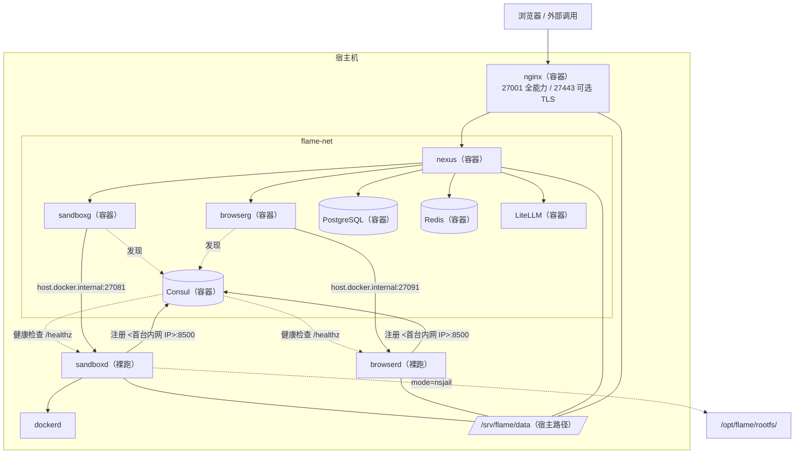

# Flame 部署方案

中文 | [English](deployment.md)

> 状态：**产物已落，未验证**。`deploy/prod/` 已经存在（compose、unit、四个镜像定义、脚本、配置模板），本文件
> 继续承载设计与依据；标 `TODO(verify)` 的仍是估算值，不是实测结果。
> 范围：一台普通 Linux 主机可运行整套产品；扩展到多机时，本方案只提供组件与旋钮，由使用者决定起几个实例、
> 用哪个端口。
>
> §5.1 是产物的实际形状。产物与文档不一致时，以 `deploy/prod/` 为准，并把本文档改过来——规格说明一旦和文件
> 分家，读者就只剩下猜。
>
> 逐条可执行的命令、配置与验收项见 [`deployment-runbook.zh.md`](deployment-runbook.zh.md)。

---

## 1. 目标与范围

### 1.1 目标

1. 一组产物，放在**一台普通 Linux 主机**上就能运行完整产品——一份 compose 作为启动器，systemd 负责开机自启与
   失败重启，不依赖 K8s 或任何集群。
2. 每个组件都能**独立发布、独立配置、独立回滚**：镜像 tag 与配置分离，回滚是改一个变量。
3. 扩展到多机时，使用者只需要决定*几台*、*哪个端口*、*谁来负载均衡*，不需要改代码。

### 1.2 非目标

- Kubernetes、Ansible 等编排与配置管理层；
- 自动扩缩容、服务网格；
- 多租户隔离之外的能力（数据出境与模型合规属于产品问题）。

### 1.3 交付形态

| 形态 | 承载 | 原因 |
|---|---|---|
| **裸跑**（systemd + 二进制） | `sandboxd` + `codehost`、`browserd` + `browserhost`、`nsjail` | 需要宿主的 docker daemon、宿主 Chromium、setuid 与本地 profile；进容器必然路径错位或边界反转 |
| **容器**（同一 `flame-net`） | `nexus`、`sandboxg`、`browserg`、`nginx`、`postgres`、`redis`、`litellm`、`consul` | 无宿主状态；服务名互访；宿主不再需要 Python / PostgreSQL / Redis / nginx 包 |
| 主机级 | Docker Engine、systemd | 容器运行时与进程监管 |

一句话规则：**持有宿主特权或宿主设备的裸跑，其余全部容器化。**

---

## 2. 决策记录

| # | 决策 | 依据 |
|---|---|---|
| 1 | 不引入 K8s / Ansible；单机用一份 compose 作为启动器 | 目标是"单机能装、多机可拆"；compose 只是启动器，不承担调度 |
| 2 | 裸跑只有执行器：sandboxd、browserd（含 codehost / browserhost / nsjail） | sandboxd 的全部工作就是 `docker run -v <宿主路径>`；进容器路径不再同义，挂 socket 等于把宿主 root 交给被隔离组件 |
| 3 | 其余全部容器化：nexus、两个网关、nginx、PostgreSQL、Redis、LiteLLM | 不可变产物；宿主不再需要 Python 与数据库包；能力版本与镜像一致 |
| 4 | **只有 nginx 发布对外端口**（27001，可选 27443）；内网只发两类：Consul 的 8500，以及跨机 nexus 时的数据面（PG 5432 / Redis 6379 / LiteLLM 4000），绑定地址由 `FLAME_BIND_IP` 决定（单机回环、多机内网） | 其余容器一律不 `-p`，PostgreSQL 的认证面不暴露到宿主与公网。8500 与跨机数据面都是"必须跨机可达"的，因此绑回环或内网网卡、用防火墙限定来源，不经过 nginx、不对公网；跨机 nexus 的完整前提见 §9.3 |
| 5 | 发布以镜像 tag 为唯一版本，统一 `FLAME_TAG` | 回滚是改一个变量；避免"nexus 新版、网关旧版"的版本漂移 |
| 6 | 每个 sandboxd 对应一个 docker daemon（一个节点一个） | 启动清扫按全局标签删容器，共用 daemon 会互删在途容器 |
| 7 | 每节点一个 browserd，容量通过 `workers` 扩展 | 独占 Chromium 与 profile 目录 |
| 8 | 一个平台一种沙箱 `mode` | nexus 只持有一个 `sandbox.url`；混部让能力快照失真、容量打分不可比 |
| 9 | nsjail 的 rootfs 从镜像导出，不单独维护 | 一份构建定义、两种物化，杜绝版本漂移 |
| 10 | 共享路径定死 `/srv/flame/data`，容器内**同名挂载** | 沙箱 bind mount、浏览器截图、nexus 下载三方共用同一绝对路径 |
| 11 | 平台 SQL 由独立 migrate 作业执行 | 多个 nexus 副本在启动时并发执行 DDL 意味着锁等待与半成品 |
| 12 | PostgreSQL 18 用官方镜像 | 版本与上游一致、跨发行版一致；数据仍须本地块存储 |
| 13 | TLS 在 nginx 终止，nexus 只跑明文 | nexus 没有 TLS 代码；nginx 本来就是必需件；证书一份而非每台一份 |
| 14 | 27001 全能力，27443 可选叠加 | 证书缺失时 `listen ... ssl` 会让 nginx 起不来，TLS 只能是叠加项 |
| 15 | 产物含 4 个裸跑二进制（sandboxd / codehost / browserd / browserhost）；其余二进制进镜像；`seedpoc` 不再作为独立产物出现 | 裸跑只需要这四个；`seedpoc` 的实现在产物里叫 `bootstrap`，进 nexus 镜像（§7.2），演示那个名字不再出现在 release 里 |
| 16 | 配置与租户数据不进镜像 | 日常运营（建技能、改 AGENT.md、上架资产）不需要重建任何镜像 |
| 17 | 专用 dockerd 可选，v1 默认不做 | 随包提供 `flame-docker.service`，需要更强隔离时手动启用 |
| 18 | 镜像与原生二进制共用同一版本号 | 两条轨道不能有两条版本线 |
| 19 | 首次启动的种子由独立 bootstrap 作业完成，不由 nexus 启动时自动创建 | 开箱可用；同时不把"创建默认口令管理员"变成每次开机都执行的行为 |
| 20 | bootstrap 不注册模型、不内置供应商 key | key 不该由安装脚本猜；首次登录后由管理员添加，README 写明 |
| 21 | 种子内容与 PoC 保持一致，包括默认口令与固定 API key | 部署脚本与 PoC 同一套脚本，验过就是同一套；风险用 README 警告提示，不在种子上分叉 |
| 22 | Consul 默认启用，且与其余组件一同进容器；单机与多机同一份配置；8500 只发布到内网 | 它是**双向被访问**的：执行器注册、网关发现，装在宿主要多一份主机依赖与升级路径；容器里只需一个 `consul:8500`。多机时各节点的执行器直接注册到首台的 8500，`service_id` 默认由"名称+地址+端口"派生、天然每台唯一，不再每台装一个 agent。默认关闭会让单机与多机产生配置分叉，而"加第二台沙箱机"正是最需要发现的时刻 |

---

## 3. 拓扑

### 3.1 单机



### 3.2 横向扩展

只有 sandboxd 与 browserd 按节点复制；nexus 与两个网关默认只做**同机**多进程。所有容器互访走 `flame-net` 的服务名。
把 nexus 跨机时，数据面（PostgreSQL / Redis / LiteLLM）必须对 nexus 节点开放，代价与前提见 §9.3。

- sandboxd / browserd 自行注册到 Consul，网关动态发现；`backends` 静态种子只是兜底，不是单机替代方案（单机与多机
  用同一份配置，见决策 22）；
- Consul 常开，但不是硬依赖：拉取失败保留当前池。缺口是"网关在 Consul 不可达时重启"——此时只有 `backends` 种子可用；
- **容器访问宿主上的执行器**需要一条显式路径，见 §6.2 第六条约束。

---

## 4. 组件

### 4.1 服务

| 组件 | 形态 | 端口 | 状态 | 多实例 |
|---|---|---|---|---|
| nginx | 容器 | **27001 发布**（+27443 可选） | 前端产物、证书挂载 | 可以（前置 LB 时） |
| nexus | 容器 | 27006（不发布） | 共享存储、插件目录 | 可以（同 key，同 PG·Redis·存储） |
| sandboxg | 容器 | 27080（不发布） | 无（粘性在 Redis） | 可以（Redis 必需） |
| browserg | 容器 | 27090（不发布） | 无（粘性在 Redis） | 可以（Redis 必需） |
| sandboxd | 裸跑 | 27081（内网：网关与 Consul） | docker daemon、`tmp_dir` | **每节点 1** |
| browserd | 裸跑 | 27091（内网：网关与 Consul） | Chromium、`profile_root` | **每节点 1** |
| PostgreSQL | 容器 | 5432（仅 `flame-net`；跨机 nexus 时发内网） | 命名卷（本地磁盘） | 主备 / 托管 |
| Redis | 容器 | 6379（仅 `flame-net`；跨机 nexus 时发内网） | 命名卷（AOF） | Sentinel / 托管 |
| LiteLLM | 容器 | 4000（仅 `flame-net`；跨机 nexus 时发内网） | 自己的库 | 可以（同 salt key） |
| Consul | 容器 | 8500（只发内网网卡；容器内 `consul:8500`） | 命名卷（catalog 可由执行器重注册重建） | 单节点 server；需要多节点时加同镜像 server 并 `retry_join` |

### 4.2 `flame/sandbox` 里有什么

| 类别 | 内容 |
|---|---|
| 解释器 | Python 3.13（`/usr/local/bin/python` → `python3`）、Lua 5.4、Node 24、bash |
| Python 包 | openpyxl、xlrd、pandas、numpy、requests、python-docx、beautifulsoup4——构建期安装并完成字节码编译 |
| 系统工具 | coreutils（常驻命令的 `sleep`）、procps（`pkill`/`pgrep`/`ps`）、passwd、ca-certificates |
| 字体 | fonts-liberation、fonts-noto-cjk |
| 自有二进制 | `/usr/local/bin/codehost`——常驻隔离单元，每次 execute fork 一个全新解释器 |
| 运行约束 | 非 root `1000:1000`、只读 rootfs、无 `ENTRYPOINT`、`CMD sleep infinity` |

**刻意不在里面**：nexus、sandboxd、browserd、PostgreSQL、Redis、nginx、浏览器、`curl`、`git`、`jq`、`pip`、
`gcc`、全局 npm 包、网络访问。

后果必须写明：agent 脚本里的 `pip install` 一定失败（没有网络 + 只读 rootfs）；要加依赖只能改 Dockerfile 重建镜像。

### 4.3 其余镜像

| 镜像 | 内容 | 说明 |
|---|---|---|
| `flame/base` | Python 3 与插件依赖、`curl`（健康检查） | 一年变一两次；application 层因此只有一层 |
| `flame/nexus` | nexus、backfillversions、**bootstrap**（`FROM flame/base`） | 宿主不再需要 Python；bootstrap 必须与 provision 同源，见 §7.2 |
| `flame/gateway` | sandboxg、browserg（同一镜像，靠 compose 的 `command` 区分） | `scratch`，无 shell、无 entrypoint：入口由 compose 指定 |
| `flame/web` | nginx 配置 + 前端产物 | 证书与共享存储挂载进来，不打进镜像；TLS 块由入口脚本按证书存在与否接入 |
| `flame/sandbox` | `sandboxd/Dockerfile` 构建（Debian 13 + lua/python/node + Python 包 + codehost） | 只有一份构建定义；`build.sh` 先把 codehost 放进它的构建上下文 |
| `postgres:18.<minor>` | 官方 | 命名卷 + initdb.d 脚本 |
| `redis:7-alpine` | 官方 | requirepass + AOF |
| `hashicorp/consul` | 官方 | 单节点 server；多 server 时 `retry_join` |
| LiteLLM 官方镜像 | 官方 | `-database` 变体 |

---

## 5. 目录布局

### 5.1 仓库内（`deploy/prod/`）

```
deploy/prod/
├─ README.md / README.zh.md            前置检查、快速开始、三个易踩点、本版缺口
├─ compose.yaml                        单机容器编排（nexus / 网关 / web / PG / Redis / LiteLLM / consul + 两个作业）
├─ compose.multi-host.yaml             多机叠加：只写内网端口，由 COMPOSE_FILE 决定加不加载
├─ compose.dev.yaml                    本机试跑叠加：.devrun 路径 + 命名卷；永不用于部署
├─ images/
│  ├─ base.Dockerfile                  flame/base：Python 运行时与插件依赖，很少变
│  ├─ nexus.Dockerfile                 nexus + bootstrap + backfillversions + static（FROM base，一层）
│  ├─ gateway.Dockerfile               sandboxg / browserg 同构，scratch，无 shell
│  └─ web.Dockerfile                   nginx + dist + 站点配置
├─ config/
│  ├─ nexus.yaml                       全部写成 ${VAR}，由 nexus 从自己的环境展开
│  ├─ litellm.yaml                     store_model_in_db + master key；没有它配模型会静默不生效
│  ├─ sandboxd.yaml                    mode + registry + docker/nsjail（nsjail 段注释保留）
│  ├─ sandboxg.yaml                    discovery + sandbox_token + backends（空，不写回环种子）
│  ├─ browserd.yaml                    共享 workspace_root + 本地 profile_root
│  ├─ browserg.yaml                    discovery + max_per_tenant + redis
│  ├─ nginx/
│  │  ├─ flame-common.conf             map，http 级只定义一次
│  │  ├─ flame-locations.inc           业务 location，两个入口共用
│  │  ├─ flame-http.conf               listen 27001，全能力
│  │  ├─ flame-tls.conf                listen 27443 ssl，可选
│  │  └─ flame-enable-tls.sh           容器启动时按证书存在与否软链 TLS 配置块
│  ├─ postgres/10-litellm-db.sql       initdb.d：只建 litellm 库；平台 SQL 不在这里
│  └─ redis/redis.conf.tmpl            requirepass + appendonly yes，渲染时替换口令
├─ env/
│  ├─ flame.env.example                版本 tag、密钥、两种 consul 视角、部署形态开关
│  ├─ sandboxd.env.example             CONSUL_HTTP_TOKEN（yaml 没有 token 字段；地址走 registry.address）
│  └─ SECRETS.md / SECRETS.zh.md       每个变量的影响面与轮换风险
├─ systemd/
│  ├─ flame.service                    `flame up -d`（容器唯一入口）
│  ├─ flame-migrate.service            oneshot，跑 scripts/migrate.sh；无 [Install]，永不随之开机
│  ├─ flame-sandboxd.service           裸跑，Requires=docker.service
│  ├─ flame-browserd.service           裸跑
│  └─ flame-docker.service             可选，默认不 enable（单独 daemon，不接线则无效果）
├─ scripts/
│  ├─ lib.sh                           log/die、密钥生成、配置渲染器（install 与 dev-up 共用）
│  ├─ flame                            包装脚本：读 env、展开 COMPOSE_FILE，装到 /usr/local/bin
│  ├─ build.sh     images.sh           交叉编译 + 四个镜像；images.sh 另有 save / load 做离线交付
│  ├─ install.sh                       前置检查（--check）、落 release、渲染配置、装 unit、导入镜像
│  ├─ migrate.sh   migrate-apply.sh    宿主编排作业 / 容器内按依赖序执行 SQL（--check 校验文件集合）
│  ├─ bootstrap.sh health.sh           一次性种子作业（种子后回填 v1）/ 13 节验收检查
│  ├─ smoke.sh                        端到端：登录→配模型→发布→暴露→用 API key 调一次，断言回答里含发出的串
│  └─ dev-up.sh                       本机试跑：拉起、种子、本机 sandboxd、应用面；down/purge/status/logs
└─ out/                                构建产物：bin、static、web、sql（gitignored）
```

三处与早期草案不同，都是产物定型时改的：

- **没有 `images/sandbox.Dockerfile`**：沙箱镜像直接用 `sandboxd/Dockerfile`，只有一份构建定义。它 `COPY
  bin/codehost-linux`，所以 `build.sh` 先把 codehost 放进那个构建上下文。
- **没有 `sql -> ../../nexus/platform/sql` 软链**：软链在 Windows 检出与打包时都不可靠。`build.sh` 把
  `nexus/platform/sql` 复制到 `out/sql`，`migrate-apply.sh` 里的执行清单与 `scripts/verify-sql.ps1` 逐字对齐，
  `--check` 要求文件集合**相等**——唯一真相仍在仓库那一处。
- **没有 `90-admin.sql`**：平台管理员 `plat` 由 `bootstrap` 作业创建（`seedpoc` 的 `ensurePlatformUser` 用同一套
  bcrypt 写入），而不是 migrate 末尾追加一段 SQL。这样 `FLAME_ADMIN_PASSWORD` 才真的生效：SQL 里的哈希是常量，
  先由 SQL 建号会让种子作业永远"已存在、不改口令"。

### 5.2 机器上（`install.sh` 幂等创建）

```
/opt/flame/releases/<ver>/{bin,static,web,sql,scripts,config,systemd,compose*.yaml}
/opt/flame/current -> releases/<ver>
/opt/flame/rootfs/<ver>/                                  nsjail rootfs，从镜像导出
/etc/flame/{flame.env, nexus.yaml, sandboxd.yaml, sandboxd.env, browserd.yaml,
            sandboxg.yaml, browserg.yaml, redis.conf}
/etc/flame/tls/{fullchain,privkey}.pem                    可选，存在即启用 27443
/etc/flame/initial-credentials.txt                        bootstrap 写出，0600；轮换后删掉
/srv/flame/data/{tenants,platform-assets,plugins}
/srv/flame/pg-init/10-litellm-db.sql                      只在空数据卷上执行
/var/lib/flame/{nexus/logs, sandboxd/tmp, browserd/profiles}
/var/log/flame/<service>/
```

`/etc/flame/redis.conf` 与四份执行器/网关 yaml 是**渲染出来的一次性产物**：`install.sh` 只在文件不存在时生成，
`--force-config` 才会覆盖。升级因此不会冲掉宿主策略与口令；要改策略就改 `/etc/flame/<name>.yaml` 并重启对应
单元，不要改 release 里的模板。

`/opt/flame/rootfs/<ver>` 一份目录对应一代镜像，而且是**导出**来的、不是另造的：内容直接来自 `flame/sandbox:<ver>`，
两种模式因此不可能漂移。导出过程有两件事不会跟过来——`docker export` 不带设备节点，所以 `/dev/null`、`/dev/zero`、
`/dev/random`、`/dev/urandom`、`/dev/tty` 必须用 `mknod` 建出来；缺了它们 nsjail 能起，但第一次 exec 就失败，表现为
"该语言不可用"而不是"坏了"。建完后设 `read_only_rootfs: true`：一个运行期能被改的 rootfs，就是一个会悄悄偏离镜像的
rootfs。配方与自证命令见运行手册 §5.3。

Docker 侧的持久状态：`flame-pg`、`flame-redis`、`flame-consul` 三个命名卷，以及 `flame-net` 网络。`flame-consul`
只存服务目录，丢卷等价于重装：执行器注册是周期性的，会自己回来。

### 5.3 三处不对称

- **nexus 没有 `-config` 参数**：它读工作目录下的 `./config.yaml`，所以容器里用 `working_dir:
  /var/lib/flame/nexus`，配置挂成 `./config.yaml`。工作目录**不放在 `/etc/flame`**：`xlog` 会在工作目录下建
  `logs/`，而容器里的 `/etc/flame` 是配置的家；放进一个可写目录再把 `logs` 从宿主挂进去，日志才不会随容器重建
  消失。其余四个服务接受 `-config <path>`。
- **共享存储在容器里必须同名挂载**（`/srv/flame/data:/srv/flame/data`）。挂到别的路径不会报错，只会与
  sandboxd 看到的两份不同。
- **执行器走 `releases/` 软链，容器走镜像 tag**。两者共用同一个版本号。

---

## 6. 配置

### 6.1 逐服务要点

| 服务 | 要点 |
|---|---|
| `compose.yaml` | 所有容器加入 `flame-net`；只有 `web` 有对外 `ports`（`${FLAME_PUBLISH_IP}:27001:27001` 与 `${FLAME_TLS_IP}:27443:27443`——容器内端口与宿主一致，暴露范围由变量决定），`consul` 另发 `${FLAME_BIND_IP}:8500:8500`（单机回环、多机内网）；PG / Redis / LiteLLM 的 `ports` 只出现在 `compose.multi-host.yaml`，单机不加载；`nexus`/`web` 挂 `/srv/flame/data:/srv/flame/data`；`web` 另挂证书；`postgres` 挂命名卷与 `initdb.d`；`redis` 挂渲染出的 `/etc/flame/redis.conf`；`nexus` 与 `bootstrap` 用 `env_file: /etc/flame/flame.env`（配置文件里的 `${VAR}` 由它们自己展开）；所有 Go 服务设 `XLOG_CONSOLE=1`，否则日志只进文件、`docker logs` 是空的；两个网关**和 `consul`** 都要加 `extra_hosts: host.docker.internal:host-gateway`——健康检查是从 consul 发出的，它也得能解析 `service_addr` |
| nexus | `sandbox.url` → `ws://sandboxg:27080`、`browser.url` → `ws://browserg:27090`（容器服务名）；`storage.root_dir=/srv/flame/data`；`download.x_accel_prefix=/__files`；`db.host=postgres`（用户 `flame`）、`redis.addrs=[redis:6379]`、`litellm.url=http://litellm:4000`（跨机时这几个改首台内网地址，见 §9.4）；配置挂成 `/var/lib/flame/nexus/config.yaml`，工作目录与它同层（见 §5.3） |
| sandboxd | `mode` 是开关；`allowed_mount_roots` 必须与 nexus 的 `storage.root_dir` **字面相等**；`tmp_dir` 机器本地且独占；`listen` 用 `0.0.0.0:27081`；`registry.service_addr` 留空即从 `listen` 推导（具体 IP 直接用，通配则走 `advertise_iface` 或主机名），推导失败或指向回环而注册中心在远端时**启动即拒绝**；`service_port` 已移除（端口恒随 `listen`）；`service_id` 默认是 `<名称>-<地址>-<端口>`，无需手配 |
| consul | 单节点 server（`-bootstrap-expect=1`），数据在 `flame-consul`；8500 绑 `${FLAME_BIND_IP}`（单机回环、多机内网），容器内用 `consul:8500`；执行器的 ID 默认按地址派生、天然唯一，不必手配；开 ACL 时执行器用 `CONSUL_HTTP_TOKEN`。要抗单点就在其它宿主机起同镜像的 server，`retry_join` 指向首个节点 |
| sandboxg | `discovery.type=consul` + `discovery.address=consul:8500` + `sandbox_token` **必填**；`backends` 种子只作兜底，且**不能写 `127.0.0.1`**（容器里的回环是网关自己），要么删掉、要么写 `host.docker.internal:27081`；`sticky_ttl_sec ≥ interactive_idle_sec + 2×janitor_sec` |
| browserd | `workspace_root` 与 nexus 存储根同一目录；`profile_root` 机器本地；`max_per_tenant: 0` |
| browserg | `max_per_tenant` 是唯一生效点；Redis 必需 |
| nginx | 27001 全能力入口：静态站、`/nexus/` 去前缀、`/service/` 保留前缀、`/__files/` 的 `internal` + `alias`、WS 升级；27443 是可选 TLS 叠加，见 §6.4 |
| PostgreSQL | `POSTGRES_USER=flame` 让 initdb 直接建出这个角色与口令，因此不需要"建角色 + 移交所有权"的脚本；`/docker-entrypoint-initdb.d` **只在数据目录为空时执行**，故只建 `litellm` 库；平台 SQL 交给 `migrate.sh`；命名卷而非绑定挂载（避开 uid 999 权限坑），且卷挂在 `/var/lib/postgresql` 而不是 `/var/lib/postgresql/data`——18 的镜像把 `PGDATA` 挪到了 `/var/lib/postgresql/18/docker`，挂在旧路径上会静默地不再持久化；`shm_size` ≥ 256 MB，否则并行查询在 64 MB 的 `/dev/shm` 上失败 |
| Redis | `requirepass` + `appendonly yes`；`noeviction`（缓存与配额计数混用） |

### 6.2 七条硬约束

1. **共享存储路径处处一致，且容器内同名挂载**——不一致不报错，只静默丢文件。
2. **沙箱 uid（1000）与 nexus 容器运行的 uid 一致**（`user: "1000:1000"`）——否则脚本写出的文件租户读不到、删不掉。
3. **fleet 内 `interactive_idle_sec` 与 `janitor_sec` 必须一致**——网关只从*某一个*实例拉能力快照校验 `sticky_ttl`。
4. **池参数不能跨模式照搬**——nsjail 冷启动约 10 ms 不必常驻；docker 要 300 ms–1 s，这才是 `idle.max` 的理由。
5. **只有 nginx 发布对外端口；内网例外只有 Consul 的 8500 与跨机 nexus 的数据面（§9.3）；任何容器都不挂 docker
   socket**——前者保证 PG 的认证面不暴露到公网、注册入口只对内网可达，后者保证隔离边界不被反转。
6. **`registry.service_addr` 留空即可，显式写就必须是网关与 Consul 都能拨通的地址**——留空时从 `listen` 推导
   （具体 IP 直接用；通配地址则取 `advertise_iface` 或主机名的非回环地址），推导失败、或推成回环而注册中心在
   远端，**启动时直接拒绝**，不会注册一个永远 critical 的条目。显式写法下，本机部署用
   `host.docker.internal`（网关与 `consul` 两个容器都要有 `extra_hosts: host.docker.internal:host-gateway`），
   跨机部署用内网 IP。这个地址同时服务两件事：网关拨号，以及 Consul agent 的 HTTP 健康检查。
7. **`/v1/code` 通道在两种模式下都不出网，且没有开关**——请求帧本身不带出网意图（该通道跨租户共享，一段脚本无法
   归属到某个租户），所以守护进程把 code worker 钉死为 `Egress: false`：docker 下变成 `--network none`，nsjail 下
   变成 `--iface_no_lo`。能力上报写的是 `code: off`；沙箱和它自己的上报不一致，比配置错误更糟——agent 被告知了关于
   自身运行环境的错误事实，而且无从察觉。

第 6 条要诚实说明：容器化把"跨边界"从 *原生 → 容器* 挪成了 *容器 → 原生*，**并没有消灭它**。换来的是不可变
产物与宿主零 Python；代价是网关和 consul 各有一条到执行器的链路，必须在 compose 与 `sandboxd.yaml` 两处同时配对，
否则表现为"sandboxd 不可达"或"服务注册了却始终不健康"。

### 6.3 切换沙箱模式

| 旋钮 | docker | nsjail |
|---|---|---|
| `mode` | `docker` | `nsjail` |
| 运行时来源 | `docker.image: flame/sandbox:<ver>` | `nsjail.rootfs: /opt/flame/rootfs/<ver>` |
| 宿主依赖 | dockerd + docker CLI | nsjail（setuid root） |
| 出网 | `docker.network: bridge` | 需要 `--disable_clone_newnet` 才能 egress；**`/v1/code` 两种模式下都断网**（约束 7） |
| 解释器名 | 来自镜像，走镜像自己的 PATH 解析 `lua` / `python` | rootfs 同源，名字也在，但解析必须跟随 **rootfs 内部**的符号链接（`/usr/local/bin/lua` → `/usr/bin/lua5.4`，绝对目标）；在宿主机上 `stat` 只会看到悬空链接，名字原样传给 nsjail，表现为"语言不可用，exit 255" |
| 池化 | L2 容器复用 | 只有 L3（jail 与解释器同生共死） |

nsjail 以 **setuid root** 安装，sandboxd 自身仍以 `flame` 用户运行，所以切模式既不改 unit 也不改用户。代价必须
写明：这等于给 `flame` 用户一条受控的提权路径，安全边界退化为 nsjail 自身的参数校验。

### 6.4 TLS 与入口端口

**TLS 在 nginx 终止，nexus 只跑明文。27001 是全能力入口，27443 是可选叠加。**

依据：nexus 没有 TLS 代码（全仓无 `ListenAndServeTLS` / `tls.Config`）；nginx 本来就是必需件；证书只需一份；
nexus 不用 Cookie（认证是 `Authorization: Bearer`），后端不需要知道请求是否来自 HTTPS。

| 场景 | 27001 | 27443 | 用途 |
|---|---|---|---|
| **A 无证书（默认）** | `0.0.0.0` 或内网 IP，全能力 | 不存在 | 内网部署、首次上线 |
| **B 本机证书** | `127.0.0.1`，全能力 | `0.0.0.0`，TLS 全能力 | 直接对外提供 HTTPS |
| **C 上游 LB 终止 TLS** | 内网 IP，全能力 | 不存在 | 云 LB / 企业网关已在前置 |

能力相同、暴露范围不同。证书缺失时 `listen ... ssl` 会让 nginx 启动失败（`[emerg] cannot load certificate`），
所以 TLS 只能是叠加项。

`map` 只能在 http 上下文定义一次（放在 `flame-common.conf`）；两个 server 各写一份会报 `duplicate map`。启用方式：
`install.sh` 在证书存在时软链 `flame-tls.conf`，否则只装 `flame-http.conf`。

**安全前提：全能力意味着明文传输 Bearer token。** A 绑内网，B 把 27001 收紧到 `127.0.0.1`，C 只接受 LB 转发。

转发头走 map，不要直接写 `$scheme`：

```nginx
map $http_upgrade $connection_upgrade { default upgrade; '' close; }
map $http_x_forwarded_proto $fwd_proto { default $scheme; https https; }
```

否则场景 C 下 nexus 永远看到 `http`——今天无害，将来加 OAuth 回调或邮件链接会踩。

证书签发被端口选择绑定：27443 等于选 **DNS-01**（HTTP-01 需 80，TLS-ALPN-01 需 443）。DNS 托管商不提供 API 时，
只能临时开 80 或使用企业 CA；RHEL 系在 SELinux enforcing 下还需
`semanage port -a -t http_port_t -p tcp 27443`。

---

## 7. 安装

```bash
# 构建机（有 go 与 node）
./scripts/build.sh                                  # 原生二进制 + 前端 + SQL 副本 → out/
./scripts/images.sh build --tag $FLAME_TAG          # base / nexus / gateway / web + sandbox 镜像
./scripts/images.sh save  --tag $FLAME_TAG --dir /srv/flame/release-images   # 离线交付

# 目标机（root）
sudo ./scripts/install.sh --tag $FLAME_TAG --check                       # 只检查，不改任何东西
sudo ./scripts/install.sh --tag $FLAME_TAG --images /srv/flame/release-images
flame up -d consul postgres redis litellm           # 数据面先起
./scripts/migrate.sh                                # 平台 SQL；--check 只校验文件集合
flame --profile jobs run --rm bootstrap             # 平台管理员 + t0 种子，见 §7.2
systemctl start flame-sandboxd flame-browserd       # 两个裸跑执行器
flame up -d                                         # nexus / 网关 / web
./scripts/health.sh                                 # §13 的验收项，失败即点名
```

`install.sh` 只落位、渲染配置、装 unit 并 `enable`，**不启动任何东西**：启动顺序本身就是安装的一部分（数据面 →
SQL → 种子 → 执行器 → 应用面），把它塞进一个脚本等于让半成品数据库和新代码赛跑。

### 7.1 前置检查

| 检查 | 命令 | 缺失后果 |
|---|---|---|
| Docker 与 compose 插件 | `docker info && docker compose version` | 什么都起不来 |
| 共享存储真挂载 | `findmnt -T /srv/flame/data` | 文件静默丢失 |
| 镜像齐全 | `docker image inspect flame/nexus:$FLAME_TAG` 等 | 容器起不来 |
| 沙箱镜像 / rootfs | `docker image inspect flame/sandbox` / 目录存在 | 首次 exec 失败 |
| Chromium 与字体 | `command -v chromium` | 浏览器工具报「不可用」 |
| nsjail | `nsjail --version`、setuid 位、`/sys/fs/cgroup` 可写 | nsjail 模式不可用 |
| 端口 | 27001（+27443）+ 27081 / 27091（内网：网关与 Consul）+ 8500（内网） | 启动失败，或服务注册了却始终不健康 |
| 证书（可选） | `/etc/flame/tls/*` 存在则启用 27443 | 不报错，按场景 A 运行 |
| 内存 | 无浏览器 ≥ 6 GB，有浏览器 ≥ 10 GB | 负载下 OOM |

宿主不再需要 `python3`、`psql`、PostgreSQL 或 Redis 的发行版包——它们都在镜像里。

`migrate.sh --check` 复刻 PoC 的不变式：`nexus/platform/sql/` 的文件集合必须与执行清单完全相等。

### 7.2 首次启动的种子数据

种子落在**两个 schema**里，内容与 PoC 完全一致，只是承载方式按 schema 分：

| schema | 种子内容 | 来源 |
|---|---|---|
| `platform` | 平台表结构、供应商预设（`llm_provider_presets` / `llm_presets_seed`）、限额默认值（`zz_limit_defaults`）、能力闸门（`capability_gates` / `plugin_gates` / `tenant_plugins`） | `nexus/platform/sql/*.sql` 按 `migrate-apply.sh` 的依赖序执行（与 `verify-sql.ps1` 同一份清单，`--check` 要求文件集合相等） |
| `t0` | 租户表结构、物化到磁盘的定义域文件（`main` 的 `AGENT.md`、四个受保护技能）、预置的 LLM 供应商与模型（`DeepSeek` 空密钥、停用，`deepseek-flash`）、注册行、租户管理员、全部能力、API key | `docker compose run --rm bootstrap`，等价于 PoC 的 `seedpoc` |

**`platform` 的表结构是纯 SQL，账号与 `t0` 必须是命令**——这不是取舍：t0 的 `AGENT.md` 与技能文件由
`provision.Provision` 物化，SQL 写不出文件；而平台账号的哈希必须由 `account.HashPassword` 生成，SQL 里只能写死
一个常量哈希。PoC 用 `90-admin.sql` 建 `plat`，代价是那个口令无法在安装时指定——正式版把它交给 `bootstrap`，
`FLAME_ADMIN_PASSWORD` 才真的生效。

`bootstrap` 做的事（与 `seedpoc` 等价，全部幂等）：

| 步骤 | 内容 | 重复执行时 |
|---|---|---|
| 1 | 平台管理员 `plat`（`auth.BootstrapAdminName`，代码常量、不可配置）；口令默认 `12345678`，可用 `FLAME_ADMIN_PASSWORD` 覆盖 | 已存在则**不改口令** |
| 2 | 平台用户 `user01`，作为 t0 的 owner | 已存在则复用 |
| 3 | 租户 `t0`，显示名 `Default tenant`：`provision.Provision` 建表、物化定义域文件、写注册行；租户管理员 `provision.DefaultAdminName` 同口令 | 已存在则跳过，保留现有数据 |
| 4 | 校验 `main` 仍是 supervisor、四个受保护技能仍在 | 失败即退出——这是"控制台空着"的根因 |
| 5 | 给 t0 打开**全部**能力（`capability.All()`，与 PoC 同源同一份清单） | 幂等 |
| 6 | 为 t0 主用户建 API key，默认 `sk-poc-t0-primary` | 已存在则复用 |
| 7 | 补齐 t0 的预置 LLM 配置：供应商 `DeepSeek`（空密钥、停用）与模型 `deepseek-flash`。上面新建的租户已从模板拿到这两行，这一步是给种子出现之前就存在的 t0 补——它的 `provision` 不会再执行 | `ON CONFLICT DO NOTHING`，操作者自己配过的供应商/模型一律不覆盖 |

**与 PoC 的差别只有两处，且都不改变种子内容**：

- **执行时机**：PoC 每次容器启动都跑 `seedpoc`；正式版在安装/升级时显式跑一次 `bootstrap`。两者都幂等，重复执行
  只补缺失项。
- **凭据输出**：PoC 直接打印到 stdout；正式版同时写 `/etc/flame/initial-credentials.txt`（`0600`，属主 `flame`），
  终端打印路径，`--print` 才输出明文。

**两条必须写进 README 的警告**（不改变设计，只提示）：

1. 默认口令 `12345678` 与固定 API key `sk-poc-t0-primary` 是 PoC 的取值：首次登录后立即改口令，并轮换或删除该 key；
2. `plat` 受保护的是档案 / 角色 / 状态与删除，口令本身可以改。

**不注册模型。** 装完控制台里只有一个 `main` 和一个空模型列表——模型需要供应商 key，PoC 也没有种这一项。
首次登录三步：用 `plat` 与默认口令登录 → 改口令 → 加一个模型，之后 `main` 才可用。

**已存在时不覆盖**是刻意的：覆盖会冲掉管理员对 t0 的编辑。模板更新后刷新 t0 的定义域文件用 `tenantmigrate`
（§11 第 8 项），不是 bootstrap。

**compose 里因此有两个一次性服务**（都挂在 `jobs` profile 后，`up -d` 不会启动它们）：`migrate`（`postgres` 镜像
跑 psql，按清单执行 `releases/<ver>/sql`）与 `bootstrap`（`flame/nexus` 镜像覆盖 `entrypoint` 去跑种子脚本）。
两者都要与 nexus 相同的 `user: "1000:1000"` 与存储挂载——否则 bootstrap 写出的文件属主不对，nexus 与沙箱都读不了。

---

## 8. 发布与回滚

### 8.1 六类变更，六条路

| 变更 | 动作 | 代价 |
|---|---|---|
| Go 代码 / 依赖 | 重建该服务镜像 → 换 tag → 重建容器 | 编译 + 构建，十几秒到一分钟 |
| 配置（`config.yaml` / env） | 改挂载的文件 → 重启容器 | 秒级 |
| 前端资源 | 重建 `flame/web` 镜像 → 换 tag | 秒级到十几秒 |
| **租户定义域**（`AGENT.md`、`SKILL.md`、技能、插件） | **什么都不做** | 0 |
| 平台 SQL | `migrate.sh` | 秒级 |
| 沙箱运行时（Python 包等） | 重建 `flame/sandbox` → 换 tag → 重启 sandboxd | 分钟级 |

第四行是重点：**租户日常运营完全不碰镜像**。技能、智能体指令、资产、版本目录都是 `/srv/flame/data` 下的数据。

### 8.2 为什么重建很便宜

镜像分层：`flame/base`（Python 与插件依赖，很少变）→ 应用层（只有二进制变）。一次普通发布只是加一层、推几十 MB。
单机部署**不需要 registry**：镜像就在本机，`compose up -d` 直接使用。

### 8.3 顺序与回滚

```bash
./scripts/build.sh
./scripts/images.sh build --tag 2026.12.01
./scripts/migrate.sh                 # 先迁移
# 改 /etc/flame/flame.env: FLAME_TAG=2026.12.01
sudo ./scripts/install.sh --tag 2026.12.01   # 落 releases/<ver>、重指 current、重载 unit
flame up -d sandboxg browserg nexus web
systemctl restart flame-sandboxd flame-browserd   # 单元路径没变，只有 restart 才会跑新二进制
```

回滚就是把 `FLAME_TAG` 改回去 + `compose up -d`。旧镜像留在本机，不依赖网络。原生二进制回滚是改
`/opt/flame/current` 软链 + 重启对应 unit。

### 8.4 三条纪律

1. **不要在容器里改文件**——重建即丢。可变的东西只有两处：挂载的配置、`/srv/flame/data`。
2. **不要用 `latest`**——版本统一到 `FLAME_TAG`，镜像与二进制共用同一个版本号。
3. **紧急 hotfix 也要走构建**——`docker cp` 进容器只能当临时止血，必须记录并在下一次发布收紧。

池的维护代价如实记录：停 sandboxd 会 `Close()` 掉复用容器，交互式会话全丢；停 browserd 会销毁该节点所有
Chromium，`session lost` 是设计答案。没有 drain 端点，流程只能是低峰 + 等 `interactive_idle_sec`（300 s）过期再停。

---

## 9. 多实例

产物只提供四件事：端口可改、地址可填、状态目录每实例独立、模板 unit。

### 9.1 加一台沙箱节点

```bash
1) 装 docker、把 /srv/flame/data 挂到同一路径（Consul 在第一台的容器里，本机不装 agent）
2) 放 /srv/flame/bin/{sandboxd,codehost,nsjail}、导入 sandbox 镜像、解 rootfs
3) 写 /etc/flame/sandboxd{,.env}，只改 registry.address（首台内网 IP:8500）；service_addr 留空即自动推导
   （多网卡机器用 advertise_iface，或显式写本机内网 IP），service_id 默认已按地址唯一；开 ACL 时再加
   CONSUL_HTTP_TOKEN
4) 放行本机 27081：对首台（Consul 探测 `/healthz`）与网关所在节点可达；sandboxd 的 `listen` 必须是 0.0.0.0:27081
5) systemctl enable --now flame-sandboxd
6) 确认：curl -s "http://<首台内网IP>:8500/v1/health/service/sandboxd?passing=1" 里有本机地址，
   且 `consul catalog services` 仍有 sandboxd（两台都在）
7) 网关不改配置，下次拉取（≤5s）自动纳入
```

### 9.2 同机多进程（nexus / 网关）

`docker compose up -d --scale nexus=2` 可以起多个副本，但有两个前提：

- 所有副本共享同一 `FLAME_TAG`、同一 `JWT_SECRET` / `FLAME_VALUE_KEY`、同一 `flame-net`；
- **nginx 不会自动跟随扩缩容**：`proxy_pass http://nexus:27006` 在启动时解析一次并缓存。要跟随，改用
  `resolver 127.0.0.11 valid=10s;` + `set $upstream nexus:27006; proxy_pass http://$upstream;`（变量形式强制重解析），
  或扩缩容后 `docker compose restart web`。

跨机不是"再多开一个容器"：数据面、入口端口与共享存储都要先就位，见 §9.3。

### 9.3 跨机部署（可选）

先分清三档，只有第三档才需要动数据面端口：

| 档位 | 形态 | 需要放开 |
|---|---|---|
| 1 | 单机：全部容器 + 本机裸跑执行器 | 27001（+27443）对外；`127.0.0.1:8500` 给宿主上的执行器 |
| 2 | 首台跑全部容器，其它机器只加 `sandboxd` / `browserd` | 8500（执行器注册）；27081 / 27091（Consul 健康检查 + 网关拨号） |
| 3 | 容器也分机（nexus / 网关 / 数据面各自成组） | 下表全部 |

**只加沙箱节点（第 2 档）时，5432 / 6379 / 4000 一个都不用开**——执行器不碰数据面。第 3 档才需要按依赖关系
逐个放行；单机时这些客户端都在 `flame-net` 里，不需要任何 `ports`。

| 客户端 | 依赖 | 端口 | 跨机时的放行对象 |
|---|---|---|---|
| nexus（每台） | PostgreSQL：平台库 + `litellm` 库 | 5432 | 每台 nexus |
| nexus（每台） | Redis：run ledger / 停止广播 / 配额计数 / 缓存 | 6379 | 每台 nexus |
| nexus（每台） | LiteLLM（模型调用唯一出口） | 4000 | 每台 nexus |
| LiteLLM | PostgreSQL（它自己的库） | 5432 | LiteLLM 所在节点 |
| `migrate` / `bootstrap` / `backfillversions` 作业 | PostgreSQL | 5432 | 执行作业的节点（默认首台） |
| sandboxg / browserg | Redis：粘性绑定、每租户计数 | 6379 | 每个网关节点 |
| sandboxg / browserg | Consul：服务发现 | 8500 | 每个网关节点 |
| sandboxd / browserd（每台） | Consul：注册 | 8500 | 每台执行器节点 |
| nexus（仅 `registry.enabled: true` 时） | Consul：注册（默认关） | 8500 | 每台 nexus（ID 默认含地址，天然唯一） |
| Consul | sandboxd / browserd：健康检查 | 27081 / 27091 | Consul 所在节点 → 每台执行器（反方向） |
| nginx | nexus | 27006 | nginx 节点（与 nexus 不同机时） |
| nexus | sandboxg / browserg | 27080 / 27090 | nexus 节点（与网关不同机时） |

两条读表结论，容易被漏掉：

- **执行器不碰 PostgreSQL 和 Redis**：`sandboxd` / `browserd` 只注册 Consul，所以沙箱节点不需要开数据面端口。
- **网关是 Consul 的读者**：`sandboxg` / `browserg` 的 discovery 直接读 8500，跨机网关也要能到它；只给执行器开 8500 不够。
- **ACL 是两端的事**：启用 ACL 后，注册端（执行器）与发现端（网关）都要 `CONSUL_HTTP_TOKEN`；两边的
  `DiscoveryConfig` / `RegistryConfig` 都没有 token 字段，只能走环境变量。
- **Consul 多 server 另算端口**：要抗单点就再加 8300（server RPC）与 8301（LAN serf，TCP+UDP）在内网互通，
  并给每个 server 一个唯一的 `-node` 名；单 server 时这两个端口不需要发布。

默认拓扑里 nexus 与两个网关只是**同机**多进程；跨机不在 v1 的承诺范围内，要做就得同时满足四条，否则"把端口开出去"
只会换来更隐蔽的故障：

- **数据面必须在同一内网可达**：`db.host`、`redis.addrs`、`litellm.url` 指向首台内网地址；PostgreSQL 5432、
  Redis 6379、LiteLLM 4000 只发布到内网网卡（`-p <内网IP>:5432:5432` 等），防火墙只放行 nexus / 网关节点，
  不经 nginx、不对公网。这是决策 4 的内网例外，与 Consul 的 8500 同类。
- **入口与网关也要按节点放行**：nginx 与 nexus 不同机时，27006 对 nginx 节点开放；nexus 与网关不同机时，
  27080 / 27090 对 nexus 节点开放。它们和 8500 一样只发内网、只放行平台自己的节点，不经过公网。
- **共享存储必须真的共享**：`storage.root_dir=/srv/flame/data` 在每台机器上必须是同一份（NFS / CephFS 等）。
  各机器各挂一块本地盘、路径同名，不会报错，只会通过 `download.x_accel_prefix` 与沙箱 bind mount 表现为
  "文件时有时无"。
- **明文是现状，不是可选项**：nexus 的 PG DSN 写死 `sslmode=disable`（`shared/config/config.go`），Redis 客户端
  没有 TLS 字段——跨机等于口令与数据在网络上明文传输。只能在受控内网 / 专线里做；要在不可信网络上跨机，
  先补 `db.sslmode` 与 Redis TLS，再谈部署。

切换只动 `/etc/flame/flame.env`，`docker compose` 命令与单机完全一样：

```bash
# 第 1 档（单机）：FLAME_BIND_IP 不写也安全——base 里是 ${FLAME_BIND_IP:-127.0.0.1}
# 第 2 档（只加执行器）：不加载 overlay，只把 consul 换到内网
#   FLAME_BIND_IP=10.0.0.11
# 第 3 档（容器分机）：再叠加端口文件
#   FLAME_BIND_IP=10.0.0.11
#   COMPOSE_FILE=compose.yaml:compose.multi-host.yaml
```

`compose.multi-host.yaml` 只写 `ports`，**只在第 3 档加载**，并只保留实际跨机的项：

```yaml
services:
  # 仅当 nexus 跨机时才需要
  postgres: { ports: ["${FLAME_BIND_IP:?FLAME_BIND_IP must be the intranet IP}:5432:5432"] }
  redis:    { ports: ["${FLAME_BIND_IP:?FLAME_BIND_IP must be the intranet IP}:6379:6379"] }
  litellm:  { ports: ["${FLAME_BIND_IP:?FLAME_BIND_IP must be the intranet IP}:4000:4000"] }
  # 仅当 nginx / nexus 不在同一台时
  # nexus:  { ports: ["${FLAME_BIND_IP:?set FLAME_BIND_IP}:27006:27006"] }
```

base 的 `consul` 则写成 `"${FLAME_BIND_IP:-127.0.0.1}:8500:8500"`：第 1 档落在回环，第 2、3 档落到内网网卡。

nexus 的地址同样用变量切（`config/nexus.yaml`）：

```yaml
db:      { host: "${FLAME_DB_HOST}" }            # postgres | 10.0.0.11
redis:   { addrs: ["${FLAME_REDIS_ADDR}"] }      # redis:6379 | 10.0.0.11:6379
litellm: { url: "http://${FLAME_LITELLM_HOST}:4000" }
```

逐服务、逐档位要改哪些字段，见 §9.4。

两个注意点：

- **默认值与必填都写在 compose 里，不靠人记**：base 用 `${FLAME_BIND_IP:-127.0.0.1}`（漏设只落回环）；
  overlay 用 `${FLAME_BIND_IP:?...}`（漏设直接报错）。两者都不给 `"${VAR}:5432:5432"` 留空的机会——那会展开成
  `":5432:5432"`，也就是 `0.0.0.0`，比开内网更糟。
- **PG / Redis / LiteLLM 的 `ports` 只写在多机文件里**：Compose 的 `ports` 是合并而非替换，base 与 override
  都写同一个容器会得到两条绑定；只放一处，语义才确定。

这四条满足后，`migrate` 仍只能在一处执行（决策 11）；nginx 前置外部 LB；`sandboxg`/`browserg` 跨机时按 §9.1 同理
处理（自己注册、网关发现），不必改网关配置。

### 9.4 配置随档位的变化

仓库里的 `config/*.yaml` 是开发态默认值（`localhost`、`127.0.0.1`、`mode: none`），部署时本来就要改。这一节只列
**随档位变化**的字段；其余（`token`、`mode`、`allowed_mount_roots`、`sticky_ttl_sec`、`max_per_tenant`）一次定好
不再动。

| 服务 | 字段 | 第 1 档（单机） | 第 2 档（加执行器） | 第 3 档（容器分机） |
|---|---|---|---|---|
| nexus | `db.host` / `db.port` | `postgres` / `5432` | 不变 | 首台内网 IP / `5432` |
| nexus | `redis.addrs[0]` | `redis:6379` | 不变 | `<首台内网>:6379` |
| nexus | `litellm.url` | `http://litellm:4000` | 不变 | `http://<首台内网>:4000` |
| nexus | `sandbox.url` | `ws://sandboxg:27080` | 不变 | 网关内网地址 |
| nexus | `browser.url` | `ws://browserg:27090` | 不变 | 内网地址 |
| sandboxd | `listen` | `0.0.0.0:27081` | 不变 | 不变 |
| sandboxd | `registry.address` | `127.0.0.1:8500`（宿主回环） | 首台内网 `:8500` | 同第 2 档 |
| sandboxd | `registry.service_addr` / `advertise_iface` | 留空（自动推导） | 留空或本机内网 IP | 留空或本机内网 IP |
| sandboxd | `registry.service_id` | 默认 `<名称>-<地址>-<端口>`，不必配 | 同 | 同 |
| browserd | 同 sandboxd 的三项，端口 27091 | `0.0.0.0:27091` / 默认 ID | 同 sandboxd | 同 sandboxd |
| sandboxg | `discovery.address` | `consul:8500` | 不变 | 首台内网 `:8500` |
| sandboxg | `sandbox_token` | = nexus 的 `sandbox.token` | 不变 | 不变 |
| sandboxg | `redis.addr` | `redis:6379` | 不变 | `<首台内网>:6379` |
| sandboxg | `backends[].url` | 删除，或 `http://host.docker.internal:27081` | 同 | 同 |
| browserg | `discovery.address` / `browser_token` / `redis.addr` | 同上，端口 27090 | 同 | 同 |

nexus 这五行建议写成 `${FLAME_DB_HOST}` / `${FLAME_REDIS_ADDR}` / `${FLAME_LITELLM_HOST}` /
`${FLAME_SANDBOX_URL}` / `${FLAME_BROWSER_URL}`，切换只动 `flame.env`。展开器没有默认值语法，变量必须显式给值。

其余四份不支持 `${VAR}`：`sandboxd` 只展开"定位类"字段（`log_dir` / `tmp_dir` / `allowed_mount_roots` / 解释器 /
rootfs / image），`registry.*` 不在其中；`browserd` / `sandboxg` / `browserg` 完全不展开。它们都在 `/etc/flame/`，
升级不覆盖，写死一次是安全的。唯一能"留空走环境变量"的是 Consul 地址：`registry.address` / `discovery.address`
为空时，`hashicorp/consul/api` 的 `DefaultConfig()` 会读 `CONSUL_HTTP_ADDR`
（`tools/xregistry/consul_registry.go`）。

四个容易配错的地方：

1. **`listen` 不能停在 `127.0.0.1`**——`sandboxd` / `browserd` 的示例值是 `127.0.0.1:27081`，跨机时 Consul 与
   网关都拨不到，必须 `0.0.0.0`。
2. **`registry.service_addr` 写死回环、而注册中心在远端时，启动就会失败**——这是有意的：回环等于探测探测方自己，
   放过去只会得到"注册成功但永远 critical"。留空让它推导，才是正常用法。
3. **网关的 `backends[].url` 不能写 `127.0.0.1`**——容器里的回环是网关自己，会一直拨空。
4. **第 2 档不需要动 nexus 的数据面地址**；只有第 3 档才改。

### 9.5 已知限制

- sandboxg 按**活进程数**给后端打分，不按机器规格：等进程数下大机器与小机器份额相同。
- 浏览器会话永远无法迁移；持有它的实例不健康时，`open` 以 `session lost` 失败，而不是重新路由。
- **第 3 档没有编排产物**：每台机器起哪些服务仍要人工挑选（没有 profiles / 角色清单），v1 只验证第 1、2 档。
- **Consul ACL 不在部署脚本里**：启用需手工写 agent 配置；注册端与发现端各自注入 `CONSUL_HTTP_TOKEN`。
- **PostgreSQL / Redis 无 TLS**：见 §9.3 最后一条，这是代码缺口，不是配置项。
- **跨机 nexus 未验证**：验证计划 V6 只覆盖同机两副本。

---

## 10. 验证计划

| 级 | 内容 | 通过标准 |
|---|---|---|
| V0 | 构建 | 4 个裸跑二进制为静态 ELF；5 个镜像（base / nexus / gateway / web / sandbox）可 `inspect` |
| V1 | 数据面 + nexus | `docker compose ps` 全绿；`/health` 200；`consul catalog services` 含 `sandboxd` / `browserd` |
| V2 | sandboxd `mode=docker` | `go test ./isolate -run Docker` 全绿；网关能通过 `host.docker.internal` 拨通 |
| V3 | browserd | `open → snapshot → kill`；截图落在 `workspace_root` |
| V4 | 网关插入 | 行为同 V2/V3；`/metrics` 有后端打分 |
| V5 | 全链路 | 建租户 → 加模型 → agent 回答 → 工作流脚本运行 |
| V6 | 多实例 | nexus×2 跨实例列/停 run；网关×2 粘性不裂；**sandboxd×2 单 daemon 互删（留证）** |
| V7 | nsjail | `setsid` 杀干净、env 对等、`/dev/null`+`/tmp`、cgroup 上限、CJK 字体 |

`TODO(verify)`：镜像与 rootfs 体积、两模式冷启动、每节点内存峰值、`host.docker.internal` 的额外延迟。

---

## 11. 风险与待办

| # | 项 | 处置 | 归属 |
|---|---|---|---|
| 1 | nsjail 只传 `PATH`，镜像其余 ENV 丢失 | 附录 A 改动 | 代码 |
| 2 | nsjail 是否 `setsid` 未验证 | V7 第一条，不通过改 cgroup 收口 | 验证 |
| 3 | 两 sandboxd 共用 daemon 会互删 | 每节点 1 实例；需要时专用 dockerd | 约束 |
| 4 | 容器 → 宿主执行器依赖 `host.docker.internal` | compose 与 `sandboxd.yaml` 两处配对，写进文档 | 配置 |
| 5 | nginx 不跟随 `--scale` | `resolver` + 变量 `proxy_pass`，或扩缩容后重启 web | 配置 |
| 6 | 无 drain 端点 | 流程权宜（低峰 + 等过期） | 代码 v2 |
| 7 | 平台 SQL 无版本表 | `schema_migrations` + advisory lock | 代码 v2 |
| 8 | 租户 schema 无升级机制 | `cmd/tenantmigrate`（`backfillversions` 是先例） | 代码 v2 |
| 9 | 轮换 `FLAME_VALUE_KEY` 使已存密文全废 | 双 key 读、单 key 写 | 运维 |

---

## 附录 A：nsjail 环境变量对等（建议改动，需评审）

```go
// isolate/runtimeenv.go
// runtimeEnv is the interpreter environment every isolation mode must provide.
// Why not left to the image: the same script must behave identically under docker and
// nsjail, and `docker export` does not carry image ENV into an nsjail rootfs.
var runtimeEnv = []string{
    "PATH=" + nsjailPath,
    "HOME=/tmp",
    "LANG=C.UTF-8",
    "PYTHONUNBUFFERED=1",
    "PYTHONDONTWRITEBYTECODE=1",
    "NODE_PATH=/usr/local/lib/node_modules",
    "NODE_NO_WARNINGS=1",
    "LUA_PATH=...",
    "LUA_CPATH=...",
}
```

- `isolate/docker.go`：`containerArgs` 为每一项追加 `-e k=v`，再叠加 `spec.Env`（后者优先）；
- `isolate/nsjail.go`：把单条 `--env PATH=...` 换成每项一条 `--env k=v`；
- Dockerfile 的 `ENV` 再保留一个发布周期作为过渡，之后删除——两处定义必然漂移。

---

## 附录 B：端口

| 端口 | 服务 | 可达来源 |
|---|---|---|
| 27001 | nginx（全能力入口） | 按场景：内网地址 / 回环 |
| 27443 | nginx（TLS，可选） | 公网（场景 B） |
| 27081 | sandboxd（裸跑） | **每台**沙箱的网关所在节点 + Consul 所在节点（Consul 主动探测 `/healthz`） |
| 27091 | browserd（裸跑） | **每台**浏览器池的网关所在节点 + Consul 所在节点（同上） |
| 27006 / 27080 / 27090 / 4000 / 5432 / 6379 | nexus / 两个网关 / LiteLLM / PG / Redis | 仅 `flame-net`，不发布；跨机时发内网网卡、只放行平台节点：27006 给 nginx，27080/27090 给 nexus，4000/5432/6379 给 nexus 与网关（§9.3） |
| 8500 | Consul | 内网（执行器注册 + 跨机网关的发现）；容器内走 `flame-net` 的服务名；不对公网，来源用防火墙限定 |

## 附录 C：密钥

| 变量 | 影响面 | 轮换风险 |
|---|---|---|
| `FLAME_TAG` | 所有镜像与二进制 | 回滚就是改它 |
| `JWT_SECRET` | 每个 nexus 实例必须一致 | 轮换会让所有会话立刻失效（可接受） |
| `FLAME_VALUE_KEY` | 加密 `kind=secret` 的 `global_vars` 行 | **轮换会让所有已存密文不可读**；需要双 key 过渡 |
| `LITELLM_MASTER_KEY` | 网关控制面 | 与 nexus 配置同步修改 |
| `LITELLM_SALT_KEY` | 网关库中保存的供应商 key | **永不更换** |
| `SANDBOX_TOKEN` / `BROWSER_TOKEN` | 网关 ↔ 实例 ↔ nexus | 滚动轮换需要短暂的双值窗口 |
| `POSTGRES_PASSWORD` | 只在数据目录为空时被 initdb 写入 | **改它不会改已有库的口令**；轮换要用 `ALTER ROLE` |
| `REDIS_PASSWORD` | 网关与 nexus 的内存数据面 | 与 `redis.conf` 及三份配置同步改 |
| 数据库 / Redis 凭证 | — | 来自密钥管理；绝不写进镜像或配置文件 |

---

## 产物定型时拍板的三件事

1. **共享存储路径就用 `/srv/flame/data`。** 它已经被四份配置硬编码（`sandboxd.allowed_mount_roots`、
   `browserd.workspace_root`、`nexus.storage.root_dir`、nginx 的 `alias`），改它要同时动五处，而名字本身不带来
   任何收益。要换位置就在安装时整体替换，不要只改一处。
2. **镜像 tag 用日期（`2026.12.01`）。** `FLAME_TAG` 是这条产品线唯一的版本号，回退是把它改回去；日期天然可比较、
   可排序，也不需要有人判断"这次改动算不算 minor"。语义化版本只在同一个 tag 要表达多种兼容性承诺时才有价值，
   而这里只有一条版本线。
3. **专用 dockerd 只给 unit 文件，默认不 enable。** 它单独起一个 daemon，但 `sandboxd` 仍走默认 socket，所以启用
   它本身不改变任何行为——这是一个需要接线（`DOCKER_HOST`）才有意义的开关。把它写成"v1 开关"会让人以为改一行
   就加固了隔离，而实际只是多了一套镜像缓存。
