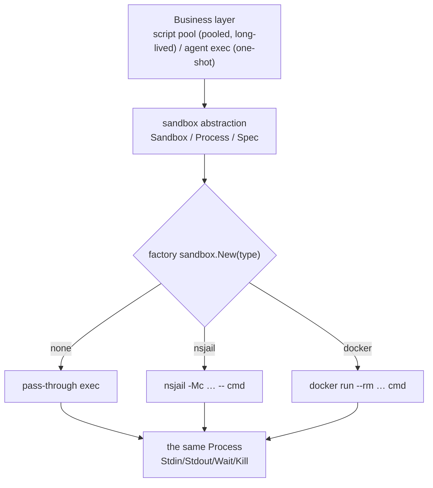

# Sandbox execution plan

> Configurable process isolation for "workflow script execution" and "agent command execution",
> with three implementations (`none` / `nsjail` / `docker`) and zero changes to business code.
>
> **Current state: stage 1 is done** (interface abstraction + the `none` implementation + the two call sites
> consolidated + configuration skeleton).
> The nsjail / docker implementations are in §7.

---

## 1. Background

### 1.1 The "bare run" points before the change

| Location | Original code | Shape |
|---|---|---|
| Workflow script pool | `flame/tools/script/worker.go` → `exec.Command(cmd, script)` | **long-lived worker** (pooled and reused) |
| agent exec tool | `nexus/service/agent/tools/exec.go` → `exec.CommandContext(shell, "-c", cmd)` | **one-shot command** |
| MCP / RPC stdio | `service/{mcp,rpc}/client/conn.go` → `exec.Command(conn.Command)` | admin configured (untouched this round) |

All three ran as the **nexus service process identity**, with no kernel-level isolation.

### 1.2 Application-layer protection (kept as the first line of defence)

1. **Tool layer** `tools/safePath()`: rejects absolute paths and `..`
2. **Storage layer** `FilesystemStorage.fullPath()`: `filepath.Join(Root, filepath.Clean("/"+p))`, cannot escape root
3. **(added in stage 1) tenant prefix assertion** `Context.StoragePath()`: the result must land under `tenants/{schema}/`

### 1.3 Threat model

| Threat | Before | With the sandbox enabled |
|---|---|---|
| Command escape (`rm -rf /`, reading `/etc/passwd`, reading `config.yaml`) | executable | blocked at kernel level |
| Reading `tenants/t1/**` across tenants | application layer only | mount isolation, physically invisible |
| Network exfiltration | wide open | `network=none` |
| CPU / memory / fork bomb | unlimited | cgroup limits |
| Privilege escalation | nexus identity | anonymous uid + read-only rootfs |

### 1.4 Why "locking down exec" closes the loop

An agent's intelligence is the Go loop inside nexus; **LLM output is plain text**. Its only "code execution" channel is the
`exec` tool, and the remaining tools (`file_*`, `meta`) go through `storage` + `safePath`, which are **bounded**.

```
lock exec
  └─► cannot create symlinks / hard links (file tools only write regular files)
        └─► the literal path check in safePath is sufficient
              └─► file tools have no traversal path  ⇒ loop closed
```

> The tenant prefix assertion from §1.2 is still needed as the second line of defence (added in stage 1).

---

## 2. Goals and non-goals

**Goals**: one abstraction covering both shapes; three implementations switchable by configuration; zero changes to business
code; unconfigured means today's behaviour.

**Non-goals**: turning the whole agent into a process (§9); sandboxing MCP/RPC stdio; egress allow-lists.

---

## 3. Architecture

### 3.1 Layering



### 3.2 Creation and invocation (clarification)

- **Creation**: once per the **configured type** (`sandbox.New(cfg.TypeFor("script_pool"))`), reused for the process lifetime.
- **Invocation**: `sb.Start(ctx, spec)` — `spec` carries the **concrete command** (`Argv`), mounts (`Mounts`) and limits
  (`Limits`).
- `none` **ignores** `Mounts`/`Limits` and runs `Argv` against host paths (equivalent to the pre-change behaviour).
- `nsjail`/`docker` **wrap** `Argv` with `Mounts`/`Limits` before handing it to the underlying binary.

### 3.3 Core interfaces (`flame/tools/sandbox`)

```go
type Sandbox interface {
	Name() string
	Start(ctx context.Context, spec *Spec) (Process, error)
}

type Process interface {
	Stdin() io.WriteCloser
	Stdout() io.ReadCloser
	Wait() error
	Kill() error
}

type Spec struct {
	Argv    []string   // full command line (sandbox paths)
	Dir     string     // working directory (sandbox path)
	Env     []string   // nil = inherit the parent process
	Stdin   []byte     // one-shot input (used by Run)
	Stderr  io.Writer  // nil = io.Discard
	Mounts  []Mount
	Limits  Limits
	Network bool
}

type Limits struct {
	MemoryMB, CPUCount, MaxPIDs int
	MaxFileMB                   int
	Timeout                     time.Duration
	MaxOutputBytes              int64 // output cap for Run, so huge output cannot eat memory
}
```

**Both shapes share `Start`**:

| Shape | Usage |
|---|---|
| Pooled long-lived (script pool) | `Start` → repeatedly write `Process.Stdin()` / read `Stdout()` |
| One-shot (agent exec) | `Start` → write → close stdin → read → `Wait`, or use `sandbox.Run` directly |

---

## 4. The three implementations compared

| | `none` | `nsjail` | `docker` |
|---|---|---|---|
| Actual argv | `lua /work/w.lua` | `nsjail -Mc --chroot … -- lua /work/w.lua` | `docker run --rm -i … lua /work/w.lua` |
| Process tree | nexus → target | nexus → **nsjail** → target | nexus → docker → … → target |
| Filesystem | the whole host | rootfs + mount points | image + mount points |
| Network | wide open | closed | `--network none` |
| Identity | nexus identity | anonymous uid | container uid |
| Startup cost | ~1 ms | **~10 ms** (order of magnitude, to be measured) | ~300 ms–1 s (order of magnitude, to be measured) |
| Platform | all platforms | Linux only | all platforms |

### 4.1 Path mapping (paths differ inside and outside the sandbox)

| Item | `none` | Inside the sandbox |
|---|---|---|
| Interpreter | `lua5.4` (on PATH, or absolute) | `/usr/bin/lua5.4` (in the image, `lua` symlinked to it) |
| worker script | `D:/proj/.../script/workers/default/worker.lua` | `/workers/default/worker.lua` (read-only mount) |
| Run-domain working directory (exec) | `D:/.../tenants/t0/users/{uid}/sessions/{sid}` | `/workspace` (read-write mount, cwd) |
| agent definition domain (exec) | `D:/.../tenants/t0/agents/{name}` | `/agent` (read-only mount) |
| Skill directory (run_skill_script) | `D:/.../tenants/t0/skills/{skill}` | `/skill` (read-only mount) |

> The worker scripts are embedded via `//go:embed workers/*` and extracted into `script/workers/` at startup.
> Sandboxing **does not change the script content**; it only mounts it read-only into the sandbox and prefixes argv.

---

## 5. Configuration

> **Status note**: the `sandbox:` structure below is the stage-1 shape (in-process isolation inside nexus) and is kept for
> historical reference. On the nexus side all that is left is "where to connect": `sandbox.url` (sandbox service base URL,
> with `/v1/exec` and `/v1/code` appended per use) plus `sandbox.token`; the isolation mode, resource limits, pool and
> concurrency policy all live in the sandboxd configuration (`sandboxd/config.yaml`), see §9.

```yaml
sandbox:
  default: "none"            # none | nsjail | docker
  script_pool:               # per-purpose override (empty inherits default)
    type: ""
    limits: { timeout_sec: 600, memory_mb: 512 }
  agent_exec:
    type: ""
    limits: { timeout_sec: 30, memory_mb: 256 }
  nsjail:
    binary: "nsjail"
    rootfs: "/opt/nsjail/rootfs"
    uid: 99999
    gid: 99999
    disable_network: true
    read_only_rootfs: true
    limits: { memory_mb: 512, cpu_count: 1, max_pids: 128 }
    extra_args: []
  docker:
    binary: "docker"
    image: "flame-runner:latest"
    network: "none"
    read_only: true
    user: "1000:1000"
    limits: { memory_mb: 512, cpu_count: 1, max_pids: 128 }
    extra_args: []
```

**Precedence**: per-purpose `type` → global `default` → `"none"` (`SandboxConfig.TypeFor(use)`)

**Script-language side** (host vs sandbox paths):

```yaml
script:
  lua:
    command: "lua"                         # none mode (lua5.4 on the host PATH)
    sandbox_command: "/usr/bin/lua5.4"     # sandbox mode (empty inherits command)
    sandbox: ""                            # implementation for this language alone
```

### 5.1 Gateway (`sandboxg`): discovery and static backends

`sandboxg/config.yaml` has two sources for the backend list. They are not alternatives you have to choose between, but they
are not equal either:

| `discovery.type` | `backends` |
| --- | --- |
| empty | the pool; nothing else moves it |
| `consul` / `nacos` | the initial **seed**: it serves traffic before the first pull and while the registry is unreachable. A successful pull is authoritative, so a static entry the registry does not list is dropped (its sticky bindings are cleared with it) |

Two answers keep the pool instead of emptying it: a pull that **errors**, and a pull that **succeeds but returns no
instance** (a rolling restart looks exactly like the second). A backend that is really gone is then removed by the health
check (`health_check_fail_threshold`), not by an empty registry answer.

Tokens differ by source: an instance from `backends` uses its own `token`, an instance from discovery uses `sandbox_token`
(a registry yields addresses only), so a discovery-managed deployment has to set `sandbox_token`.

Rule of thumb: fixed set → `backends` only; elastic set → `discovery` + `sandbox_token`; "static always wins, discovery
only fills in" is not supported.

---

## 6. Changes already shipped

| Path | Change |
|---|---|
| **pooled** `tools/script/worker.go` | `spawnWorker(sb, cmd, scriptPath)`: `exec.Command` → `sb.Start(spec)`; `Worker.cmd` → `proc sandbox.Process` |
| **pooled** `tools/script/pool.go` | `PoolConfig.Sandbox` field; passed to `spawn()`. **The pooling mechanism (prestart / borrow-return / health sweep / replace) is unchanged** |
| **one-shot** `agent/tools/exec.go` | `sb.Start(spec)` + concurrent stdout reading; **keeps the `limitedBuffer` truncation** |
| **injection** `agent/tools/tool.go` | `SetSandbox` / `CurrentSandbox` (same style as `SetScriptPool`) |
| **configuration** `shared/config` + `config.yaml` + `cmd/main.go` | configuration skeleton + startup initialisation |

> After stage 1 the pool and worker were moved wholesale into the standalone `sandboxd` (`internal/daemon/pool.go`,
> `workers/worker.*`); the `tools/script/*` paths in the table above are the shape at the time.

---

## 7. Staged plan

| Stage | Content | Status |
|---|---|---|
| **1** | `sandbox` package + `none` implementation + both call sites consolidated + configuration skeleton + tenant prefix assertion | ✅ **done** |
| **2** | `docker` implementation (cross-platform, verifiable on Windows) | ⏳ pending |
| **3** | `nsjail` implementation (Linux, lowest startup cost) | ⏳ pending |
| **4** | startup self-check (dependency check + warning when production runs without a sandbox) | ⏳ pending |

### Stage 1 acceptance (done)

```
INFO: Sandbox initialized: script_pool=none agent_exec=none
INFO: Script pool initialized          ← the worker started under the abstraction (ping/pong passed)
go build ./...  → 0 in both modules
```

---

## 8. Risks and mitigations

| Risk | Mitigation |
|---|---|
| `none` used in production by mistake | stage 4 startup self-check (strong warning / refuse to start) |
| docker startup cost (agent exec latency) | use nsjail for the script pool; or introduce "long-lived container" / "terminal session pool" → **decided as L2, see §9** |
| nsjail rootfs maintenance cost | preinstall only lua/python/node; image the rootfs |
| wrong paths inside vs outside the sandbox | keep `sandbox_command` and `Mounts` explicitly separate; validate at startup |
| worker state pollution inside the pool | `lifecycle=restart` (discard after use, see §9); lua is the exception, using `reuse` + soft reset inside the worker |

**What the sandbox does not solve** (explicit boundaries):

| Problem | Note |
|---|---|
| The LLM sending data to an external model | compliance / business problem |
| Prompt injection producing "legitimate but harmful" actions | the sandbox stops crossing boundaries, not authorized behaviour |
| Path holes in nexus's own storage access | guaranteed by the application layer (the three defences in §1.2) |

---

## 9. Pooling unit and lifecycle (L1 / L2 / L3)

### 9.1 The question: what exactly is the pooled "unit"

The money pooling saves = build cost ÷ reuse count. A cold worker start has two cost components:

| Component | Content | Magnitude (estimate, **to be measured**) |
|---|---|---|
| ① isolation setup | nsjail: clone namespace + bind mount + chroot; docker: container creation | nsjail ~1–3 ms; docker **300 ms–1 s** |
| ② interpreter start | start lua / python / node and load the worker script | lua ~2 ms; python ~20–50 ms; node ~30–60 ms |

The question is not "pool or not", but **what is being reused**:

| | Reused | ① isolation setup | ② interpreter start | State across requests | Fits |
|---|---|---|---|---|---|
| **L1** reuse | everything (isolation unit + interpreter) | amortised | amortised | **leftovers** | lua |
| **L2** container reuse + new interpreter per request | only the isolation unit | amortised | paid per request | none | docker + python/go |
| **L3** discard after use | nothing | paid per request | paid per request | none | nsjail + python/go |

**L2 only holds for docker**: `docker exec` is the native capability of "entering an existing unit from outside". nsjail has
no exec-into (its execute modes are LISTEN / ONCE / RERUN / EXECVE; under `nsjail -Mc` the jail and the interpreter live and
die together — killing the interpreter makes the jail disappear with it). Doing L2 with nsjail would mean building a
supervisor inside the jail (frame proxy, PID 1 reaping, per-request timeout management, mounts fixed at build time), while
rebuilding the jail takes only ~10 ms — not worth it.

### 9.2 Decision (settled)

| Language | nsjail / none | docker | Rationale |
|---|---|---|---|
| **lua** | `reuse` | `reuse` | µs-level high frequency (branch / loop / binding transform); cold start would dominate the execution itself |
| **python / go** | `restart` (L3) | `restart` (L2) | tens of ms to seconds per run, so cold start is a small share; trade cleanliness for simplicity |

⚠️ Once L2 ships, the docker column's `reuse` and `restart` are **equivalent**: the interpreter is created per request anyway,
so leftovers are moot (see §9.3). The table keeps the values only so existing configuration need not change.

Configuration landing point: `script.pools.<lang>.lifecycle` in `sandboxd/config.yaml` (default `reuse`, preserving historical
behaviour; a misspelled value fails at startup instead of silently degrading). The pool switch is the language entry as a
whole: an entry present = that language enables an idle pool and serves requests, so comment the whole entry out if you do not
want it (script requests for that language then receive `unsupported_lang`); "no prewarm / no idle retention" is expressed by
`script.pools.<lang>.idle.{initial,max}` (`0` is legal, and omitting both means `{0,0}`).

### 9.3 Implementation notes per tier

**L1 (unchanged)**: `Release(w, reusable)` — return for reuse only when the protocol layer is clean and the liveness probe
passes; otherwise destroy.

**L3 (shipped, `internal/daemon/pool.go` + `worker.go`)**
- with `lifecycle=restart`, `Release` **always destroys** (reusable or not) and the refiller tops the pool up;
- `Worker.Destroy()` = close stdin → kill → **Wait to reap** (`isolate`'s `Process.Kill` does not reap, and not waiting leaks
  one zombie per request) → delete the worker's exclusive tmp directory (with retries; failures are left to the next startup
  sweep);
- the **refiller** maintains `idle.initial` idle workers: prewarm at startup + immediate top-up on `kick` after a return + 1 s
  self-healing sweep (with `idle.initial = 0` it returns immediately and the pool only spawns on the request path). The
  original `prewarm` ran once at startup — under the restart tier, without a refiller the pool drains quickly and prewarming
  is wasted.

**L2 (shipped, `sandboxd/isolate/docker_unit.go` + `sandboxd/internal/daemon/unit.go`)**
- the isolation layer gains a "reusable unit" capability: `sandbox.Reusable` with `Acquire() (Unit, error)` /
  `Unit.Exec(spec)` / `Unit.Close()`. The pool does **capability detection** via `iface.(sandbox.Reusable)` and has no
  `if docker` branch (`none`/`nsjail` do not implement the interface → they degrade to L3 automatically).
- docker implementation: create the container once with `docker run -d --rm --init --label sandboxd=1 --network none
  --read-only -v <workers>:ro -v <unit_tmp>:/tmp -w /tmp <image> sleep infinity`; per request
  `docker exec -i -w /tmp/<req-id> <id> <interpreter> /workers/worker.<ext>`.
- killing the interpreter (**never use `docker kill/stop/rm`**, that destroys the unit) in three tiers: close stdin (all three
  workers exit on EOF) → `docker exec <id> pkill -9 -f /workers/worker.` as a follow-up (killing the exec client does not
  guarantee the in-container process dies) → if still not clean, **discard the whole unit** (`Unit.Close()`).
- two details that must be respected: `--init` (PID 1 must be able to reap, otherwise orphans/zombies forked by the script
  pile up under `sleep infinity`); **do not add `-t`** (TTY line processing corrupts the binary frames with a 4-byte length
  prefix).
- `docker exec` does not support `-v` → writable directories are mounted when the container is created; each request creates a
  subdirectory under them and **deletes it afterwards**.
- unit and host paths must be **absolute**: docker's `-v` rejects relative paths (they are treated as a named volume and fail
  with `invalid characters for a local volume name`).
- **whether containers are reused is a configuration decision**: unit pool capacity uses `script.pools.<lang>.idle.max`
  verbatim, with `0` meaning no retention — the unit is `Unit.Close()`d on return and a container is created per request (less
  memory, slower). The old code had a `<=0 → 4` hard fallback that made L2 container reuse **immune to configuration**; it has
  been removed.
- shutdown and self-healing — L2-specific: a unit's lifecycle is independent of the client (L3's foreground process exits when
  stdin closes; a `docker run -d` unit does not). Therefore:
  (a) sandboxd needs a graceful shutdown (signal → pool `Close()` → destroy units one by one);
  (b) units left behind by a crash / hard kill are reclaimed on the next startup by `--label sandboxd=1`
  (`sandbox.OrphanCleaner`).

### 9.4 Soft reset for lua (shipped, `sandboxd/workers/worker.lua`)

lua keeps `reuse`, and the worker clears leftovers itself:
- a fresh `_ENV` per request (`setmetatable({}, {__index = _G})`) → globals written by the script are dropped with the request,
  while the standard library / `require` stay available;
- compare `package.loaded` before and after, clearing modules newly loaded by this request (the `require` cache is a table
  shared across requests);
- injected variables, callbacks and `log`/`print` also go into this request's `_ENV` instead of `_G`;
- **capability ceiling** (not a security boundary): a script that explicitly writes `_G.x`, module-level state inside a
  required module, static data in C extensions — a hostile script needs `lifecycle=restart` or a stronger isolation unit, not
  a soft reset.

### 9.5 Acceptance

`sandboxd/internal/daemon/pool_lifecycle_test.go` (fake isolation, no interpreter needed):

- restart: even a clean return must kill the process and delete the tmp directory, and the refiller restores the idle pool to
  `initial`;
- reuse: a clean return reuses the same worker instance without triggering a top-up; a dirty worker is destroyed and replaced.

`worker_softreset_test.go` (real lua, skipped automatically when lua is absent):

- a global written by the previous request reads as `nil` in the next one;
- the standard library / `require` still work, but modules newly loaded by this request are not left to the next;
- `input` does not leak across requests; runtime errors still carry line numbers.

### 9.6 The "kill it clean" closing semantics (shipped)

After one execution finishes, **no process / container / goroutine / pipe is left behind** — all four, because "killed only the
direct child" does not count as clean.

**Consolidated in one place** (`sandboxd/isolate/process.go`): all four start paths (none / nsjail / `docker run` /
`docker exec`) go through `startWithPipes`, so "how to kill" is decided exactly once (changing it in three places means three
places drift):

- the consolidation is a single `killFunc`, bound to **both `Process.Kill` and `cmd.Cancel`**. The latter cannot be skipped:
  the default cancel action of `exec.CommandContext` is `Process.Kill()` (a single pid), which would bypass the timeout /
  ctx-cancel path entirely;
- `cmd.WaitDelay` covers "the process exited but the pipe is still held": whenever `Stderr` is not an `*os.File`, `os/exec`
  starts an internal copying goroutine for it, and the only exit from that wait is pipe EOF (no goroutine is created when
  `Stderr` is nil — so do not fill it with `io.Discard` again).

**The method splits by the strength of the isolation boundary**:

- **boundary inside the host process tree (none / nsjail) → process group**: `SysProcAttr.Setpgid` +
  `kill(-pgid, SIGKILL)`, with `taskkill /T /F` on Windows.
  **Capability ceiling**: a process group is joined voluntarily and can `setsid` out of it, while none has no cgroup /
  namespace backstop — so its promise is "clean within the group", **not** "kill every descendant". That ceiling cannot be
  removed by an implementation.
- **docker → address the container**: the CLI is not the container's parent, so killing it only breaks the pipe
  (`docker run -d` is living proof of "CLI exits, container keeps running"; `--sig-proxy` does not help either — SIGKILL is
  uncatchable, there is nothing to forward).
  Therefore `docker run` carries `--name sandboxd-exec-<random>` + `--label sandboxd-exec=1`, and Kill does `rm -f` on the
  container first, then collects the CLI. A container is its own cgroup whose members are bookkept by the kernel, so **even
  `setsid` cannot escape** — this is the tier that is not escapable.
  Use a name rather than `--cidfile`: a name takes effect on the command line, needs no local file, and therefore has no file
  lifecycle to manage.

**Handler side** (`internal/daemon/handle_exec.go`): stdout forwarding runs on its own goroutine while the main goroutine keeps
an "interruptible wait". Because "stdout EOF" **is not** "process exit" — stdout is an fd inherited by the whole process tree,
and a single leftover process keeps it from ever reaching EOF. When the client disconnects, kill first and then force-release
the pipe, otherwise the handler stays stuck forever with one goroutine and one fd (which is also not clean).

**Orphan backstop**: `--rm` only guarantees "delete when the container exits", not "the container exits when the service
exits". At startup, sweep by `sandboxd=1` (reusable units) and `sandboxd-exec=1` (one-shot containers) — the latter had no
label at all before this change, so leaks were invisible.

**Verified** (Windows + docker, 2026-10-15):

- `sandboxd/isolate/process_test.go` — a three-level process tree (test process → middle layer → heartbeat layer); after Kill
  it asserts the **grandchild** stops writing heartbeats. An implementation that kills only the direct child still lets the
  middle layer exit, so "the parent finished" cannot be the criterion.
- `sandboxd/isolate/docker_test.go` — real docker: the container disappears after Kill and orphan containers are reclaimable by
  label; another case pins "killing the CLI ≠ killing the container" as an executable premise (a failure there would mean
  docker changed semantics).
- `sandboxd/internal/daemon/exec_e2e_test.go` — end-to-end against the real service: disconnect / explicit kill frame / normal
  exit must all leave no container behind, and the service must not be dragged down.
- all three groups were negatively verified: reverting the consolidation to "kill only the pid" or "kill only the CLI" does
  make the corresponding cases fail.
- all three groups are environment-gated (`SANDBOXD_TEST_EXEC_URL` / `SANDBOXD_TEST_DOCKER` / `SANDBOXD_TEST_IMAGE`) and skip
  automatically where there is no docker / no service.

**Awaiting a real Linux run** (not constructible on Windows; verification stops here):

1. **whether nsjail does its own `setsid`** — this decides whether the process-group method holds for nsjail.
   Method: start the service with `mode=nsjail` and run the three cases from `exec_e2e_test.go` (they assert "any
   container/process left behind", independent of mode).
   If processes inside the jail stay alive → the process group cannot reach them → switch to nsjail's cgroup option instead.
2. **`handle_exec`'s "stop forwarding and release the pipe on disconnect"** — the pathological scenario is not constructible
   under docker (`rm -f` takes down every process in the container together with the pipe); verifying it properly needs a
   grandchild that really `setsid`s out and still holds stdout. Construction on Linux: run `exec setsid sh -c 'sleep 300 >&1'
   &` inside, disconnect immediately, and assert the handler is not stuck (the service still answers `/healthz`) and the
   process is collected. Without that `handle_exec` change it stays stuck forever.

**Known capability ceilings** (not todos, but design limits):

- none mode's promise is only "clean within the process group", **not** "kill every descendant" — it has no cgroup /
  namespace backstop, and a single `setsid` escapes. Do not use none where real isolation is needed.
- the follow-up kill of the interpreter inside a reused unit is still a `pkill -9 -f /workers/worker.` substring match
  (processes matching the same substring are hit too); but the backstop is "discard the unit" → `rm -f`, so it over-kills but
  never leaks.
- the startup sweep assumes this service owns the docker daemon: with several instances sharing one daemon, startup
  reclamation deletes sibling instances' in-flight containers (this was already true in the unit-label era).

### 9.7 Still to do

1. **the L2 body** (see 9.3), needs an environment with docker to verify;
2. **measure the cold-start numbers**: the two magnitudes in §9.1 come from comments/documentation estimates and should be
   measured before settling the python/go trade-off;
3. in-jail supervisor for nsjail (L2-for-nsjail) — unless jail rebuild cost later proves unacceptable, do not do it.

### 9.8 The browser moved out of the sandbox (shipped)

**Decision**: the browser is its own service **and its own Go module**: `browserd/` (`flame/browserd`), holding
`cmd/browserd` (the pool), `cmd/browserhost` (the in-container driver) and `cmd/browserclient` (the manual verification
tool). It is separate at the module level for the same reason it is separate at the process level — it has its own
release cadence and its own resource profile, and sharing a module with sandboxd meant every browser change rebuilt the
sandbox image. sandboxd no longer launches a browser, no longer accepts `tool_id=browser` on `/v1/interactive`, and no
longer reports a `browser` field in `/v1/capabilities`.

**Why**: a browser is not "a shell that draws pictures". It is 200-400 MB, takes seconds to start, and keeps login state
in its `user-data-dir`; a shell's lifecycle parameters (one process per session, idle timeout, kill) do not describe it
correctly. Tying it to the sandbox also tied it to the isolation mode — under nsjail the rootfs simply cannot host
Chromium, so "does this deployment offer a browser" was answered by an unrelated decision.

**Protocol**: `/v1/browser` speaks the **same frames** as `/v1/interactive` (open / `ChanStdin` / kill), so the caller
reuses `sandbox.InteractiveClient` — a new URL, not a new client. The open frame's `argv` and `mounts` are ignored: the
pool decides which driver and which Chromium to launch. `Spec.Dir` is honoured, but with a different meaning than in the
sandbox — it is a **workspace path relative to `workspace_root`**, not a sandbox-internal absolute path.

**Workspace (the one thing still shared)**: a browser produces files (screenshots, downloads) that the model must be able
to open afterwards. `workspace_root` must therefore be the same mount as nexus's `storage.root_dir`; each session runs the
driver with `cwd` inside it, so a relative screenshot path and the download directory both land in the tenant's workspace.
The Chromium profile does **not** live there: it is this service's private state and is deleted when the session ends.

**Capacity**: one session = one Chromium, never reused across sessions (reuse would hand one tenant's cookies to the
next). What is pooled is capacity: `workers` (the memory ceiling), `max_per_tenant` (a per-tenant quota, keyed by the
`?tenant=` query), queueing with `queue_timeout_sec`, and idle reclamation (`idle_timeout_sec` + `janitor_sec`).

**Kill semantics**: an open frame **without a spec** is a probe or a kill, and it never creates a browser — otherwise
"reclaim the processes of this run" would launch a Chromium only to destroy it. A kill frame releases the lease and
deletes the profile.

**Verification**: `browserclient` drives the real protocol by hand (`open` → `snapshot` → `kill`, and kill twice); the
pool's unit tests run without a browser installed (lease stickiness, queue timeout, per-tenant cap, idle reclamation,
workspace path escape, downloads following the workspace).

### 9.9 The browser gateway (browserg) — separate from sandboxg

A single `browserd` cannot serve a deployment that needs more than one: sessions are sticky by nature, and a per-tenant
cap counted inside one instance multiplies by the number of instances. The gateway is therefore `browserg/`
(`flame/browserg`, `:27090`), and pool instances run on `:27091`.

**Why not fold it into sandboxg** — three structural conflicts, not taste:

1. **`/v1/capabilities` is not the same document.** sandboxg passes one sandboxd's snapshot through. The browser snapshot
   is a *pool* answer (`available` = any instance, `headed_available` = all of them, counters summed, `idle_sec` = the
   minimum) and nexus derives it from `browser.url`. Two shapes behind one path would force a new config key just to say
   which one you mean.
2. **Sticky keys collide.** The shell channel and the browser channel share the same `session_id` but must land on
   different pools; sandboxg's key namespace (`sandboxg:session:<id>`) would have to grow a per-domain suffix, and a mistake
   there is not a crash — it is a shell routed to a browser pool.
3. **The capacity models are not comparable.** sandboxg scores an instance by live process count; a browser's unit is a
   live Chromium (300 MB, one per session). Ranking one against the other would need a type switch inside the router.

Plus the blast radius: a shared process means one restart drops every browser connection together with every exec route,
and the two pools scale on completely different curves.

**Routing**: every open frame that carries a session key is sticky — including a session-less run, where nexus puts the
run id in the same field. `?tenant=` on the channel is forwarded unchanged; it is the key the instance counts with, and a
path-only forward would silently disable it.

**Capacity**: `queue × 1_000_000 + sessions × 1_000 / workers` — queueing dominates, and the occupancy rate breaks ties.

**Quota**: `max_per_tenant` is enforced by the gateway alone (`live` from each instance's `/v1/sessions` plus a short-lived
`pending` count for opens the next snapshot has not seen yet). A cap configured per instance would multiply by the number of
instances, so browserd's own cap should stay 0 and `workers` remains its hard ceiling.

**Failure semantics**: if the binding points at an instance that is no longer healthy, the open fails with
`session lost` instead of being re-routed. A browser cannot be migrated — the cookies and tabs are gone with the instance —
and silently building an empty one elsewhere would leave the model talking to a page it no longer has. `session_empty`
(no lease left) is different: it is a clean signal, and the gateway unbinds without an error.

**Multi-instance precondition**: every browserd's `workspace_root` must be the same directory as nexus's
`storage.root_dir`. Otherwise a screenshot is written on whichever machine served the session, and nexus — possibly on
another machine — cannot read it back, with no error anywhere.

---

## 10. Evolution (out of scope this round)

**Put the whole agent in the sandbox** (more thorough defence in depth):

1. the agent loop + tools compiled into a standalone `agent-runner` binary
2. nexus starts it via `sandbox.Start()`, talking **stdin/stdout JSON IPC** (reusing the script-pool protocol)
3. the sandbox only mounts this tenant's workspace; the network only allows LiteLLM
4. meta tools (`create_agent` etc.) become callbacks into nexus

**Cost**: the agent becomes a process; storage / streaming (`progressCh`) / meta tools all cross a process boundary; and
**once the network is open for the LLM, the value of network isolation drops**.

**Stronger isolation** (same tier of improvement): gVisor / Kata Containers / Firecracker microVM — a user-space kernel or
micro-VM, not in the same security class as nsjail/docker (which share the host kernel).
