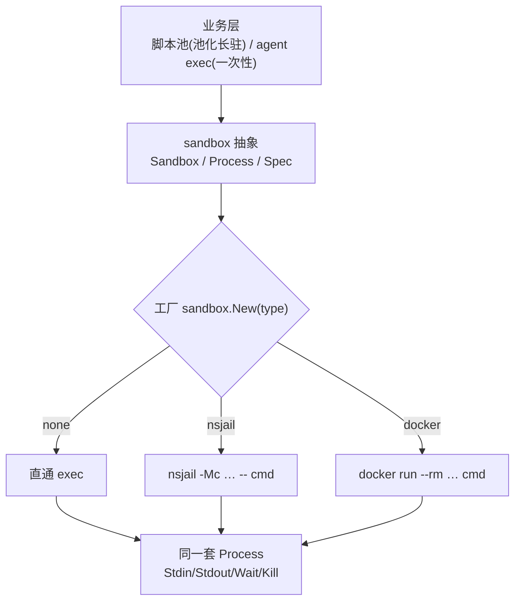

# 沙箱执行方案

中文 | [English](sandbox-design.md)

> 为「工作流脚本执行」与「agent 命令执行」引入可配置的进程隔离，
> 支持 `none` / `nsjail` / `docker` 三种实现，业务代码零改动。
>
> **当前状态：阶段 1 已完成**（接口抽象 + `none` 实现 + 两处收口 + 配置骨架）。
> nsjail / docker 实现见 §7。

---

## 1. 背景

### 1.1 改造前的「裸跑」点

| 位置 | 原始代码 | 形态 |
|---|---|---|
| 工作流脚本池 | `flame/tools/script/worker.go` → `exec.Command(cmd, script)` | **长驻 worker**（池化复用） |
| agent exec 工具 | `nexus/service/agent/tools/exec.go` → `exec.CommandContext(shell, "-c", cmd)` | **一次性命令** |
| MCP / RPC stdio | `service/{mcp,rpc}/client/conn.go` → `exec.Command(conn.Command)` | 管理员配置（本期不动） |

三者均以 **nexus 服务进程身份**运行，无内核级隔离。

### 1.2 应用层防护（保留为第一道防线）

1. **工具层** `tools/safePath()`：拒绝绝对路径与 `..`
2. **存储层** `FilesystemStorage.fullPath()`：`filepath.Join(Root, filepath.Clean("/"+p))`，逃不出 root
3. **（阶段 1 新增）租户前缀断言** `Context.StoragePath()`：结果必须落在 `tenants/{schema}/` 内

### 1.3 威胁模型

| 威胁 | 改造前 | 启用沙箱后 |
|---|---|---|
| 命令逃逸（`rm -rf /`、读 `/etc/passwd`、读 `config.yaml`） | 可执行 | 内核级阻断 |
| 跨租户读 `tenants/t1/**` | 仅应用层 | 挂载隔离，物理不可见 |
| 网络外泄 | 全开 | `network=none` |
| CPU / 内存 / fork 炸弹 | 无限制 | cgroup 限制 |
| 提权 | 同 nexus 身份 | 匿名 uid + 只读 rootfs |

### 1.4 为什么「锁 exec」基本闭环

agent 的智能是 nexus 内的 Go 循环，**LLM 输出是纯文本**；它唯一的「代码执行」通道是
`exec` 工具，其余工具（`file_*`、`meta`）都走 `storage` + `safePath`，是**有界**的。

```
锁住 exec
  └─► 无法创建 symlink / 硬链接（file 工具只能写普通文件）
        └─► safePath 的字面路径检查已足够
              └─► 文件工具无穿越途径  ⇒ 闭环
```

> 仍需 §1.2 的租户前缀断言作为第二道防线（阶段 1 已加）。

---

## 2. 目标与非目标

**目标**：统一抽象覆盖两种形态；三种实现可配置切换；业务代码零改动；不配置即等于现状。

**非目标**：agent 整体进程化（见 §9）；MCP/RPC stdio 沙箱化；网络出口白名单。

---

## 3. 架构

### 3.1 分层



### 3.2 创建与调用（澄清）

- **创建**：按**配置里的类型**创建一次（`sandbox.New(cfg.TypeFor("script_pool"))`），进程级复用。
- **调用**：`sb.Start(ctx, spec)` —— `spec` 携带**具体命令**（`Argv`）、挂载（`Mounts`）、上限（`Limits`）。
- `none` **忽略** `Mounts`/`Limits`，直接按宿主路径执行 `Argv`（等价改造前行为）。
- `nsjail`/`docker` 用 `Mounts`/`Limits` **包装** `Argv` 后交给底层。

### 3.3 核心接口（`flame/tools/sandbox`）

```go
type Sandbox interface {
	Name() string
	Start(ctx context.Context, spec *Spec) (Process, error)
}

type Process interface {
	Stdin() io.WriteCloser
	Stdout() io.ReadCloser
	Wait() error
	Kill() error
}

type Spec struct {
	Argv    []string   // 完整命令行（沙箱内路径）
	Dir     string     // 工作目录（沙箱内路径）
	Env     []string   // nil = 继承父进程
	Stdin   []byte     // 一次性场景输入（Run 使用）
	Stderr  io.Writer  // nil = io.Discard
	Mounts  []Mount
	Limits  Limits
	Network bool
}

type Limits struct {
	MemoryMB, CPUCount, MaxPIDs int
	MaxFileMB                   int
	Timeout                     time.Duration
	MaxOutputBytes              int64 // Run 的输出上限，防大输出吃爆内存
}
```

**两种形态共用 `Start`**：

| 形态 | 用法 |
|---|---|
| 池化长驻（脚本池） | `Start` → 反复 `Process.Stdin()` 写 / `Stdout()` 读 |
| 一次性（agent exec） | `Start` → 写 → 关 stdin → 读 → `Wait`，或直接用 `sandbox.Run` |

---

## 4. 三种实现对比

| | `none` | `nsjail` | `docker` |
|---|---|---|---|
| 实际 argv | `lua /work/w.lua` | `nsjail -Mc --chroot … -- lua /work/w.lua` | `docker run --rm -i … lua /work/w.lua` |
| 进程树 | nexus → 目标 | nexus → **nsjail** → 目标 | nexus → docker → … → 目标 |
| 文件系统 | 整个宿主 | rootfs + 挂载点 | 镜像 + 挂载点 |
| 网络 | 全开 | 关闭 | `--network none` |
| 身份 | nexus 身份 | 匿名 uid | 容器 uid |
| 启动开销 | ~1 ms | **~10 ms**（量级估算，待实测） | ~300 ms–1 s（量级估算，待实测） |
| 平台 | 全平台 | Linux only | 全平台 |

### 4.1 路径映射（沙箱内外不同）

| 项 | `none` | 沙箱内 |
|---|---|---|
| 解释器 | `lua5.4`（PATH 内，或绝对路径） | `/usr/bin/lua5.4`（镜像内，`lua` 软链至此） |
| worker 脚本 | `D:/proj/.../script/workers/default/worker.lua` | `/workers/default/worker.lua`（只读挂载） |
| 运行域工作目录（exec） | `D:/.../tenants/t0/users/{uid}/sessions/{sid}` | `/workspace`（读写挂载、cwd） |
| agent 定义域（exec） | `D:/.../tenants/t0/agents/{name}` | `/agent`（只读挂载） |
| 技能目录（run_skill_script） | `D:/.../tenants/t0/skills/{skill}` | `/skill`（只读挂载） |

> worker 脚本由 `//go:embed workers/*` 内嵌、启动时释放到 `script/workers/`。
> 沙箱化**不改脚本内容**，只把它只读挂载进沙箱并改 argv 前缀。

---

## 5. 配置

> **现状提示**：下面的 `sandbox:` 结构是阶段 1（nexus 内联隔离）的形态，保留作历史参考。
> 现在 nexus 侧只剩「连到哪里」：`sandbox.url`（沙箱服务基地址，按用途拼 `/v1/exec` 与
> `/v1/code`）+ `sandbox.token`；隔离方式、资源上限、池与并发策略全部在 sandboxd 的配置里
> （`sandboxd/config.yaml`），见 §9。

```yaml
sandbox:
  default: "none"            # none | nsjail | docker
  script_pool:               # 用途级覆盖（留空沿用 default）
    type: ""
    limits: { timeout_sec: 600, memory_mb: 512 }
  agent_exec:
    type: ""
    limits: { timeout_sec: 30, memory_mb: 256 }
  nsjail:
    binary: "nsjail"
    rootfs: "/opt/nsjail/rootfs"
    uid: 99999
    gid: 99999
    disable_network: true
    read_only_rootfs: true
    limits: { memory_mb: 512, cpu_count: 1, max_pids: 128 }
    extra_args: []
  docker:
    binary: "docker"
    image: "flame-runner:latest"
    network: "none"
    read_only: true
    user: "1000:1000"
    limits: { memory_mb: 512, cpu_count: 1, max_pids: 128 }
    extra_args: []
```

**优先级**：`用途级 type` → `全局 default` → `"none"`（`SandboxConfig.TypeFor(use)`）

**脚本语言侧**（区分宿主/沙箱路径）：

```yaml
script:
  lua:
    command: "lua"                         # none 模式（宿主 PATH 里的 lua5.4）
    sandbox_command: "/usr/bin/lua5.4"     # 沙箱模式（留空则沿用 command）
    sandbox: ""                            # 本语言单独指定实现
```

---

## 6. 已落地的改造点

| 路径 | 改造 |
|---|---|
| **池化** `tools/script/worker.go` | `spawnWorker(sb, cmd, scriptPath)`：`exec.Command` → `sb.Start(spec)`；`Worker.cmd` → `proc sandbox.Process` |
| **池化** `tools/script/pool.go` | `PoolConfig.Sandbox` 字段；`spawn()` 传入。**池化机制（预启动/借还/健康巡检/replace）零改动** |
| **一次性** `agent/tools/exec.go` | `sb.Start(spec)` + 并发读 stdout；**保留 `limitedBuffer` 截断** |
| **注入** `agent/tools/tool.go` | `SetSandbox` / `CurrentSandbox`（同 `SetScriptPool` 风格） |
| **配置** `shared/config` + `config.yaml` + `cmd/main.go` | 配置骨架 + 启动初始化 |

> 阶段 1 之后，池化与 worker 已整体搬到独立的 `sandboxd`（`internal/daemon/pool.go`、
> `workers/worker.*`），上表里的 `tools/script/*` 路径是当时的形态。

---

## 7. 分阶段计划

| 阶段 | 内容 | 状态 |
|---|---|---|
| **1** | `sandbox` 包 + `none` 实现 + 两处收口 + 配置骨架 + 租户前缀断言 | ✅ **已完成** |
| **2** | `docker` 实现（跨平台，Windows 可验证） | ⏳ 待做 |
| **3** | `nsjail` 实现（Linux，启动开销最低） | ⏳ 待做 |
| **4** | 启动自检（依赖检查 + 生产未启用沙箱告警） | ⏳ 待做 |

### 阶段 1 验收（已完成）

```
INFO: Sandbox initialized: script_pool=none agent_exec=none
INFO: Script pool initialized          ← 说明 worker 在抽象下启动成功（ping/pong 通过）
go build ./...  → 两个 module 均 0
```

---

## 8. 风险与缓解

| 风险 | 缓解 |
|---|---|
| `none` 被误用于生产 | 阶段 4 启动自检（强告警/拒绝启动） |
| docker 启动开销（agent exec 延迟） | 脚本池用 nsjail；或引入「长驻容器」、「终端会话池」 → **已定为 L2，见 §9** |
| nsjail rootfs 维护成本 | 只预置 lua/python/node；rootfs 镜像化 |
| 沙箱内外路径不一致写错 | `sandbox_command` 与 `Mounts` 显式分离；启动时校验 |
| 池内 worker 状态污染 | `lifecycle=restart` 用完即弃（见 §9）；lua 例外走 `reuse` + worker 内软重置 |

**沙箱不解决的问题**（明确边界）：

| 问题 | 说明 |
|---|---|
| LLM 把数据发给外部模型 | 合规/业务问题 |
| 提示注入导致「合法但有害」的操作 | 沙箱只防越界，不防有权行为 |
| nexus 自身读写存储的路径漏洞 | 由应用层保证（§1.2 三道防线） |

---

## 9. 池化单元与生命周期（L1 / L2 / L3）

### 9.1 问题：池化的「单元」到底是什么

池化省的钱 = 建造开销 ÷ 复用次数。一次 worker 的冷启动含两段成本：

| 段 | 内容 | 量级（估算，**待实测**） |
|---|---|---|
| ① 隔离建立 | nsjail：clone namespace + bind mount + chroot；docker：容器创建 | nsjail ~1–3 ms；docker **300 ms–1 s** |
| ② 解释器启动 | 起 lua / python / node 并加载 worker 脚本 | lua ~2 ms；python ~20–50 ms；node ~30–60 ms |

关键不在「要不要池化」，而在**复用的是什么**：

| | 复用对象 | ① 隔离建立 | ② 解释器启动 | 跨请求状态 | 适用 |
|---|---|---|---|---|---|
| **L1** reuse | 全部（隔离单元 + 解释器） | 摊薄 | 摊薄 | **残留** | lua |
| **L2** 容器复用 + 每请求新解释器 | 只复用隔离单元 | 摊薄 | 每请求付 | 无 | docker + python/go |
| **L3** 用完即弃 | 不复用 | 每请求付 | 每请求付 | 无 | nsjail + python/go |

**L2 只对 docker 成立**：`docker exec` 是「从外部进入已有单元」的原生能力。nsjail 没有 exec-into
（执行模式只有 LISTEN / ONCE / RERUN / EXECVE；`nsjail -Mc` 下 jail 与解释器同生共死，杀解释器 =
jail 一起消失）。要在 nsjail 里做 L2，只能在 jail 内自建 supervisor（帧代理、PID 1 回收、单次超时
自管、挂载建时定死），而 jail 重建只要 ~10 ms —— 不值得。

### 9.2 决策（已定）

| 语言 | nsjail / none | docker | 理由 |
|---|---|---|---|
| **lua** | `reuse` | `reuse` | µs 级高频（分支 / 循环 / binding transform），冷启动会盖过执行本身 |
| **python / go** | `restart`（L3） | `restart`（L2） | 单次几十 ms ~ 秒级，冷启动占比小；用干净换省心 |

⚠️ L2 落地后，docker 一列的 `reuse` 与 `restart` 已经**等价**：解释器本来就每请求新建，
残留无从谈起（见 §9.3）。上表保留取值只是为了不改动既有配置。

配置落点：`sandboxd/config.yaml` 的 `script.pools.<lang>.lifecycle`（缺省 `reuse`，保持历史行为；
取值拼错会在启动时直接报错，不会静默降级）。pool 的开关是整个语言条目：条目在 = 该语言启用空闲池
并对外服务，不要就把它整条注释掉（该语言的 script 请求会收到 `unsupported_lang`）；「不预热 /
不留驻」由 `script.pools.<lang>.idle.{initial,max}` 表达（`0` 合法，两者都省略即 `{0,0}`）。

### 9.3 各档实现要点

**L1（未改动）**：`Release(w, reusable)` —— 协议层干净且探活通过的归还复用，否则销毁。

**L3（已落地，`internal/daemon/pool.go` + `worker.go`）**
- `lifecycle=restart` 时 `Release` **一律销毁**（无论 reusable 与否），由 refiller 补新单元；
- `Worker.Destroy()` = 关 stdin → kill → **Wait 回收**（`isolate` 的 `Process.Kill` 不回收，
  不 Wait 就是按请求泄漏僵尸）→ 删除该 worker 独占的 tmp 目录（带重试；失败留给下次启动清）；
- **refiller** 维持 `idle.initial` 个空闲 worker：启动预热 + 归还后 `kick` 即时补量 + 1 s 自愈巡检
  （`idle.initial = 0` 时它开头就 return，池只在请求路径上按需起进程）。
  原先 `prewarm` 只在启动跑一次 —— restart 档下没有 refiller，池子会被迅速抽干，预热等于白做。

**L2（已落地，`sandboxd/isolate/docker_unit.go` + `sandboxd/internal/daemon/unit.go`）**
- 隔离层新增「可复用单元」能力：`sandbox.Reusable` 的 `Acquire() (Unit, error)` /
  `Unit.Exec(spec)` / `Unit.Close()`。池按 `iface.(sandbox.Reusable)` 做**能力探测**，
  不出现 `if docker` 分支（`none`/`nsjail` 不实现该接口 → 自动退化成 L3）。
- docker 实现：建容器一次 `docker run -d --rm --init --label sandboxd=1 --network none --read-only
  -v <workers>:ro -v <unit_tmp>:/tmp -w /tmp <image> sleep infinity`；每请求
  `docker exec -i -w /tmp/<req-id> <id> <interpreter> /workers/worker.<ext>`。
- 杀解释器（**不能用 `docker kill/stop/rm`**，那是销毁单元）三档：关 stdin（三个 worker 都是
  「读到 EOF 就自退」）→ `docker exec <id> pkill -9 -f /workers/worker.` 补刀（杀 exec 客户端不保证
  容器内进程死）→ 仍未退干净则**弃掉整个单元**（`Unit.Close()`）。
- 两个必须遵守的细节：`--init`（PID 1 得能 reap，否则脚本 fork 出的孤儿/僵尸堆在 `sleep infinity` 下）；
  **不能加 `-t`**（TTY 的行处理会破坏 4 字节长度前缀的二进制帧）。
- `docker exec` 不支持 `-v` → 可写目录在建容器时挂好，每请求在其下建子目录、**用完删**。
- 单元与宿主路径必须是**绝对路径**：docker 的 `-v` 不接受相对路径（会被当成 named volume，
  报 `invalid characters for a local volume name`）。
- **容器要不要复用由配置决定**：单元池容量取 `script.pools.<lang>.idle.max` 原样，`0` 表示
  不留驻 —— 归还时直接 `Unit.Close()`，每次请求现场建容器（更省内存、更慢）。旧代码里这个
  容量有个 `<=0 → 4` 的硬兜底，导致 L2 的容器复用**不受配置控制**，现已去掉。
- 停机与自愈 —— L2 特有：单元的生命周期独立于客户端（L3 的前台进程会随 stdin 关闭自退，
  `docker run -d` 的单元不会）。因此：
  (a) sandboxd 需要优雅关闭（信号 → 池 `Close()` → 逐个销毁单元）；
  (b) 崩溃 / 强杀残留的单元按 `--label sandboxd=1` 在下次启动时回收（`sandbox.OrphanCleaner`）。

### 9.4 lua 的软重置（已落地，`sandboxd/workers/worker.lua`）

lua 继续 `reuse`，残留由 worker 自己清：
- 每请求一份新 `_ENV`（`setmetatable({}, {__index = _G})`）→ 脚本写的全局变量随请求丢弃，
  标准库 / `require` 照常可用；
- 执行前后对比 `package.loaded`，清掉本次新加载的模块（`require` 缓存是跨请求共享的表）；
- 注入变量、回调、`log`/`print` 也都写进本次的 `_ENV`，不再写 `_G`；
- **能力上限**（不是安全边界）：脚本显式写 `_G.x`、被 require 模块自身的模块级状态、C 扩展静态数据
  —— 敌意脚本要靠 `lifecycle=restart` 或更强的隔离单元，不能靠软重置。

### 9.5 验收

`sandboxd/internal/daemon/pool_lifecycle_test.go`（假隔离，不依赖解释器）：

- restart：干净归还也必须杀进程、删 tmp 目录，且 refiller 把空闲池补回 `initial`；
- reuse：干净归还同一个 worker 实例且不触发补量；脏 worker 销毁并补齐。

`worker_softreset_test.go`（真实 lua，本机无 lua 时自动跳过）：

- 上一个请求写的全局变量下一个请求读到 `nil`；
- 标准库 / `require` 仍可用，但本次新加载的模块不留给下一个请求；
- `input` 不跨请求残留；运行期错误仍带行号。

### 9.6 「杀干净」的收尾语义（已落地）

一次执行结束后，**没有进程 / 容器 / goroutine / 管道残留**，四者缺一不可 —— 「只杀到直接
子进程」不算干净。

**收口在一处**（`sandboxd/isolate/process.go`）：四条启动路径（none / nsjail / `docker run` /
`docker exec`）都经过 `startWithPipes`，「怎么杀」只在这里定一次（分三处改等于三处都会漂移）：

- 收口是一个 `killFunc`，**同时绑到 `Process.Kill` 与 `cmd.Cancel`**。后者不能省：
  `exec.CommandContext` 的默认取消动作是 `Process.Kill()`（只杀一个 pid），
  会把超时 / ctx 取消那条路整个绕过去；
- `cmd.WaitDelay` 兜住「进程已退出、管道还被攥着」：只要 `Stderr` 不是 `*os.File`，
  `os/exec` 就会为它起内部复制 goroutine，而这段等待的唯一出口是管道 EOF
  （`Stderr` 为 nil 时不建 goroutine —— 所以不要再把它填成 `io.Discard`）。

**手段按隔离边界的强弱分成两类**：

- **边界在宿主进程树里（none / nsjail）→ 进程组**：`SysProcAttr.Setpgid` +
  `kill(-pgid, SIGKILL)`，Windows 用 `taskkill /T /F`。
  **能力上限**：进程组是自愿加入、可以主动 `setsid` 脱离的，而 none 没有 cgroup / namespace
  兜底 —— 所以它的承诺是「组内干净」，**不是**「杀掉全部后代」。这个上限不能靠实现消除。
- **docker → 容器寻址**：CLI 不是容器的父进程，杀它只是断管（`docker run -d` 就是「CLI 退出、
  容器照跑」的活证据；`--sig-proxy` 也救不了 —— SIGKILL 不可捕获、无从转发）。
  因此 `docker run` 带上 `--name sandboxd-exec-<随机>` + `--label sandboxd-exec=1`，
  Kill 时先 `rm -f` 容器再收 CLI。容器即 cgroup、成员由内核记账，**`setsid` 也逃不掉** ——
  这才是不可逃逸的那一档。
  用名字而不是 `--cidfile`：名字在命令行里就生效，不需要本地文件，也就没有文件生命周期要管。

**handler 侧**（`internal/daemon/handle_exec.go`）：stdout 转发放在独立 goroutine，
主 goroutine 保持「可中断的等待」。因为「stdout EOF」**不等于**「进程退出」—— stdout 是被整棵
进程树继承的 fd，一个残留进程就能让它永不 EOF。客户端断开时先杀干净、再强制释放管道，
否则 handler 会带着一个 goroutine 与一个 fd 永久卡住（同样是没杀干净）。

**孤儿兜底**：`--rm` 只保证「容器退出时删除」，不保证「服务退出时容器退出」。启动时按
`sandboxd=1`（复用单元）与 `sandboxd-exec=1`（一次性容器）各扫一遍回收 ——
后者在本次改造前连标签都没有，泄漏了是隐形的。

**已验证**（Windows + docker，2026-10-15）：

- `sandboxd/isolate/process_test.go` —— 进程树三层（测试进程 → 中间层 → 心跳层），
  Kill 之后断言**孙进程**不再写心跳。只杀直接子进程的实现同样能让中间层退出，
  因此「父进程结束」不能作为判据。
- `sandboxd/isolate/docker_test.go` —— 真机 docker：Kill 后容器消失、孤儿容器可按标签回收；
  另有一条把「杀 CLI ≠ 杀容器」钉成可执行前提的用例（它一旦失败就说明 docker 改了语义）。
- `sandboxd/internal/daemon/exec_e2e_test.go` —— 打真服务的端到端：断链 / 显式 kill 帧 /
  正常退出三条路径都必须不留容器，且服务不被拖住。
- 三组都做过负向验证：把收口退回「只杀 pid」或「只杀 CLI」，对应用例确实失败。
- 三组都被环境门控（`SANDBOXD_TEST_EXEC_URL` / `SANDBOXD_TEST_DOCKER` / `SANDBOXD_TEST_IMAGE`），
  没有 docker / 没有服务的环境自动跳过。

**待 Linux 实测**（Windows 上构造不出来，验证停在这里）：

1. **nsjail 是否自己 `setsid`** —— 这决定进程组这条手段对 nsjail 是否成立。
   做法：`mode=nsjail` 起服务，把 `exec_e2e_test.go` 的三条用例跑一遍即可
   （断言的是「容器/进程有没有残留」，与 mode 无关）。
   若发现 jail 内进程活着 → 进程组杀不到它 → 改用 nsjail 的 cgroup 参数收口。
2. **`handle_exec` 的「断开即停止转发 + 释放管道」** —— docker 下构造不出病态场景
   （`rm -f` 会把容器内所有进程连同管道一起收掉），要专项验它需要一个真正 `setsid`
   逃逸、且仍攥着 stdout 的孙进程。Linux 上的构造：
   `exec setsid sh -c 'sleep 300 >&1' &`，随即断开连接，断言 handler 没有卡住
   （服务继续响应 `/healthz`）且进程被收掉。缺了 handle_exec 那处改动就会永久卡住。

**已知的能力边界**（不是待办，是设计上的上限）：

- none 模式的承诺只是「进程组内干净」，**不是**「杀掉全部后代」—— 它没有 cgroup / namespace
  兜底，进程一个 `setsid` 就逃走。不要把 none 用在需要真隔离的场景。
- 复用单元内解释器的补刀仍是 `pkill -9 -f /workers/worker.` 的片段匹配（同片段进程会被误伤）；
  但兜底是「弃单元」→ `rm -f`，所以只误杀、不泄漏。
- 启动清扫假设本服务独占该 docker 守护进程：多实例共用一个 daemon 时，
  启动回收会把兄弟实例的在途容器一起删掉（单元标签时代就是如此）。

### 9.7 仍待做

1. **L2 本体**（见 9.3），需要有 docker 的环境验证；
2. **冷启动数字实测**：§9.1 的两个量级目前来自注释/文档估算，应实测后再定 python/go 的取舍；
3. nsjail 下的 in-jail supervisor（L2-for-nsjail）—— 除非将来 jail 重建成本被证明不可接受，否则不做。

---

## 10. 演进方向（非本期）

**agent 整体进沙箱**（更彻底的纵深防御）：

1. agent 循环 + 工具编成独立 `agent-runner` 可执行文件
2. nexus 用 `sandbox.Start()` 启动，走 **stdin/stdout JSON IPC**（正好复用脚本池协议）
3. 沙箱内只挂本租户工作区；网络只放行 LiteLLM
4. 元工具（`create_agent` 等）改为回调 nexus

**代价**：agent 进程化；`storage` / 流式（`progressCh`）/ 元工具都要跨进程；
且**一旦为 LLM 开网络，网络隔离价值下降**。

**更强隔离**（同档次提升）：gVisor / Kata Containers / Firecracker microVM
—— 用户态内核或微虚拟机，与 nsjail/docker（共享宿主内核）不在同一安全等级。
